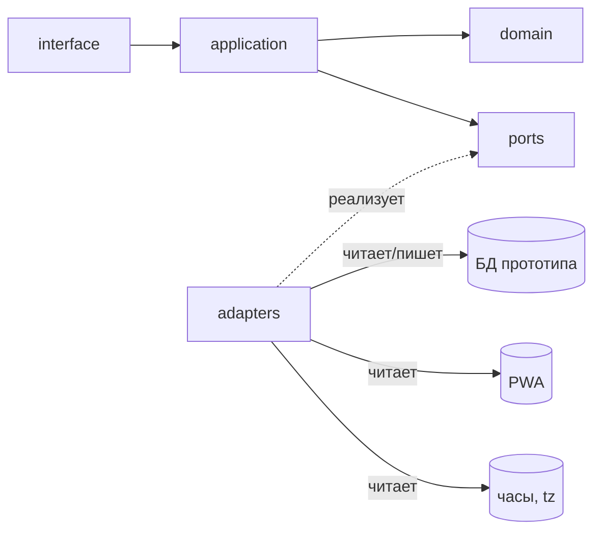
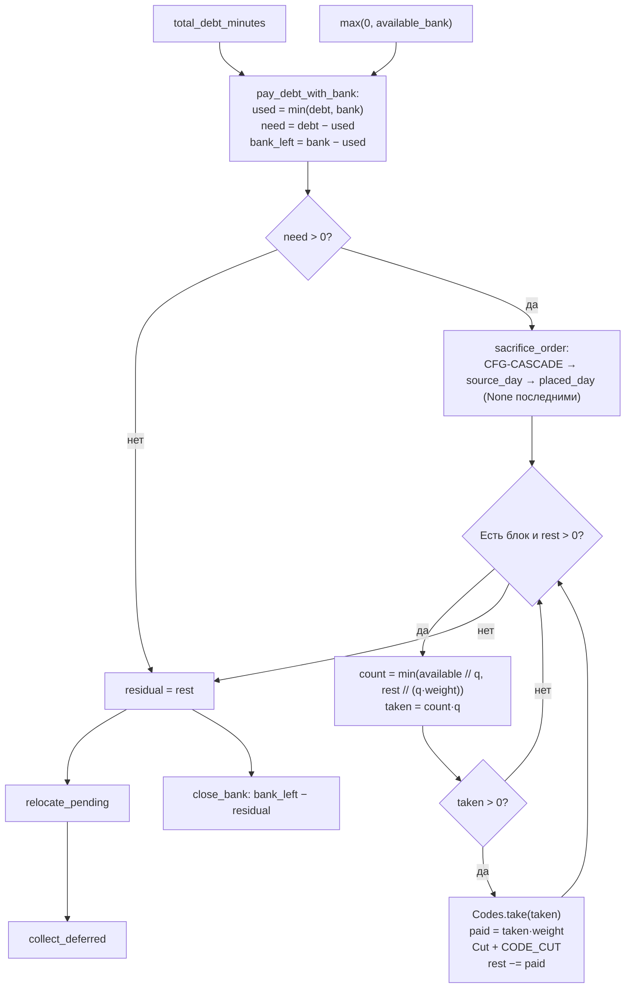

# Учёт переработок и банк часов — спецификация (v7.1)

> Редакция v7 объединяет базовую спецификацию v6 и решения владельца R1–R33: недостача и ёмкость — от окна; «План=Факт» освобождает от недостачи («Авто» — только колонка кода «К»); согласованные отсутствия — UTC-интервалы через полночь; флаги `ABSENCE_GAP` и `MISSED_DAY` удалены (след «не пришёл» — `LATE(None)`); период сужается до трудоустройства (Табель при этом читается полным периодом); просмотр незакрытого периода при незакрытом предшественнике отклоняется (признак «задан начальный банк» — `PeriodState.opening_bank_set`); пересчёт перечитывает отметки/Табель свежими; «План=Факт» — единый предикат из четырёх условий (окно и График в нём не участвуют); ядро `pair_marks` проверяет чередование отметок (`CHK-PUNCH-SEQUENCE`) и не чинит их; режимы `view`/чтение/`close`/`recalculate` сведены в таблицу 7.2; история изменений — приложение А (А.5–А.9). **Редакция v7.1** (11.10.2026, по итогам архитектурного аудита): решение владельца **R34** — план карточки дня всегда равен длине стандартного окна, план строки Табеля — информационный/зарплатный атрибут (3.3, RUL-PLAN-FROM-WINDOW; EX-15/31/44/51/54 обновлены); редакторские фиксы: EX-14 контроль 3 (момент «ушёл» до `from_utc`), `MinuteOfDay` без отсутствий (3.1), перечисление значений `Reason.step` (6.2), контракты выборки `ShiftPort`/`AbsencePort` (2.6), `CHK-PERIOD-BOUNDS` (5.3), полный порядок `deferred_in` (3.3), `PeriodView.employment` (7.1), размещение `PeriodState`/`ClosingInputs`/`Employment` в `domain/types` (8.1), семантика ключей `Flag.data` (6.6), достроенные сигнатуры (8.1). **Раунд 8 — решения владельца R35–R40** (ответы на вопросы аудита): периоды вне трудоустройства не учитываются и не показываются; гранулярность периода — настройка «месяц / половина месяца» (1–15 / 16–конец); начальный банк задаётся механизмом ручной корректировки (`OPENING_SEED`, только первый период); доска — только трудоустроенные сегодня; карточка УТ дублирует информационный план строки; «кто ещё должен прийти» — ближайший подинтервал; история — приложение А.10. **Правка F-20** (11.10.2026, подтверждение владельца): EX-14 контроль 3 — выход 31.10 исправлен по нормативной модели (кусок `[00:00, 12:00)`: рабочее 4, недостача 8, переработка ДН 6/ДЯ 2 гасится каскадом, код УТ — ДН 4; прежде ошибочно «рабочее 12, недостача 0, кодов нет»); история — приложение А.11. Документ самодостаточен и нормативен целиком.

## 0. Назначение и критерий готовности

Документ описывает расчёт часов, переработок, банка часов и управленческого табеля (УТ), а также отдельный расчёт информационных флагов по Графику. Спецификация самодостаточна: всё, что здесь написано, нормативно; всё, что не написано, не реализуется.

Реализация — на Python, набором небольших функций и модулей с физическим разделением слоёв `domain`, `application`, `ports`, `adapters`, `interface` (чистая архитектура). В домене нет побочных эффектов, чтения системного времени, обращений к БД/HTTP/ФС и человекочитаемого форматирования.

**Критерий готовности:**

1. Все приёмочные примеры EX-01…EX-55 (каждый подкейс примера — отдельный тест) воспроизводятся автотестами цифра в цифру.
2. Все инварианты (10) проверяются в моменты, указанные в 10.1, на каждом прогоне; INV-DETERMINISM — свойством тестов.
3. Слои физически разделены пакетами; `domain` не импортирует `application`, `adapters`, `interface`.
4. В домене нет `datetime.now()`, `date.today()`, `print`, `logging`; время передаётся параметром `now`.
5. Поведение определяется справочниками и настройками, а не ветвлением по строковым кодам внутри `domain`.
6. Каждая функция соответствует правилу «одно действие»; исключения — композиционные `settle()` и `evaluate_flags()`.
7. Валидация конфигурации запускается при загрузке настроек и сообщает все найденные нарушения разом.
8. Повторный расчёт на одних и тех же сырых данных детерминирован и даёт идентичный результат.
9. Конвейеры вкладок веб-приложения независимы (16): use case'ы не вызывают друг друга, тяжёлый конвейер `settle()`/`evaluate_flags()` запускается только сценариями вкладки «Управленческий табель»; подтверждается архитектурными тестами (13, п.16).

### 0.1 Указания AI-агенту, выполняющему реализацию

Документ написан для AI-агента, который **переписывает расчётный движок внутри уже существующего прототипа веб-приложения**.

1. **Сначала изучи прототип.** Найди: текущий расчётный код, модели данных, источники отметок/Табеля/Графика/банка, места вызова расчёта из UI/API, существующие тесты. Составь карту «что есть → какой слой/порт этой спецификации это заменяет».
2. **Спецификация главнее прототипа.** Если поведение прототипа расходится с документом, верен документ. Не переносить старую логику «как есть», если она противоречит нормам (раздел 15 «Миграция прототипа»).
3. **Не менять то, что вне границ системы** (раздел 1.3): UI, кадровые документы, хранение Графика, PWA. Существующие таблицы/модели БД переиспользуются через адаптеры; домен о них не знает.
4. **Порядок работы:** доменные типы и справочники → валидация конфигурации → тесты Ф/И/В (сначала красные) → доменные функции стадиями → `settle()` и `evaluate_flags()` → порты и адаптеры к существующей БД → use case'ы → подключение к существующему интерфейсу → удаление старого движка.
5. **Старый движок удаляется**, а не остаётся параллельной веткой. Допустим временный переключатель на время миграции, но в итоговом коде его нет.
6. **Если норма кажется неполной или противоречивой** — остановиться и задать вопрос владельцу, а не додумывать. Додуманное поведение = ошибка реализации.
7. **Тексты для человека** собираются только в `interface` (2.4); домен возвращает данные.

### 0.2 Виды текста в документе

- **Нормативно** — обязательный контракт реализации. Любое отклонение меняет бизнес-логику.
- **Пояснение** — объясняет, зачем правило устроено именно так, но не добавляет обязательств.
- **Пример** — демонстрирует применение нормы и подтверждается автотестом.

Если пояснение и формальное правило расходятся, приоритет имеет формальное правило. Каждая норма имеет одно нормативное место; остальные упоминания — ссылки на него.

### 0.3 Идентификаторы

Каждая норма, проверка, инвариант, справочник и приёмочный пример имеют устойчивое мнемоническое имя: оно читается само, одинаково в документе, в коде ошибки и в имени теста. При удалении нормы её имя не переиспользуется.

| Префикс | Что обозначает | Где определено | Где используется |
|---|---|---|---|
| `CFG-*` | справочник (данные конфигурации) | 5 | строки справочников, `Settings` (3.5) |
| `CHK-*` | проверка: конфигурации, входных данных или данных Графика | 5.3 | код в `ConfigError` / `InvalidInputDataError`, имя файла и функции проверки (8.1) |
| `RUL-*` | правило расчёта | 9 | нормативное утверждение, на которое ссылаются разделы и примеры |
| `INV-*` | инвариант | 10 | код в `InvariantViolationError`, имя функции проверки (8.1), моменты проверки (10.1) |
| `EX-*` | приёмочный пример | 11 | имя автотеста, например `test_ex_14_period_border` |
| `КОД_ЗАГЛАВНЫМИ` | код `Reason` или флага | 6.2, 6.6 | попадает в результат, трассу и лог |

Состав проверок по уровням — 5.3; моменты проверки инвариантов — 10.1; карта «тема → норма» — 14.

---

## 1. Границы системы

### 1.1 Входные данные

| Источник | Что даёт | Куда идёт |
|---|---|---|
| Табель | код дня, плановые часы и группа сотрудника на каждый календарный день периода | расчёт часов, флаги |
| Карточка сотрудника | интервал трудоустройства (даты приёма/увольнения) | `application`: эффективный период (7.1, v7) |
| PWA | сырые отметки `момент UTC` + тип `in/out` («пришёл» / «ушёл») | расчёт часов (округлённые), флаги (исходные) |
| График | плановые смены и согласованные отсутствия; хранится отдельно | **только** флаги (4.7) |
| Модификаторы календарного дня (CFG-MODIFIERS) | двойные переработки, оплата переработок, `План=Факт`, учёт в УТ | расчёт часов |
| Банк часов | остаток на начало периода + ручные корректировки | расчёт часов |
| Настройки | все справочники (раздел 5); `tz`, шаг, версии | расчёт часов, флаги |
| Отложенные блоки (`deferred_in`) | коды УТ, не размещённые в прошлом периоде | расчёт часов |

### 1.2 Выходные артефакты

| Артефакт | Содержание | Кто формирует |
|---|---|---|
| Карточки дней | план, полный факт, рабочее время, переработка, недостача, коды УТ | `settle()` |
| Управленческий табель | итоговые коды УТ по дням после размещения и, в `close`, после изъятия | `settle()` |
| Банк часов | остаток на закрытие периода, включая перенос минуса | `settle()` |
| Отложенные блоки (`deferred_blocks`) | коды УТ, для которых в периоде не нашлось приёмника | `settle()` |
| Отчёт об исключениях | структурированные бизнес-ситуации расчёта часов | `settle()` |
| Трассировка | последовательность действий расчёта с причинами и данными | `settle()` |
| Информационные флаги | типизированные флаги по дням (код + параметры); при закрытии периода сохраняются как снимок (7.2) | `evaluate_flags()` |
| Представление дня | `DayView` — карточка дня + её флаги | `application` (склейка) |
| Доска «сейчас» | сколько на работе, сколько ожидается, карточки открытых сессий, кто ещё должен прийти | `application` (`presence_board`) + домен (`assemble_board`), 16.2 |
| История сессий | сырые сессии (начало, конец либо открыта) за произвольный диапазон | ядро `pair_marks()` (16.4) |

### 1.3 Вне системы

Вне системы: расчёт денег, кадровые документы, согласование отпусков, построение и ручное редактирование Графика, UI приложения, **восстановление** последовательности отметок на стороне PWA. Домен не чинит чередование `in/out`, но **проверяет** его: нарушение — `InvalidInputDataError("CHK-PUNCH-SEQUENCE")` из ядра `pair_marks` (2.8, 5.3, v7/R31); исправление данных — ответственность адаптера и источника. Построение и редактирование Графика, ввод Табеля остаются вне расчётного ядра; как вкладки веб-приложения они нормированы разделом 16.

---

## 2. Архитектурные законы

### 2.1 Слои и направление зависимостей



* `interface` знает только `application`; `application` знает `domain` и `ports`; `domain` не импортирует никого; `ports` содержит только `Protocol` и импортирует доменные типы; `adapters` реализуют порты поверх существующей БД/PWA/часов прототипа.
* `application` — единственное место, где данные собираются из портов, передаются в `domain`, а результаты сохраняются.
* В `domain` нет побочных эффектов: только «данные → данные».
* Домен состоит из **четырёх независимых чистых расчётов**: `settle()` (часы, банк, УТ) и `evaluate_flags()` (флаги) — раздел 6; `assemble_board()` (доска «кто сейчас на работе») и история сессий вкладки «Факт» — раздел 16. Расчёты друг друга не вызывают; из результата `settle()` флаги получают **только** признак «План=Факт применён» по дням — `Mapping[date, bool]`, а не карточки (6.6). Сопряжение отметок в сессии — общий кернел `pair_marks` (4.3, 8.1): часы, флаги и история используют его каждый со своими отметками (расчётные/исходные) и своими границами (горизонт/`closing_mark`).

### 2.2 Одна функция — одно действие

| Признак | Формулировка |
|---|---|
| Имя | один глагол без «и»: `cut_working_time`, `place_block`, `round_moment` |
| Уровень | либо вычисления, либо вызов других функций — не смешивать |
| Размер | до ~20 строк |
| Вложенность | ≤ 2 уровней (`for` → `if`) |
| Знания | получает всё параметрами, возвращает значение; не знает, кто её вызвал |
| Состояние | не читает и не пишет глобальное, не мутирует аргументы |
| Циклы | один цикл — допустимо; два разных цикла — две функции |
| Побочные эффекты | запрещены (кроме адаптеров) |

Статус таблицы: это **инженерная дисциплина реализации**, а не бизнес-норма. Она проверяема механически (архитектурные тесты, 13 п.5) и удерживает агентскую реализацию (0.1) от расползания функций; бизнес-поведение задаётся разделами 4–7 и от формы кода не зависит.

**Композиция вместо длинных функций** (сигнатуры — по каталогу 8.1):

```python
def build_day_card(day, intervals, day_raw_marks, st):
    window   = window_of_day(day, st)                # окно из CFG-WINDOWS
    fact     = fact_of_day(intervals)
    has_event = has_presence_event(day, day_raw_marks, st)
    plan, applied = apply_plan_equals_fact(day, fact, plan_of_day(day, st), has_event, st)
    work     = cut_working_time(intervals, window)        # факт ∩ окно; window=None → 0 (RUL-WORK-AND-OVERTIME)
    parts    = overtime_parts(intervals, window)          # части факта вне окна
    debt     = debt_of_day(day, work, applied, st)        # v7: норма — окно; applied ⇒ 0
    codes    = codes_of_day(day, parts, st)
    return DayCard(...)
```

Длинные функции-сценарии — только `settle()` и `evaluate_flags()`; каждая их строка — вызов одной стадии.

**Проверка на здравый смысл:** если название стадии звучит как существительное верхнего уровня (`Карточки`, `Размещение`, `Каскад`, `Флаги`), внутри неё должно быть несколько маленьких функций. Если функцию нельзя объяснить одной фразой — её нужно разрезать.

### 2.3 Поведение из справочников, а не из веток

Разрешены только три вида условий:

1. защита от структурно невозможных данных (`if interval.is_empty(): return 0`);
2. чтение значения из справочника (`st.day_code_policy[code].accepts_ut`);
3. арифметика и сравнение чисел.

❌ `if day.code in ("ДО", "ОТ", "Б", "НБ", "НН"): return False`
✅ `return st.day_code_policy[day.code].accepts_ut`

❌ `auto = day.code == "К" or group == "Пятидневка"`
✅ `auto = st.day_code_policy[day.code].plan_equals_fact_auto`   # v7: единственный источник «Авто» — колонка кода

Новое требование («введём код ДК», «праздники удваиваются», «изменим порядок списания») реализуется строкой справочника, а не правкой функций.

### 2.4 Чистота домена

* Нет `datetime.now()` / `date.today()`. «Сейчас» приходит параметром `now`.
* Нет чтения БД, файлов, сети, переменных окружения.
* Нет `print` / `logging`. Диагностика — через возвращаемую трассировку.
* **Нет форматирования строк для человека**: флаги, исключения, трасса — код + параметры. Человекочитаемые тексты (подписи флагов, сообщения) собирает только `interface` по коду и параметрам. Это единственное нормативное место правила; далее — ссылки.
* Тайм-зона не берётся из ОС: `tz` — поле `Settings` (3.5).

### 2.5 Неизменяемость

Все структуры данных — `@dataclass(frozen=True)`. Изменение = новое значение через `dataclasses.replace`.

**Глубокая неизменяемость (нормативно).** `frozen=True` запрещает замену поля, но не защищает содержимое коллекций; поэтому:

* последовательности в полях доменных структур хранятся только как `tuple`; параметры функций принимают `Sequence`, но в полях результата мутабельные коллекции не удерживаются;
* `Mapping`-поля материализуются при создании как read-only представление (`types.MappingProxyType`) **по копии** исходного словаря: изменение внешних коллекций после вызова не влияет на результат, а держатель оригинала не сохраняет доступ на запись;
* нормализация выполняется при конструировании структуры (фабрика либо `__post_init__` через `object.__setattr__`);
* значения `Reason.data` и `Flag.data` ограничены типом `DataValue` (3.1) — произвольные объекты не допускаются;
* правило распространяется на `Settings`: адаптер `SettingsPort` материализует её тем же способом.

Единственное исключение — аккумулятор кодов УТ `Codes` внутри `settle()` с методами `add` / `take` / `place` / `get`; он не выходит наружу и не отдаёт внутренние коллекции вызывающему коду.

### 2.6 Порты

Объявляются в пакете `ports`, реализуются в `adapters`. Домен не знает, откуда берутся данные.

```python
class TimesheetPort(Protocol):
    def days(self, employee_id: str, period: Period) -> Sequence[Day]: ...

class PunchPort(Protocol):
    def marks_between(self, employee_id: str,
                      from_utc: datetime, to_utc: datetime) -> Sequence[Mark]: ...
    def last_mark_before(self, employee_id: str,
                         at_utc: datetime) -> Mark | None: ...
    def first_mark_after(self, employee_id: str,
                         at_utc: datetime) -> Mark | None: ...
        # первая отметка после момента — закрывает сессию,
        # выходящую за правую границу диапазона (16.4)
    def last_marks(self, at_utc: datetime) -> Sequence[Mark]: ...
        # батч для вкладки «Отметки» (16.2): по одной последней отметке
        # на каждого сотрудника, одним запросом

class ShiftPort(Protocol):          # График: смены
    def shifts(self, employee_id: str, period: Period) -> Sequence[Shift]: ...
        # контракт выборки (v7.1): все смены, пересекающие
        # [00:00 period.start, 00:00 period.end+1), — включая начинающиеся
        # до периода (ночные смены, накрывающие утро первого дня)
    def shifts_on_day(self, day: date) -> Sequence[Shift]: ...
        # батч (16.2): смены всех сотрудников, пересекающие день

class AbsencePort(Protocol):        # График: согласованные отсутствия
    def absences(self, employee_id: str, period: Period) -> Sequence[Absence]: ...
        # контракт выборки (v7.1): все отсутствия, пересекающие
        # [00:00 period.start, 00:00 period.end+1), — включая переходящие границу
    def absences_on_day(self, day: date) -> Sequence[Absence]: ...   # батч (16.2): пересекающие день

class BankPort(Protocol):
    def opening(self, employee_id: str, period: Period) -> Minutes: ...
    def adjustments(self, employee_id: str, period: Period) -> Sequence[Adjustment]: ...

class EmploymentPort(Protocol):     # интервал трудоустройства (v7)
    def employment(self, employee_id: str, period: Period) -> Employment: ...
    def active_employees(self, on_day: date) -> Sequence[str]: ...
        # батч (16.2, v7.1/R38): сотрудники, трудоустроенные на день, —
        # популяция доски «Отметки»; уволенные с незакрытой сессией
        # на доску не попадают

class SettingsPort(Protocol):
    def load(self, period: Period) -> Settings: ...
```

Нормативно:

* `SettingsPort` разрешает настройки по сроку их действия для запрошенного периода, включая ретроспективные исправления. Расчёт использует неизменяемый набор разрешённых настроек; с результатом сохраняются идентификаторы их версий (`Settings.versions`). Календарные переопределения разрешаются для каждой даты.
* Шаг расчёта един для всего периода; смена шага допускается только на границе периодов. Для первого периода без предшественника `previous_step_minutes` равен текущему шагу.
* График не входит в `Settings`: он читается через `ShiftPort` и `AbsencePort` и передаётся только в `evaluate_flags()` (4.7).
* Интервал трудоустройства читается через `EmploymentPort` и используется **только в `application`**: эффективный период = запрошенный период ∩ интервал трудоустройства (7.1, RUL-EMPLOYMENT-PERIOD); домен получает уже суженный период и не знает о датах приёма/увольнения.
* **Непрерывность банка (контракт адаптера):** `opening(P)` = закрывающий банк `P−1`; для **первого периода сотрудника** — `0`: начальное значение задаётся **механизмом ручной корректировки банка** — `Adjustment`, отнесённая к первому периоду, с маркером `reason_code = "OPENING_SEED"` (v7.1/R37). Ядро маркер не интерпретирует (RUL-REASON-CODE-FREE); распознавание — конвенция адаптера. «Задано» — не «ноль по умолчанию», а явно внесённая посевающая корректировка (в том числе на нулевую сумму): признак хранит адаптер и отдаёт его в `PeriodState.opening_bank_set` (7.3, v7/R26, R37). Посев разрешён **только для первого периода** сотрудника (у которого нет предыдущего периода в цепочке, 16.1 п.7): вместе с RUL-SEQUENTIAL-CLOSING это конструктивно исключает закрытие любого периода при незакрытом предшественнике (А.10 п.2). Согласованность цепочки — ответственность адаптера банка (RUL-BANK-CONTINUITY).
* Правило выборки отметок `PunchPort` — раздел 7.4.
* **Контракт границ выборки (v7).** `marks_between(from_utc, to_utc)` возвращает отметки с `from_utc ≤ at < to_utc`; `last_mark_before(at_utc)` — строго `at < at_utc`; `first_mark_after(at_utc)` — первая отметка с `at ≥ at_utc`; `last_marks(at_utc)` — по одной последней отметке на сотрудника с `at ≤ at_utc`. Отметка ровно на границе попадает ровно в одну выборку: дублирование (ломает чередование) и потеря (рвёт сессию) исключены.
* **Контракт выборки Графика (v7.1).** `ShiftPort.shifts` и `AbsencePort.absences` возвращают все записи, **пересекающие** период `[00:00 period.start, 00:00 (period.end + 1 день))` в `st.tz`, — включая смены, начинающиеся до периода, и отсутствия, переходящие границу; полностью внешние записи не возвращаются. `shifts_on_day`/`absences_on_day` — записи, пересекающие сутки. Домен отбрасывает дневные отрезки вне периода (6.6, стадия 2). Нарушение постусловий — ошибка адаптера (по аналогии с 7.4 п.3): без выборки по пересечению ночная смена, начавшаяся накануне `period.start`, потеряла бы отрезок первого дня и породила ложные флаги.

### 2.7 Трассируемость

Каждое действие, меняющее результат, оставляет запись `Reason(step, code, data)`: нормализация входящего остатка, зачисление переработки в банк, размещение блока, погашение банком, изъятие кода, перенос остатка.

Каждое изъятие — запись `Cut` с датой происхождения, датой размещения либо `None`, тарифом, снятыми физическими минутами и погашенными минутами долга. Снятые физические минуты кратны текущему шагу.

Реестры кодов фиксированы (6.2 — `Reason`, 6.6 — флаги); свободный текст в домене не формируется (2.4).

### 2.8 Ошибки и доверие к источнику

* Домен бросает типизированные исключения:
  * `ConfigError` — противоречивая или неполная конфигурация (нарушения проверок конфигурации (5.3, уровень 1); отсутствие строки в справочнике). Ту же ошибку бросает **адаптер Графика** при чтении некорректных данных (CHK-ABSENCE-ORDER, CHK-ABSENCE-LENGTH, CHK-SHIFT-ORDER; 5.3) — до входа в домен;
  * `UnknownDayCodeError` — код дня Табеля отсутствует в CFG-DAY-CODES;
  * `UnknownTimesheetValueError(value)` — значение Табеля, несущее часы, не имеет строки в CFG-WINDOWS (CHK-WINDOW-EXISTS, 3.3);
  * `InvalidInputDataError(code, data)` — нарушение правил входных данных (3.3, 5.3, уровень 2);
  * `IncompleteTimesheetError` — Табель не покрывает период: отсутствует строка на день периода либо день продублирован (RUL-TIMESHEET-COVERS-PERIOD);
  * `IncompletePeriodError` — `close` запрошен раньше 00:00 дня, следующего за `period.end`, в часовом поясе расчёта, по **исходному** `now`;
  * `InvariantViolationError(code, data)` — нарушен инвариант; это ошибка реализации, а не бизнес-ситуация. Расчёт прерывается, результат не сохраняется.
* Никаких `-1`, `None`-как-ошибка, проглатывания исключений.
* Состав `data` исключений (v7.1): `InvalidInputDataError.data` и список нарушений `ConfigError` содержат код проверки и минимальный контекст (нарушающие значения, идентификаторы строк/отметок; для `CHK-PUNCH-SEQUENCE` — состав по 5.3). В отличие от `Reason.data`/`Flag.data` состав не реестрирован: приёмочные тесты сравнивают тип и код исключения, не `data`.
* Бизнес-ситуации (отсутствие приёмника и т. п.) не прерывают расчёт и возвращаются структурированными записями.
* **Домен доверяет источнику отметок, но проверяет последовательность (v7/R31).** Постусловия выборки `PunchPort` (7.4): отметки одного сотрудника; все моменты UTC-aware; все отсортированы по исходному моменту (порядок строгий и детерминированный — RUL-DETERMINISM-AND-ORDER); отметок позже `now` нет; тип задаёт источник. Чередование «пришёл»/«ушёл» гарантирует адаптер (первая линия, 7.4 п.4); **вторая линия — ядро `pair_marks`**: оно линейно проверяет последовательность и при нарушении бросает `InvalidInputDataError("CHK-PUNCH-SEQUENCE", data)` (5.3, уровень 2). Недопустимое чередование — граница данных, а не восстанавливаемый доменный сценарий: **починка последовательности в домене запрещена** — никаких пересортировок, пропуска («проедания») отметок, вставки синтетических отметок, восстановления типа по позиции и «исправления» порядка (антипаттерн 12, 2.4). Поведение при нарушении определено: типизированное исключение, расчёт прерывается, частичного результата нет.
* `PunchPort` передаёт только UTC-aware `datetime`; naive datetime — ошибка адаптера.

### 2.9 Раскладка по файлам

Каждая функция — в своём файле. Dataclass-структуры объединяются в модули. Каталог функций и дерево проекта — раздел 8. Если в прототипе принята иная структура каталогов, сохраняется **разделение слоёв и пакетов по стадиям**; имена корневых каталогов можно адаптировать к прототипу.

---

## 3. Формальные контракты данных

### 3.1 Базовые типы

| Тип | Смысл |
|---|---|
| `EmployeeId = str` | идентификатор сотрудника |
| `Minutes = int` | целые минуты — **длительности** (план, факт, рабочее время, переработка, недостача, банк, коды УТ) |
| `MinuteOfDay = int` | позиция в локальном дне, 0..1440 — **границы** интервалов, окон CFG-WINDOWS, категорий CFG-CATEGORIES (v7.1: отсутствия здесь **не** границы — они UTC-интервалы, 3.2, R17) |
| `StepMinutes = int` | шаг расчёта в целых минутах; атомарная гранула кода УТ |
| `DayId = date` | календарный день в `tz` настроек (3.5) |
| `Moment = datetime` | момент времени в UTC, timezone-aware |
| `Mode = Literal["view", "close"]` | режим расчёта |

```python
DataValue = (
    None | bool | int | float | str
    | date | datetime                        # datetime — UTC-aware
    | tuple["DataValue", ...]
    | Mapping[str, "DataValue"]              # материализуется read-only по копии (2.5)
)
```

`DataValue` — допустимый тип значений в `Reason.data`, `Flag.data` и вложенных коллекциях результатов; гарантирует сериализуемость и глубокую неизменяемость (2.5).

### 3.2 Доменные сущности

```python
@dataclass(frozen=True)
class Period:
    start: date
    end: date

@dataclass(frozen=True)
class Day:
    day: date
    code: str
    plan_minutes: Minutes               # информационный (зарплатный) план строки;
                                        # расчётный план карточки — от окна (v7.1/R34)
    employee_id: str
    group: str

@dataclass(frozen=True)
class Mark:
    employee_id: str
    at_utc: datetime                  # исходный момент из PWA
    kind: Literal["in", "out"]

@dataclass(frozen=True)
class CalcMark:                       # расчётное представление отметки
    source: Mark                      # связь с исходной отметкой сохраняется
    at_calc: datetime                 # округлённый момент

@dataclass(frozen=True)
class Interval:                       # расчётный интервал [start, end) — границы на сетке шага
    day: date
    start_minute: MinuteOfDay         # 0..1440
    end_minute: MinuteOfDay           # 0..1440

@dataclass(frozen=True)
class RawInterval:                    # исходный интервал присутствия — точные моменты (флаги, 4.5)
    day: date                         # локальный день в tz (нарезка сессий, 4.3)
    start_utc: datetime               # секунды сохраняются
    end_utc: datetime

@dataclass(frozen=True)
class Session:                        # сессия присутствия — результат ядра pair_marks (4.3)
    start: datetime                   # расчётный (часы) или исходный (флаги, история) момент
    end: datetime | None              # None — не закрыта отметкой «ушёл»; потребитель
                                      # обрезает по своей границе: горизонт (4.4) либо диапазон (16.4)

@dataclass(frozen=True)
class Shift:                          # смена Графика, может пересекать полночь
    employee_id: str
    start_utc: datetime
    end_utc: datetime

@dataclass(frozen=True)
class Absence:                        # согласованное отсутствие Графика (v7)
    employee_id: str
    start_utc: datetime               # интервал на UTC-оси; может пересекать полночь
    end_utc: datetime                 # end − start ≤ 24 ч (CHK-ABSENCE-LENGTH)

@dataclass(frozen=True)
class Adjustment:
    amount_minutes: Minutes           # знаковое, в минутах банка
    period: Period                    # период, к которому корректировка отнесена (RUL-BANK-CONTINUITY)
    reason_code: str                  # свободная строка; ядро не интерпретирует (RUL-REASON-CODE-FREE)
    note: str | None = None

@dataclass(frozen=True)
class DeferredBlock:
    source_day: date
    tariff: str
    minutes: Minutes                  # физические минуты, > 0, кратны шагу

@dataclass(frozen=True)
class Reason:
    step: str
    code: str
    data: Mapping[str, DataValue]

@dataclass(frozen=True)
class Flag:
    day: date
    code: str                         # из реестра 6.6
    data: Mapping[str, DataValue]        # параметры, например actual_at

@dataclass(frozen=True)
class Cut:
    source_day: date
    placed_day: date | None
    tariff: str
    taken_minutes: Minutes
    paid_minutes: Minutes

@dataclass(frozen=True)
class DayCard:
    day: date
    timesheet_value: str
    plan_minutes: Minutes               # = длина окна (v7.1/R34); 0 — без окна и при «План=Факт»
    full_fact_minutes: Minutes
    work_minutes: Minutes
    overtime_minutes: Minutes
    debt_minutes: Minutes
    codes: Mapping[str, Minutes]      # собственные коды дня до снятия/переноса
    pays_overtime: bool               # итоговый признак оплаты переработки дня (5.2)
    plan_equals_fact_applied: bool

@dataclass(frozen=True)
class SettleResult:
    cards: tuple[DayCard, ...]
    mgmt_timesheet: Mapping[date, Mapping[str, Minutes]]
    bank_open_minutes: Minutes
    bank_open_normalized_minutes: Minutes
    bank_adjustments_minutes: Minutes
    bank_closed_minutes: Minutes
    credited_to_bank_minutes: Minutes
    paid_with_bank_minutes: Minutes
    total_debt_minutes: Minutes
    residual_debt_minutes: Minutes
    cuts: tuple[Cut, ...]
    deferred_blocks: tuple[DeferredBlock, ...]
    exceptions: tuple[Reason, ...]
    trace: tuple[Reason, ...]

@dataclass(frozen=True)
class FlagsResult:
    flags: tuple[Flag, ...]

@dataclass(frozen=True)
class DayView:                        # представление дня (склейка application)
    card: DayCard
    flags: tuple[Flag, ...]
    timesheet_plan_minutes: Minutes   # информационный план строки Табеля (v7.1/R39):
                                      # в УТ показывается рядом с расчётным планом (= окно)
```

Нормативно:

* `DeferredBlock.minutes` хранит физические минуты кода УТ. На выходе периода величина положительна и кратна шагу периода. При смене шага входящие блоки нормализуются к новому шагу до размещения и каскада (4.6). Блоки, округлённые до нуля, исключаются.
* `Adjustment.amount_minutes` знаковое; единица — минуты банка. `Adjustment.period` — период внесения: корректировки учитываются только в своём периоде (RUL-BANK-CONTINUITY).
* `Cut.source_day` — историческая дата происхождения кода; `Cut.placed_day` — дата размещения в текущем периоде; `None` — изъятие неразмещённого блока. Размещение не меняет `source_day` и `tariff`.
* `Flag.data` содержит моменты как UTC-aware `datetime` или минуты локального дня; форматирование — в `interface` (2.4). Значения `Reason.data` и `Flag.data` — `DataValue` (3.1); коллекции внутри — `tuple` и read-only `Mapping` (2.5).
* `reason_code` в `Adjustment` — свободная строка без реестра: заполняет приложение/UI, расчётное ядро не интерпретирует её и не валидирует (RUL-REASON-CODE-FREE). У `DeferredBlock` поля `reason_code` нет (v7): происхождение блока описано `source_day`, `tariff` и `minutes`, причина неразмещения — запись `NO_RECEIVER` (6.2).

Структуры вкладок веб-приложения (раздел 16):

```python
@dataclass(frozen=True)
class SessionView:                    # сессия + признаки диапазона — вкладка «Факт» (16.4)
    employee_id: str
    session: Session                  # исходные моменты, без округления
    started_before_range: bool = False  # сессия открыта отметкой до начала диапазона
    closed_after_range: bool = False    # уход — за правой границей диапазона

@dataclass(frozen=True)
class ShiftEntry:                     # запись хранилища Графика (16.3)
    shift: Shift
    source: Literal["generated", "manual"]

@dataclass(frozen=True)
class EmployeeCard:                   # карточка открытой сессии — вкладка «Отметки» (16.2)
    employee_id: str
    open_since_utc: datetime          # исходный момент «пришёл»
    minutes_open: Minutes             # ⌊(now − open_since) / 60с⌋ — целые минуты вниз (16.2)
    expected_today: bool              # ожидается ли сегодня по Графику
    shift_today: tuple[tuple[datetime, datetime], ...]  # дневные отрезки смены сегодня

@dataclass(frozen=True)
class ExpectedArrival:                # группа (d) вкладки «Отметки»
    employee_id: str
    expected_at_utc: datetime         # ожидаемое время прихода (начало подинтервала)
    already_started: bool             # True — должен был прийти в expected_at, но отсутствует

@dataclass(frozen=True)
class PresenceBoard:
    at_work_now: int                  # (a) сколько на работе прямо сейчас
    expected_now: int                 # (b) сколько должно быть по Графику
    open_session_cards: tuple[EmployeeCard, ...]    # (c) по возрастанию open_since
    yet_to_come: tuple[ExpectedArrival, ...]        # (d) по возрастанию expected_at
```

### 3.3 Правила форматов и полноты входа

* **Значение Табеля (единственное нормативное место).** Код и плановые часы хранятся раздельно (`Day.code`, `Day.plan_minutes`); строка CFG-WINDOWS ищется по вычисляемому значению:

```
value_of(day, st):
    policy = st.day_code_policy[day.code]              # код известен — проверено на стадии 1
    if not policy.carries_hours:
        return day.code                                # «В», «ОТ», «Б», …
    return f"{day.code} {fmt_hours(day.plan_minutes)}" # ровно один пробел: «Я 12», «Я 10,75»

fmt_hours(minutes): минуты → часы, десятичная дробь через запятую, не более двух знаков,
                    хвостовые нули не пишутся:  720 → «12»;  510 → «8,5»;  495 → «8,25»;  645 → «10,75»

plan_of_day(day, st)   = длина окна window_of_day(day, st), если окно есть, иначе 0  (RUL-PLAN-FROM-WINDOW, v7.1/R34)
                         # Day.plan_minutes — информационный (зарплатный) план строки: участвует только
                         # в value_of (ключ CFG-WINDOWS), проверках CHK-PLAN-* и отображении вкладки «Табель»
window_of_day(day, st) = st.windows.get(value_of(day, st))  → Window | None       (RUL-WINDOW-FROM-TIMESHEET)
                         # None = окна нет (значение без часов): рабочее 0, весь факт — переработка, недостача 0, план 0
```

  Нотация значения совпадает с нотацией отображения (CFG-WEIGHTS): `<код> <часы>` через один пробел. Чтобы `fmt_hours` не давал непериодических дробей, `plan_minutes` обязано быть кратно 15 (CHK-PLAN-FORMAT); кратность шагу расчёта **не** требуется (решение владельца, 4.5, 4.6).
* **Отсутствие строки CFG-WINDOWS** для значения, несущего часы, — `UnknownTimesheetValueError(value)` на стадии 1 (CHK-WINDOW-EXISTS); расчёт не запускается. Поведение «окна нет» определено только для значений без часов (CFG-WINDOWS): всё отработанное — переработка.
* Все моменты `Mark.at_utc` хранятся в UTC; календарный день определяется после округления и перевода в `tz`.
* `Adjustment` применяется агрегированно на уровне периода.
* `Period` — произвольный непрерывный диапазон дат (`start <= end`; нарушение — `InvalidInputDataError("CHK-PERIOD-BOUNDS")`, стадия 1, v7.1). Последовательность периодов и понятие «следующий период» определяются в `application` (7.2–7.3).
* **Полнота Табеля (RUL-TIMESHEET-COVERS-PERIOD):** на каждый день периода в Табеле существует ровно одна строка. Пропуск дня или дубль — `IncompleteTimesheetError`, расчёт не запускается. Дней «вне Табеля» не существует: отметки выборки 7.4 всегда попадают в карточку соответствующего дня. Строки `days` вне периода — `InvalidInputDataError("CHK-DAYS-IN-PERIOD")` (CHK-DAYS-IN-PERIOD).
* **Один сотрудник, группа — по дням.** `settle()` и `evaluate_flags()` рассчитывают одного сотрудника: все строки `days` обязаны иметь одинаковый `employee_id`, иначе `InvalidInputDataError("CHK-SINGLE-EMPLOYEE")` (CHK-SINGLE-EMPLOYEE). Группа берётся из строки каждого дня (`Day.group`) и **может различаться внутри периода**: перевод сотрудника между группами допустим, разрешение модификаторов CFG-MODIFIERS идёт по группе соответствующего дня (RUL-GROUP-PER-DAY); «План=Факт Авто» разрешается колонкой кода (v7). Группа каждой строки существует в CFG-GROUPS (CHK-GROUP-EXISTS).
* **Входящие остатки и корректировки.** Каждый `DeferredBlock` из `deferred_in`: `minutes > 0` и кратен `previous_step_minutes`, `source_day` раньше `period.start`, `tariff` есть в CFG-WEIGHTS настроек рассчитываемого периода (CHK-DEFERRED-IN; тариф заморожен прошлым периодом — после переименования категории блок иначе дошёл бы до каскада без веса, 24.10.2026). На входе домен сортирует `deferred_in` канонически — по возрастанию `source_day`, затем по порядку тарифов CFG-PLACEMENT, затем по возрастанию `minutes` (полный порядок — v7.1: относительный порядок блоков с одинаковыми `source_day`+`tariff` не зависит от порядка строк адаптера); порядок строк адаптера на результат не влияет (v7, RUL-DETERMINISM-AND-ORDER). Каждая `Adjustment` относится к рассчитываемому периоду: адаптер передаёт только корректировки своего периода; домен **проверяет**, что `Adjustment.period` равен рассчитываемому периоду (CHK-OPENING), — нарушение даёт `InvalidInputDataError("CHK-OPENING")`, расчёт не запускается (v7; молчаливое отбрасывание корректировок запрещено) (RUL-ADJUSTMENTS-AGGREGATED, RUL-BANK-CONTINUITY).

### 3.4 Семантика полей результата

| Поле | Смысл | Порядок / полнота |
|---|---|---|
| `cards` | Карточки календарных дней периода | по возрастанию `day`, по одной на каждый день периода (RUL-TIMESHEET-COVERS-PERIOD) |
| `mgmt_timesheet` | Итоговые коды УТ по дням после размещения и, в `close`, после изъятия | ровно один ключ на каждый день периода; для дня без кодов — пустой `Mapping`; только итоговое состояние |
| `bank_open_minutes` | Исходный остаток банка на входе | как получен из `BankPort` |
| `bank_open_normalized_minutes` | Остаток после нормализации к шагу | при неизменном шаге равен исходному |
| `bank_adjustments_minutes` | Сумма ручных корректировок периода | агрегированно |
| `bank_closed_minutes` | Итоговый банк | согласован с INV-BANK-CLOSED и INV-VIEW-MODE |
| `credited_to_bank_minutes` | Зачислено в банк из неоплачиваемых переработок | взвешенные минуты |
| `paid_with_bank_minutes` | Погашено банком | 1:1 к долгу |
| `total_debt_minutes` | Σ дневных недостач + отрицательная часть доступного банка | до погашения |
| `residual_debt_minutes` | Недостача, не погашенная ни банком, ни кодами | уходит минусом банка |
| `cuts` | Изъятия кодов | в порядке каскада |
| `deferred_blocks` | Оставшиеся неразмещённые блоки | в `close` — после каскада и повторного размещения; порядок — по возрастанию `source_day`, затем по порядку тарифов CFG-PLACEMENT (v7) |
| `exceptions` | Бизнес-ситуации расчёта часов | канонический порядок (ниже) |
| `trace` | Трассировка | в порядке выполнения стадий; внутри стадии — в порядке обхода дней и блоков |

**Каноническая форма результата (нормативно).** Тесты сравнивают `SettleResult` и `FlagsResult` целиком (13, п.1), поэтому форма фиксирована:

* `mgmt_timesheet` содержит ключ на каждый день периода; дню без размещённых кодов соответствует пустой `Mapping`, а не отсутствие ключа;
* `exceptions` упорядочены по стадии возникновения (порядок стадий 6.3), затем по дате (`day` либо `source_day`), затем по порядку тарифов CFG-PLACEMENT;
* `trace` упорядочен по стадиям, внутри стадии — по возрастанию даты и по порядку обхода блоков (CFG-PLACEMENT для размещения и `credit_unpaid`, CFG-CASCADE для каскада, канонический порядок `deferred_in` (3.3) для нормализации; в стадии 2 запись банка идёт первой, затем записи блоков — v7);
* `deferred_blocks` упорядочены по возрастанию `source_day`, затем по порядку тарифов CFG-PLACEMENT (v7);
* `flags` в `FlagsResult` упорядочены по `day`, затем по порядку кодов реестра 6.6, затем по возрастанию `expected_at` / `first_presence_at`;
* `data` записей `Reason` и `Flag` содержит **ровно** ключи соответствующего реестра (6.2, 6.6): дополнительные ключи не допускаются — иначе результат перестал бы быть воспроизводимым (INV-DETERMINISM, 13 п.1);
* `cards` — по одной на каждый день периода, по возрастанию `day` (INV-CARDS-COVER-PERIOD).

Для `mode="view"`:

* `total_debt_minutes` вычисляется так же, как в `close`;
* `paid_with_bank_minutes = 0`, `cuts` пуст;
* `residual_debt_minutes = total_debt_minutes` — долг до погашения;
* `bank_closed_minutes = available_bank` — предварительный банк;
* `deferred_blocks` предварительные;
* результат не сохраняется.

Просмотр **закрытого** периода не пересчитывает ничего: читаются сохранённые при закрытии `SettleResult` и снимок `FlagsResult` (7.2, RUL-CLOSED-PERIOD-IMMUTABLE).

### 3.5 Структура `Settings`

`Settings` — неизменяемый разрешённый набор конфигурации на период (2.6). Единственный источник `tz`, шага и лимитов для всех функций домена.

```python
@dataclass(frozen=True)
class DayCodePolicy:                  # строка CFG-DAY-CODES
    carries_hours: bool               # несёт плановые часы
    accepts_ut: bool                  # принимает коды УТ
    counts_in_ut: bool                # учитывается в УТ (дефолт модификатора CFG-MODIFIERS «Учитываются ли часы в УТ»)
    plan_equals_fact_auto: bool       # «План=Факт = Авто» разрешается в «Да»

@dataclass(frozen=True)
class Window:                         # строка CFG-WINDOWS
    start_minute: MinuteOfDay         # 0..1440
    end_minute: MinuteOfDay           # 0..1440, > start_minute
    # План карточки, рабочее время и недостача считаются от окна (v7, v7.1/R34). Информационный план
    # строки Табеля может быть меньше длины окна (CHK-WINDOW-PLAN, RUL-PLAN-BELOW-WINDOW — зарплатная
    # норма, например обед). Отдельной сущности «перерыв» в модели нет.
    # Границы окна кратны шагу (CHK-GRID).

@dataclass(frozen=True)
class Category:                       # строка CFG-CATEGORIES
    code: str                         # база кода УТ: «ДЯ» | «ДН»
    start_minute: MinuteOfDay         # 0..1440
    end_minute: MinuteOfDay           # 0..1440; end <= start — категория пересекает полночь (CFG-CATEGORIES, CHK-CATEGORIES-COVER)

@dataclass(frozen=True)
class Group:                          # запись реестра CFG-GROUPS (v7: без полей —
    pass                              # «План=Факт Авто» разрешается только колонкой кода CFG-DAY-CODES)

@dataclass(frozen=True)
class ModifierEntry:                  # запись CFG-MODIFIERS
    name: Literal["double_overtime", "pays_overtime",
                  "plan_equals_fact", "counts_in_ut"]
    value: bool | str                 # bool для всех, кроме plan_equals_fact;
                                      # plan_equals_fact: только "yes"|"no"|"auto" (CHK-MODIFIER-TYPE)
    employee_id: str | None = None    # None — все сотрудники
    group: str | None = None          # None — любая группа
    day: date | None = None           # None — без привязки к дню
    period: Period | None = None      # None — без привязки к периоду
    # допустимы ровно шесть форм области действия (CHK-MODIFIER-SCOPE):
    # (employee_id, day) | (employee_id, period) | (group, day)
    # (group, period) | (day) | (period); прочие комбинации — ConfigError

@dataclass(frozen=True)
class GlobalDefaults:                 # глобальные подстраховки CFG-MODIFIERS (CHK-DEFAULTS)
    double_overtime: bool             # обязательная строка
    pays_overtime: bool               # обязательная строка
    plan_equals_fact: str             # обязательная строка ("yes"|"no"|"auto")

@dataclass(frozen=True)
class Settings:
    tz: ZoneInfo                                   # 4.4; по умолчанию Europe/Moscow
    period_granularity: Literal["month", "half_month"]
                                                   # гранулярность запрашиваемого периода
                                                   # (16.1 п.7, v7.1/R36); по умолчанию "month"
    step_minutes: StepMinutes                      # CFG-LIMITS
    late_limit_minutes: Minutes                    # CFG-LIMITS (лимит опоздания)
    day_limit_minutes: Minutes                     # CFG-LIMITS (лимит часов в дне, = 1440)
    day_code_policy: Mapping[str, DayCodePolicy]   # CFG-DAY-CODES
    windows: Mapping[str, Window]                  # CFG-WINDOWS; ключ — значение Табеля
    categories: tuple[Category, ...]               # CFG-CATEGORIES
    weights: Mapping[str, int]                     # CFG-WEIGHTS; ключ — код УТ
    cascade_order: tuple[str, ...]                 # CFG-CASCADE; коды УТ
    placement_order: tuple[str, ...]               # CFG-PLACEMENT; коды УТ
    groups: Mapping[str, Group]                    # CFG-GROUPS
    modifiers: Sequence[ModifierEntry]             # CFG-MODIFIERS
    global_defaults: GlobalDefaults                # глобальные подстраховки CFG-MODIFIERS (CHK-DEFAULTS)
    versions: tuple[str, ...]                      # идентификаторы версий справочников (2.6)
```

Нормативно:

* Все функции, которым нужны `tz` или шаг, получают их из `Settings` (параметр `st`); отдельных параметров `tz` в сигнатурах конвейеров нет.
* Разрешение модификатора CFG-MODIFIERS идёт по приоритету (CFG-MODIFIERS) и **завершается глобальным дефолтом**; для «Учитываются ли часы в УТ» базовым дефолтом служит колонка `counts_in_ut` CFG-DAY-CODES, глобальная строка не требуется. Отсутствие обязательной глобальной строки — `ConfigError` (CHK-DEFAULTS).
* `weights` определяет полный набор кодов УТ: для каждой категории CFG-CATEGORIES и каждого веса из CFG-MODIFIERS код `<категория>[<вес>]` обязан присутствовать в CFG-WEIGHTS (CHK-CODES-EXIST); суффикс веса пишется слитно по общему правилу `код = <категория> + (пустая строка при весе 1, иначе десятичная запись веса)`: для веса 1 суффикса нет (`ДЯ`, `ДН`), для веса 2 это «2» (`ДЯ2`, `ДН2`).
* Область действия `ModifierEntry` — ровно одна из шести форм, соответствующих уровням 1–6 приоритета CFG-MODIFIERS (CHK-MODIFIER-SCOPE); указанная группа существует в CFG-GROUPS. Записи сопоставляются **подневно**: запись с `period` действует на каждый день, входящий в этот период (частичное пересечение с запрошенным периодом — норма: запись действует только на дни пересечения); запись с `day` — ровно на этот день. Две записи одного уровня одного модификатора, матчащие один день, — конфликт → `ConfigError` (CHK-MODIFIER-CONFLICT), независимо от равенства значений. Тип значения проверяется по модификатору (CHK-MODIFIER-TYPE).

---

## 4. Предметная модель

### 4.1 Две валюты

| Валюта | Что в ней измеряется | Перевод |
|---|---|---|
| **Физические часы** (`Minutes`) | план, факт, рабочее время, переработка, коды УТ | — |
| **Часы банка** (взвешенные) | банк, недостача | физические × вес кода |

Правила обмена (осознанная асимметрия):

* **Начисление недостачи — 1:1**, без веса дня.
* **Погашение недостачи кодом — по весу кода**: 1 ч `ДЯ2` гасит 2 ч недостачи.
* **Зачисление неоплаченной переработки в банк — по весу кода**: 12 ч `ДЯ2` = 24 ч банка. Это постоянное правило, не настройка.
* **Погашение недостачи банком — 1:1.**

Пояснение: в редком случае «двойные переработки + недостача в тот же день» система чуть переплачивает сотруднику. Это принято намеренно.

### 4.2 Определения (единый глоссарий)

| Термин | Определение |
|---|---|
| **Табель** | первичный документ: код дня, плановые часы и группа сотрудника на каждый день периода (RUL-TIMESHEET-COVERS-PERIOD, 1.1) |
| **Значение Табеля** | код + часы: «Я 12», «В», «Я 10,75»; вычисляется `value_of(day, st)` (3.3, RUL-TIMESHEET-VALUE) |
| **График** | смены и согласованные отсутствия; хранится отдельно; используется только флагами (4.7) |
| **PWA** | источник сырых отметок |
| **Отметка** | `Mark(момент, тип)`: момент UTC + «пришёл» \| «ушёл». Тип задаёт источник (PWA), расчёт его не восстанавливает |
| **Расчётная отметка** | `CalcMark`: исходная отметка + округлённый момент |
| **Сессия** | отрезок `[пришёл, ушёл)` на общей временной оси; открытая — без «ушёл», обрезается по горизонту; сопрягается ядром `pair_marks` (4.3) |
| **Состояние присутствия в момент** | производный факт: момент лежит внутри некоторой сессии, `start ≤ t < end` — «строго» только про конец; приход ровно в `start` считается присутствием (4.3, v7). В карточке дня не хранится: «кто на работе сейчас» — доска (16.2), история сессий — 16.4 |
| **Интервал присутствия** | дневной кусок сессии `[начало, конец)` внутри одного дня; расчётный (по округлённым отметкам) или исходный (по реальным) (4.3) |
| **Граница нарезки** | полночь или горизонт `H`: ограничивают дневной кусок сессии; не являются реальной отметкой (4.3, 4.4) |
| **Полный факт дня** | сумма длин расчётных интервалов присутствия дня |
| **Факт присутствия дня** | предикат `fact_of_day(intervals) > 0`: суммарная длительность расчётных интервалов дня ненулевая. Числовая величина — «полный факт дня» |
| **Событие присутствия дня** | свидетельство присутствия, значимое для `План=Факт`: исходная отметка, момент которой попадает в полуинтервал дня; сохраняется и при нулевом факте дня: отметки сессии, схлопнувшейся при округлении в ноль, всё равно дают событие (`has_presence_event`, CFG-MODIFIERS, EX-48) |
| **Окно** | интервал рабочего времени из CFG-WINDOWS по **значению Табеля** («Я 12» → 08:00–20:00); границы кратны шагу (CHK-GRID). Всё, что вне окна, — переработка; окно задаёт норму недостачи (v7) |
| **Рабочее время** | полный факт ∩ окно (RUL-WORK-AND-OVERTIME) |
| **Переработка** | части полного факта вне окна |
| **План** | план карточки = длина окна значения Табеля; 0 для значения без окна (v7.1/R34, RUL-PLAN-FROM-WINDOW). План строки Табеля (`Day.plan_minutes`) — информационный/зарплатный атрибут: значение-ключ (3.3), валидация CHK-PLAN-*/CHK-WINDOW-PLAN, отображение вкладки «Табель»; в расчёте не участвует |
| **Недостача дня** | `max(0, длина окна − рабочее время)` (v7); 0 для значения без окна и для дня с применённым «План=Факт». Всегда ≥ 0, кратна шагу |
| **Долг** | то же, что недостача: «долг дня» = недостача дня (RUL-DEBT-FORMULA); «долг периода» — `total_debt_minutes` = Σ дневных недостач + max(0, −доступный банк) (4.8). Отдельного понятия «сальдо» нет |
| **Категория времени** | дневные (06:00–22:00) или ночные (22:00–06:00) часы — CFG-CATEGORIES |
| **Код УТ** | категория + вес дня: `ДЯ`, `ДН`, `ДЯ2`, `ДН2` (имена пишутся слитно; «2» — часть имени двойного кода, а не часы — см. CFG-WEIGHTS) |
| **Гранула** | один шаг расчёта в физических минутах кода УТ; неделимая единица изъятия (CFG-GRANULE) |
| **Оплачиваемость дня** | итоговый признак `pays_overtime(day)` (5.2): переработка дня идёт в УТ или в банк |
| **Приёмник** | день с `receiver_ok = Да` и свободной ёмкостью (5.2), в который можно разместить переносимый блок |
| **УТ** | управленческий табель: итоговые коды УТ по дням после размещения и изъятия |
| **Банк часов** | остаток взвешенных часов; может быть отрицательным |
| **Каскад** | погашение недостачи: банк → коды по CFG-CASCADE |
| **Изъятие** | снятие целых гранул кода УТ в погашение недостачи; след — `Cut` |
| **Остаток недостачи** | непокрытая часть; всегда переносится в следующий период минусом банка |
| **Отложенный блок** | `DeferredBlock`; входящие — `deferred_in`, исходящие — `deferred_blocks` |
| **`now_calc`** | `now`, округлённый по шагу; конец расчётного интервала текущего дня (4.4) |
| **`Reason` / `Flag`** | структурированная запись трассы / информационный флаг: код + параметры (реестры 6.2, 6.6) |
| **`view` / `close`** | режимы расчёта: показ без изъятия / закрытие с каскадом |

**Понятие «сальдо» в модели отсутствует.** Рабочее время ≤ длины окна дня (INV-WORK-LE-WINDOW); `полный факт = рабочее время + переработка` (INV-FACT-SPLIT); недостача — единственная величина долга в карточке дня. Информационный план значения может быть меньше длины окна (CHK-WINDOW-PLAN, RUL-PLAN-BELOW-WINDOW): это зарплатная норма (например, обед), на расчёт не влияет — рабочее время, недостача и план карточки считаются от окна (v7, v7.1/R34).

### 4.3 Сессии и календарные дни

**Нормативно. Сессии первичны, дни — нарезка.** Присутствие строится тремя шагами — одинаково для расчётных отметок (часы) и исходных отметок (флаги, история), см. 4.5:

1. **Сопряжение (`pair_marks`).** Отметки сопрягаются в сессии на всей временной оси **в исходном порядке** (7.4): «пришёл» открывает сессию, «ушёл» закрывает. Сессия — отрезок `[start, end)` между моментами.

   **Контракт ядра (нормативно, v7/R31, R32).** Обозначим `S` = `opening_mark` (может отсутствовать), `M` = выборка, `C` = `closing_mark` (может отсутствовать; только история сессий, 16.4):

   * **Проверка последовательности.** Ядро линейно проверяет чередование `S ++ M` и при нарушении бросает `InvalidInputDataError("CHK-PUNCH-SEQUENCE", data)` (2.8, 5.3). Нарушения: «пришёл» при уже открытой сессии; «ушёл», открывающий выборку (единственное исключение — `opening_mark`, см. ниже). Починка запрещена: ядро не пересортировывает, не пропускает и не добавляет отметки.
   * `opening_mark = None` → первая сессия начинается с первой отметки выборки (которая обязана быть «пришёл»).
   * `opening_mark.kind = «пришёл»` → открывает первую сессию: `start = opening_mark.at` (в истории — `started_before_range = True`, 16.4).
   * `opening_mark.kind = «ушёл»` → **игнорируется** (закрывать нечего: сессия открыта до выборки); первая сессия начинается с первого «пришёл» выборки. Случай достижим на полуоткрытых границах выборки `[from, to)` (2.6, 7.4) и ошибкой не считается.
   * завершающий «пришёл», не закрытый отметкой выборки, — **открытая сессия** (`end = None`), обрезается по горизонту `H` (шаг 2);
   * `closing_mark.kind = «ушёл»` → закрывает хвостовую открытую сессию: `end = closing_mark.at` (в истории — `closed_after_range = True`, 16.4). Если открытой сессии нет, `closing_mark` игнорируется.
   * `closing_mark.kind = «пришёл»` → **игнорируется**: сессия не может заканчиваться моментом «пришёл»; хвостовая сессия остаётся открытой (`end = None`).
   * пустая выборка допустима: сессий нет (при `opening_mark.kind = «пришёл»` — одна открытая сессия, обрезанная горизонтом).
2. **Горизонт.** Расчётная временная ось заканчивается горизонтом `H` (определение — 4.4). Открытые сессии обрезаются по `H`; всё, что за `H`, отбрасывается: часы через границу периода не переносятся.
3. **Нарезка по дням (`split_by_day`).** Сессии режутся локальными полуночами на дневные куски — интервалы присутствия внутри дня. Куски нулевой длины отбрасываются — в том числе сессии `[T, T)`, схлопнувшиеся при округлении (EX-48, EX-50).

«Состояние», переносимое через полночь, — не механизм, а свойство сессии: сессия просто длиннее дня. Эффект «ушёл ровно в 00:00 принадлежит предыдущему дню» — **следствие** нарезки: такая сессия даёт новому дню нулевой кусок. «Состояние присутствия в момент» (включая полночь дня) — производный факт: момент лежит внутри некоторой сессии, `start ≤ t < end` (v7/R29: «строго» — только про конец; приход ровно в `start` — присутствует, уход ровно в `end` — уже нет). **В карточке дня это состояние не хранится**: расчёту часов оно не нужно, а «кто на работе прямо сейчас» и «с каких пор» дают доска (16.2) и история сессий (16.4).

Пример — сессия `[Пн 20:00, Ср 08:00)` («пришёл» в Пн 20:00, «ушёл» в Ср 08:00):

| День | Кусок |
|---|---|
| Пн | 20:00–24:00 |
| Вт | 00:00–24:00 |
| Ср | 00:00–08:00 |

Следствия:

* нет «сменного дня» и «кусков смены»: кусок дня — пересечение сессии с днём;
* рабочее время дня ≤ длины окна дня гарантировано конструкцией (INV-WORK-LE-WINDOW); план карточки = длина окна (v7.1/R34) ⇒ рабочее время ≤ плана;
* граница нарезки (полночь или горизонт) завершает дневной кусок, но **не означает реальный уход** — сессия продолжается;
* для присутствия на начало периода достаточно **одной отметки перед выборкой** (`opening_mark`, 7.4), а не всей истории;
* **забытый уход означает непрерывное присутствие**: сессия не закрывается, пока «ушёл» не появится в источнике. Расчётный горизонт `H` (4.4) обрезает её, поэтому бесконечных часов не возникает (EX-34). Незакрытая сессия видна на доске (16.2, `EmployeeCard.open_since_utc`, `minutes_open`) и в истории сессий (16.4, `Session.end = None`); карточки дней для этого не используются. Закрытие периода при открытой сессии разрешено и выполняется на общих основаниях.

### 4.4 Время, часовые пояса, полночь, `now`

* Хранение моментов — **UTC**.
* Календарный день определяется в `tz` из `Settings` (по умолчанию `Europe/Moscow`) — одинаково для всех сотрудников, включая командировочных.
* `now` передаётся как timezone-aware момент UTC. Naive `datetime` не допускается.

**Расчётный горизонт (единственное нормативное место).** Верхняя граница расчётного присутствия текущего запуска:

* `H` — расчётный горизонт часов: `min(now_calc, полночь дня после period.end)`; по `H` обрезаются расчётные сессии (4.3);
* `H_raw` — исходный горизонт флагов: `min(now, полночь дня после period.end)`; по `H_raw` обрезаются исходные интервалы присутствия (6.6).

Отдельного «соглашения о полуночи» нет: эффект «ушёл ровно в 00:00 принадлежит предыдущему дню» даёт нарезка сессий полуночами (4.3).

**Два представления `now`:**

| Представление | Как получается | Где используется |
|---|---|---|
| `now` (исходный) | как передан | локальная дата «сегодня»; право на закрытие периода; флаги |
| `now_calc` | `round_moment(now, step)` — то же правило, что для отметок | конец расчётного интервала текущего дня |

Нормативно:

* Исходный `now` не может быть раньше начала периода: `now ≥ 00:00 period.start` в `st.tz` (CHK-NOW-IN-PERIOD, стадия 1); горизонт `H` никогда не оказывается левее периода.
* «Сегодня» — локальная дата **исходного** `now`.
* Открытая сессия обрезается по горизонту `H`: открытый интервал текущего дня заканчивается в `min(now_calc, 24:00)`, прошедшего — в 24:00. Если `now_calc` округлился до следующей полуночи, `H` не выходит за конец последнего дня периода: факт следующего дня **не создаётся** (EX-39).
* Дни позже «сегодня» не имеют расчётных интервалов: полный факт 0. Карточка такого дня в `view` считается по общим правилам (план карточки = длина окна, недостача = длина окна; v7, v7.1/R34): это прогноз «если сотрудник больше не придёт». Отдельной ветки для будущих дней нет.
* Поскольку отметок позже `now` не существует (2.8), а округление монотонно, округлённый приход никогда не позже `now_calc`; отрицательных интервалов не бывает. Нулевые сессии и куски отбрасываются (4.3).
* Закрытие разрешено, только если исходный `now` ≥ 00:00 дня после `period.end`. Округление 23:40 до 00:00 права на закрытие не даёт.

### 4.5 Округление: одно место, одна сетка

**Нормативно.** Округляются только:

1. моменты реальных отметок;
2. `now` (в `now_calc`);
3. входящие остатки при смене шага (4.6).

Длительности (полный факт, рабочее время, переработка, фрагменты категорий) **не округляются**: они получаются вычитанием и суммированием моментов, уже лежащих на сетке шага.

Правило округления момента: до ближайшего кратного шагу относительно локальной полуночи; ровно половина шага — вверх, то есть **вперёд по времени** (08:30 → 09:00 при шаге 60; v7, термин отличается от «вверх по абсолютной величине» в 4.6). Шаг делит 60 (CHK-STEP-DIVIDES-60).

Чтобы длительности автоматически оставались кратными шагу, **все расчётные границы лежат на той же сетке**: границы окон CFG-WINDOWS и категорий CFG-CATEGORIES кратны шагу от начала суток (CHK-GRID). Граница 00:00/24:00 кратна всегда.

**Информационный план Табеля может лежать вне сетки** (решение владельца): плановые часы значения задаются в минутах и в часах могут быть дробными — 645 мин = 10,75 ч (3.3). Вне сетки оказываются информационный план строки и банк; **план карточки равен длине окна и лежит на сетке (v7.1/R34)**, как и **недостача — кратна шагу всегда (v7)**: окно и рабочее время лежат на сетке. **Рабочее время, переработка и коды УТ кратны шагу всегда**: рабочее время — пересечение интервалов с окном, переработка — части присутствия вне окна, а границы интервалов и окон лежат на сетке. Поэтому гранула изъятия (CFG-GRANULE), INV-CODES-EQ-OVERTIME, INV-DEFERRED-POSITIVE и INV-CUT-POSITIVE от дробного информационного плана не зависят (INV-GRID).

Следствие: для каждого дня точно выполняется `полный факт = рабочее время + переработка` (INV-FACT-SPLIT), а границы расчётных интервалов, полный факт, рабочее время, переработка и коды УТ кратны шагу (INV-GRID). Никакого «допуска округления» нет.

**Локальные сутки всегда равны 1440 минутам.** Переходы летнего времени в `st.tz` игнорируются (А.2 п.9): сетка минут дня, границы окон и категорий строятся от локальной полуночи как если бы сутки имели постоянную длину. Зоны с переходами не поддерживаются; расчёт в такие дни не определяется и не корректируется. Защита **намеренно не вводится** (решение владельца, v7, А.6): сутки в 1440 минут — общая абстракция движка и Табеля (Табель в такие дни тоже не различает 23/25 часов); проверки CHK-TZ не существует.

**Порядок обработки:**

1. Округлить момент (RUL-ROUND-MOMENTS).
2. Сопрячь округлённые отметки в сессии в исходном порядке (4.3).

Пример: `in 23:35` при шаге 60 → `24:00` — сессия начинается в полночь следующего дня; нарезка даёт этому дню кусок с 00:00.

**Сохранение порядка (нормативно).** Округление не меняет порядок отметок: сопряжение выполняется **в исходном порядке** (по исходным моментам, 7.4); пересортировка по округлённому времени **запрещена**. Округление монотонно, поэтому расчётные моменты неубывают, а корректное чередование `in/out` (2.8) сохраняется и для расчётных отметок. При совпадении округлённых моментов порядок задаётся порядком исходных отметок: «ушёл» 08:10 → 08:00 обрабатывается **раньше** «пришёл» 08:20 → 08:00 — первый закрывает предыдущую сессию, второй открывает новую (EX-47).

**Исходные и расчётные отметки.** Исходный момент хранится в `CalcMark.source`. Для часов сессии сопрягаются по **расчётным** отметкам и обрезаются по горизонту `min(now_calc, полночь после period.end)`. Для флагов — по **исходным** отметкам с обрезкой `min(now, та же граница)`, теми же функциями (общее ядро `pair_marks`, 4.3). Картина дня у двух представлений может различаться (например, реальный уход в 00:20 при расчётном 00:00) — это нормально.

**Точность исходных интервалов (нормативно).** Исходные интервалы — `RawInterval`: точные `datetime`-моменты **с сохранением секунд**. Сравнения для флагов (`LATE`, `EARLY_DEPARTURE`) и с `now` выполняются по исходным моментам; усечение и округление до минут **запрещено** (EX-49). Минутный `Interval` — только для расчёта часов. Согласованные отсутствия хранятся точными UTC-моментами (5.1, v7) и используются флагами как есть.

График и согласованные отсутствия могут иметь любые моменты: они информационные и расчётные часы не режут.

### 4.6 Нормализация входящих остатков при смене шага

Если шаг нового периода отличается от шага предыдущего, на входе нового периода округляются:

* остаток банка — как один знаковый остаток (положительный банк или перенесённый долг);
* физические минуты **каждого** входящего `DeferredBlock` отдельно (округление суммы запрещено); `source_day` и `tariff` сохраняются; блок, округлённый до нуля, не добавляется.

Округление — до ближайшего кратного новому шагу; ровно половина — вверх **по абсолютной величине (от нуля)**; знак сохраняется, кроме округления до нуля. При шаге 60: `+15 → 0; +30 → +60; −15 → 0; −30 → −60`.

Информационный план строки Табеля и банк **не обязаны** быть кратными шагу (план может содержать дробные часы, например 645 мин = 10,75 ч; банк — из-за ручных корректировок). План карточки = длина окна — кратен шагу всегда (v7.1/R34, INV-GRID); недостача кратна шагу всегда (v7, RUL-DEBT-FORMULA). Остаток банка при смене шага округляется по правилу этого раздела — возможна потеря или добавление до половины шага. Это осознанное решение владельца.

Нормализация выполняется до зачисления неоплаченной переработки, размещения и погашения. При неизменном шаге не выполняется. Исходные значения не перезаписываются; повторный расчёт использует исходные значения. Каждое изменение фиксируется `OPENING_ROUNDED` (исходное, новое, старый шаг, новый шаг, разница).

### 4.7 Роль Графика (единственное нормативное место правила «График — только флаги»)

График — плановый документ, **хранится отдельно** (вне `Settings`), строится и редактируется вне расчётного ядра. Он **не участвует в расчёте часов**: план, факт, рабочее время, переработка, категории, коды УТ, лимит 24 ч, банк и каскад считаются только по Табелю, отметкам и настройкам. График используется **только** в `evaluate_flags()` (RUL-SCHEDULE-ONLY-FLAGS).

```text
Табель + отметки + банк + настройки + deferred_in
    → settle()          → часы, переработки, банк, УТ, переносы

График (смены + отсутствия) + исходные интервалы + Табель + исходный now
    → evaluate_flags()  → информационные флаги
```

`application` склеивает результаты в представления дней (`DayView`). **Изменение Графика пересчитывает только флаги** и не меняет числовой результат; для закрытого периода флаги заморожены в снимке (7.2, RUL-CLOSED-PERIOD-IMMUTABLE).

| Сущность Графика | Что это | Порт |
|---|---|---|
| **Смена** | ожидаемый рабочий отрезок; может пересекать полночь | `ShiftPort` |
| **Согласованное отсутствие** | интервал на UTC-оси (может пересекать полночь), когда сотрудника быть не должно | `AbsencePort` |

**Нормализация смены через полночь.** Смена `20:00–08:00` до расчёта флагов раскладывается на календарные отрезки: день D `20:00–24:00`, день D+1 `00:00–08:00`. Более длинные смены — по тому же правилу. Каждый отрезок существует только внутри своего дня (INV-SEGMENT-WITHIN-DAY). Смежные и пересекающиеся отрезки смен в пределах дня сливаются (v7).

**Смена через полночь — свойство Графика, а не Табеля.** В Табеле окно не пересекает полночь (CHK-WINDOW-BOUNDS); если организация введёт ночные смены, ночное значение дробится на два значения Табеля двух дней строками CFG-DAY-CODES/CFG-WINDOWS без изменения функций (паттерн EX-15). В стартовом наполнении таких кодов нет. Графиковая смена (в том числе ручная, 16.3) пересекать полночь может и накрывать день с любым кодом Табеля — расхождение Табеля и Графика не ошибка (RUL-TIMESHEET-WINS). Табельная ночная смена, завершающаяся в первый день отпуска, напротив, невозможна: такой вход — признак ошибки данных, а не штатная ситуация.

**Согласованные отсутствия (v7):** интервал на UTC-оси, может пересекать полночь и накрывать отрезки нескольких дней; длина ≤ 24 ч (CHK-ABSENCE-LENGTH). Пересекающиеся и примыкающие сливаются на временной оси. Ожидаемые подинтервалы = отрезки дня минус (отсутствие ∩ отрезок), по каждому дню. Если подинтервалов не осталось, сотрудник в этот день не ожидается. Согласованное отсутствие не влияет на план и часы (RUL-ABSENCE-ONLY-FLAGS); недостача возникает из отсутствия присутствия в окне, а не из записи отсутствия (RUL-DEBT-FORMULA v7). Правила флагов — 6.6.

### 4.8 Табель и График независимы. Долг как часть периода

Табель определяет план, окно и наличие долга; График — только флаги. Штатная ситуация — дневной Табель при ночной смене в Графике: долг дня и переработка той же ночи — **независимые части одного периода**. Расхождение Табеля и Графика не является ошибкой и не порождает флагов (RUL-TIMESHEET-WINS).

**Долг дня не привязан к переработке конкретного дня (RUL-DEBT-IS-PERIOD-WIDE).** Он входит в общий долг периода и гасится в порядке:

1. положительный банк (входящий + корректировки + зачисленные неоплаченные);
2. коды УТ по очереди CFG-CASCADE (`ДЯ` → `ДН` → `ДЯ2` → `ДН2`);
3. внутри тарифа — по возрастанию `source_day`.

Отрицательный банк не является источником погашения — он представляет переносимый долг.

**Формулы долга и банка (единственное нормативное место):**

```
available_bank     = bank_open_normalized_minutes + bank_adjustments_minutes + credited_to_bank_minutes
day_debt           = Σ дневных недостач
total_debt_minutes = day_debt + max(0, -available_bank)
положительный банк = max(0, available_bank)
```

Отрицательная часть `available_bank` включается в долг ровно один раз и повторно при закрытии не вычитается.

**Перенос кодов — только вперёд.** Назад не переносим: это вторгалось бы в закрытые периоды.

---

## 5. Конфигурация

Все таблицы — данные справочников, загружаемые через `SettingsPort` (структура — 3.5). Значения в таблицах — стартовое наполнение.

### CFG-DAY-CODES · Типы кодов Табеля

| Код | Несёт плановые часы | Принимает коды УТ | Учитывается в УТ | План=Факт Авто |
|---|---|---|---|---|
| Я | Да | Да | Да | Нет |
| К | Да | Да | Да | **Да** |
| В | Нет | Да | Да | Нет |
| ДО | Нет | Нет | Да | Нет |
| ОТ | Нет | Нет | Да | Нет |
| ОВ | Нет | Нет | Да | Нет |
| Б | Нет | Нет | Нет | Нет |
| НБ | Нет | Нет | Нет | Нет |
| НН | Нет | Нет | Нет | Нет |

Коды добавляются строкой. Смысл колонок:

* **Принимает коды УТ** — разрешение по типу дня держать коды УТ в своей строке УТ (свои и перенесённые).
* **Учитывается в УТ** — значение по умолчанию для признака «переработка дня оплачивается через УТ»; переопределяется в CFG-MODIFIERS.
* **План=Факт Авто** — для значения, несущего часы, модификатор `План=Факт = Авто` разрешается в «Да» (единственный источник «Авто», v7).

Отсутствие кода дня в CFG-DAY-CODES — `UnknownDayCodeError` (2.8).

### CFG-WINDOWS · Стандартные окна рабочего времени

Ключ — **значение Табеля** (код + плановые часы, 3.3). Строка задаёт окно рабочего времени; план берётся из строки Табеля.

| Значение Табеля | Начало | Конец | Длина окна |
|---|---|---|---|
| Я 12 | 08:00 | 20:00 | 12 ч |
| Я 9 | 09:00 | 18:00 | 9 ч |
| Я 8 | 09:00 | 17:00 | 8 ч |
| К 12 | 08:00 | 20:00 | 12 ч |
| К 9 | 09:00 | 18:00 | 9 ч |
| К 8 | 09:00 | 17:00 | 8 ч |

Пример значения, у которого план меньше длины окна (добавляется строкой, функции не меняются — EX-15):

| Значение Табеля | Начало | Конец | Длина окна | Информационный план (из Табеля) |
|---|---|---|---|---|
| Я 10,75 | 08:00 | 20:00 | 12 ч | 10,75 ч (645 мин) |

Колонка «План» показана **справочно**: в строке CFG-WINDOWS её нет; план карточки = длина окна (v7.1/R34), а план строки Табеля — информационный атрибут (3.3). В `Window` хранятся только границы окна (3.5).

**Отдельной сущности «перерыв» в модели нет** (решение владельца). Окно задаёт, какое присутствие считается рабочим временем, **норму недостачи и план карточки** (v7, v7.1/R34); информационный план строки Табеля задаёт платёжную норму. Если информационный план меньше длины окна (обед, заложенный в платёжную норму), расчёт ничего не вычитает и не смотрит, когда и на сколько сотрудник отсутствовал: рабочее время = присутствие в окне, недостача = `max(0, длина окна − рабочее время)`, план карточки = длина окна (RUL-WORK-AND-OVERTIME, RUL-DEBT-FORMULA v7, RUL-PLAN-FROM-WINDOW v7.1, RUL-PLAN-BELOW-WINDOW). Следствие: любое отсутствие внутри окна — включая согласованное — порождает недостачу; она гасится банком и кодами по периоду (4.8, EX-31 контроль, EX-54).

Для значений без часов окна нет: всё отработанное — переработка. Каждое значение Табеля с часами имеет строку на каждое встречающееся значение часов. Окно не пересекает полночь (CHK-WINDOW-BOUNDS): ночная смена в Табеле оформляется двумя значениями двух дней — строками CFG-DAY-CODES/CFG-WINDOWS (паттерн EX-15); в стартовом наполнении таких кодов нет. Границы окон кратны шагу (CHK-GRID). Плановые часы значения не превышают длины окна (CHK-WINDOW-PLAN).

**План и окно — две проекции одного значения Табеля.** Обе характеристики расчётного дня выводятся из одного значения (3.3): `window_of_day` — строка CFG-WINDOWS значения; `plan_of_day` — **длина окна** этой же строки (v7.1/R34), 0 при отсутствии окна. План строки Табеля (`Day.plan_minutes`) — информационный/зарплатный атрибут: участвует только в построении значения (`value_of` — ключ CFG-WINDOWS), валидации CHK-PLAN-CONSISTENT/CHK-PLAN-FORMAT и отображении вкладки «Табель». Связь информационного плана и окна — CHK-WINDOW-PLAN: информационный план не превышает длины окна (зарплатная гигиена). **Нормой рабочего времени, недостачи и плана карточки служит окно (v7, v7.1)**. Рассогласование — `ConfigError` при загрузке настроек (EX-12), отсутствующая строка — `UnknownTimesheetValueError` на стадии 1 (CHK-WINDOW-EXISTS). «План 12 при окне 9 ч» невозможен: получилось бы значение «Я 12», у которого нет строки CFG-WINDOWS с окном 9 ч. Окно не является независимой настройкой и не выводится из плана в момент расчёта; График в построении окна не участвует (RUL-WINDOW-FROM-TIMESHEET).

### CFG-CATEGORIES · Категории времени

| Категория | Начало | Конец |
|---|---|---|
| Дневные часы (ДЯ) | 06:00 | 22:00 |
| Ночные часы (ДН) | 22:00 | 06:00 |

Категории покрывают сутки без дыр и перекрытий; границы кратны шагу (CHK-GRID, CHK-CATEGORIES-COVER). Категория задаётся **одной строкой**, в том числе пересекающая полночь: `end_minute ≤ start_minute` означает интервал `[start, 24:00) ∪ [00:00, end)`. Членство минуты в категории (`category_of`) и разбиение интервала (`split_by_category`, `category_cuts`) учитывают переход через полночь; части интервала, попавшие в одну категорию, суммируются.

### CFG-MODIFIERS · Модификаторы календарного дня

| Модификатор | Значения | Действие |
|---|---|---|
| Двойные переработки | Да / Нет | вес часа переработки = 2 |
| Оплачиваются ли переработки | Да / Нет | участвует в `pays_overtime` (5.2) |
| План=Факт | Да / Нет / Авто | см. ниже |
| Учитываются ли часы в УТ | Да / Нет | переопределяет «Учитывается в УТ» из CFG-DAY-CODES; участвует в `pays_overtime` |

**Модификатора «Праздничный день» нет.** Удвоение в дату — переопределение `Двойные переработки = Да`.

**План=Факт: единый предикат применения (нормативно, v7/R30).** Единственный источник условия — этот блок; 6.3 (стадия 5), 8.1 (`apply_plan_equals_fact`), 9 (`RUL-PLAN-EQUALS-FACT`) и ТЗ 0.1 — его изложения и не добавляют условий.

```
plan_equals_fact_applied(D) =
      carries_hours(значение Табеля D) = Да                          # колонка CFG-DAY-CODES (3.3)
    ∧ resolve_plan_equals_fact(D, st) = «Да»                         # уровни 1–7; «Авто» — только колонка CFG-DAY-CODES
    ∧ has_presence_event(D) = False                                  # нет исходной отметки в полуинтервале дня [00:00, 24:00)
    ∧ полный факт D = 0                                              # ни одного дневного куска положительной длины
```

Все четыре условия связаны конъюнкцией; порядок их вычисления не нормативен (функция чистая). Значение «не разрешилось» недостижимо: разрешение даёт один из трёх исходов — «Да» / «Нет» / «Авто» → «Да»/«Нет» (уровень 7 обязателен, CHK-DEFAULTS).

**Разрешение модификатора и `policy` (нормативно).** `Авто` разрешается в «Да», если значение Табеля несёт часы и колонка CFG-DAY-CODES для кода дня `План=Факт Авто = Да` (в трассе `policy = auto_code`) — **единственный источник «Авто»** (v7; стартово «Да» у «К»). Иначе `Авто = Нет`. Явная запись «Да» (уровни 1–6 либо глобальный дефолт) даёт `policy = "yes"` даже для кода с `plan_equals_fact_auto = Да` — уровни 1–6 идут раньше «Авто» (6.2). У кодов без часов явное «Да» игнорируется: `plan_equals_fact_applied = False`, записи `PLAN_EQUALS_FACT` в трассе нет. Запись в трассе существует тогда и только тогда, когда предикат истинен.

**Последствия применения (исчерпывающий список).** `debt := 0` (освобождение от недостачи — RUL-DEBT-FORMULA); `plan` карточки := 0 (отображение); `DayCard.plan_equals_fact_applied = True`; **синтетические отметки, факт и рабочее время не создаются** — карточка остаётся нулевой (INV-PLAN-EQUALS-FACT-ZERO); `LATE(None)` на день подавляется (6.6, RUL-LATE-NONE-PERSISTS); начальная ёмкость дня для переносов = `лимит − длина окна` (собственных кодов нет; свободная ёмкость при размещении — по формуле стадии 8: 6.3, CFG-PLACEMENT); `Day.plan_minutes` строки Табеля **не меняется** (зарплатная норма остаётся правдивой).

**Что в предикате не участвует (v7/R30).** Окно дня и его длина (в том числе «окна нет» — у значения без часов окна нет по построению, а отсутствующая строка CFG-WINDOWS у значения **с** часами — `UnknownTimesheetValueError` на стадии 1, CHK-WINDOW-EXISTS, а не «предикат = False»); план строки Табеля; График — смены и согласованные отсутствия (RUL-SCHEDULE-ONLY-FLAGS, RUL-ABSENCE-ONLY-FLAGS: отсутствие, накрывающее день, не делает его «официально свободным» для модификатора); недостача, долг, банк, коды УТ, входящие и исходящие переносы; прочие дни периода; режим `view`/`close` и `now`. Других ограничителей нет: модификатор не «включается окном» и не «сужается» ничем, кроме четырёх условий выше.

**Событие и факт — разные признаки (4.2).** Отметки сессии, схлопнувшейся при округлении в ноль, всё равно дают событие (EX-48, EX-50); сессия, перенесённая с предыдущего дня или начавшаяся ровно в полночь, даёт факт без отметок дня (EX-13, контроли 2–3) — в обоих случаях предикат ложен и модификатор не применяется.

**Приоритет разрешения модификатора** (от сильного к слабому):

1. сотрудник + день
2. сотрудник + период
3. группа + день
4. группа + период
5. все сотрудники + день
6. все сотрудники + период
7. **глобальный дефолт** (3.5, `GlobalDefaults`): обязателен для «Двойных переработок», «Оплачиваются ли переработки» и «План=Факт» (CHK-DEFAULTS); для «Учитываются ли часы в УТ» уровнем 7 служит колонка CFG-DAY-CODES «Учитывается в УТ».

Значение модификатора обязано разрешиться для любого дня; ситуации «значение не определено» не существует — отсутствие глобального дефолта делает конфигурацию невалидной (`ConfigError`).

Уровни 1–6 задаются записями `ModifierEntry`; шесть допустимых форм области действия соответствуют уровням один-в-один (3.5, CHK-MODIFIER-SCOPE). Уровни 3–4 используют группу **соответствующего дня** (`Day.group`, RUL-GROUP-PER-DAY). Записи сопоставляются **подневно**: запись с `period` действует на дни, входящие в её период; разрешение дня D идёт от сильных уровней к слабым и останавливается на первом уровне с подходящей записью. Две записи одного уровня для одного модификатора, матчащие один день, — конфликт → `ConfigError` (CHK-MODIFIER-CONFLICT); разрешение детерминировано (RUL-DETERMINISM-AND-ORDER).

### CFG-WEIGHTS · Веса кодов УТ

| Код УТ | Вес |
|---|---|
| ДЯ | 1 |
| ДН | 1 |
| ДЯ2 | 2 |
| ДН2 | 2 |

План и рабочее время не взвешиваются.

**Имена кодов и формат отображения (единая нотация).** Имя кода пишется слитно: `ДЯ`, `ДН` — одиночные (вес 1); `ДЯ2`, `ДН2` — двойные (вес 2), где «2» — часть имени кода, а не количество часов. Код с количеством часов отображается как «`<имя кода> <часы>`» — ровно один пробел между именем и часами, без разделителей «=» и «:»:

| Запись | Смысл |
|---|---|
| `ДЯ 2` | 2 ч одиночной дневной переработки (код `ДЯ`) |
| `ДН 2` | 2 ч одиночной ночной переработки (код `ДН`) |
| `ДЯ2 3` | 3 ч двойной дневной переработки (код `ДЯ2`) |
| `ДН2 1` | 1 ч двойной ночной переработки (код `ДН2`) |

Пробел внутри имени кода запрещён: двойной код — всегда `ДЯ2`/`ДН2`, а не «ДЯ 2»/«ДН 2». Нотация едина для всего документа, включая словарь управленческого табеля (например, `{ДЯ2 3, ДН 1}`) и примеры раздела 11.

### CFG-CASCADE · Очередность погашения недостачи (каскад)

| № | Источник |
|---|---|
| 1 | Банк часов |
| 2 | ДЯ |
| 3 | ДН |
| 4 | ДЯ2 |
| 5 | ДН2 |

Пояснение порядка: сначала банк, затем коды наименьшего веса — двойные (взвешенные) коды сотрудник сохраняет дольше. Порядок **кодов** настраивается таблицей, а не ветками кода программы; банк погашает долг первым всегда (стадия 10) — это закон, `Settings.cascade_order` содержит только коды УТ (v7). Внутри тарифа — по возрастанию `source_day`. CFG-CASCADE определяет **только каскад**; порядок размещения задаётся отдельно в CFG-PLACEMENT.

### CFG-GRANULE · Неделимость гранулы кода (единственное нормативное место формулы изъятия)

Атомарная единица кода УТ — один шаг `q` в физических минутах. Изымается только целое число гранул; изъятие никогда не перекрывает остаток долга.

```
число гранул = min(available // q, rest // (q * weight))
снято        = число гранул * q
погашено     = снято * weight
```

Если одна гранула по весу дороже остатка долга, изъятие равно нулю: код остаётся сотруднику, долг переносится минусом банка. Остаток долга внутри периода не округляется. Недостача всегда кратна шагу (v7), но гранула весового кода (`q × 2`) может превышать остаток долга (EX-21, EX-23).

### CFG-LIMITS · Округления и лимиты

| Параметр | Значение | Смысл |
|---|---|---|
| Шаг расчёта | 60 мин | округление отметок и `now`; сетка границ CFG-WINDOWS/CFG-CATEGORIES; гранула кода УТ; нормализация остатков |
| Лимит опоздания | 5 мин | допуск для флагов `LATE` / `EARLY_DEPARTURE` |
| Лимит часов в календарном дне | 24 ч | длина окна + Σ кодов УТ дня ≤ 24 (ёмкость, CFG-PLACEMENT v7); план карточки = окно (v7.1/R34) ⇒ «план + Σ кодов ≤ 24» — равносильная формулировка (INV-DAY-LIMIT) |

### CFG-PLACEMENT · Порядок размещения кодов

| Параметр | Значение | Изменяемость |
|---|---|---|
| Порядок тарифов при одинаковой дате происхождения | ДЯ → ДН → ДЯ2 → ДН2 | **настраивается** (список всех кодов CFG-WEIGHTS без повторов, CHK-PLACEMENT-FULL); хранится отдельно от CFG-CASCADE |
| Приоритет собственных кодов дня | собственные коды принимающего оплачиваемого дня остаются в своём дне и занимают ёмкость раньше переносов | закон |
| Порядок переносимых блоков | по возрастанию `source_day`, затем по порядку тарифов CFG-PLACEMENT | закон |
| Объединение блоков | блоки с одинаковыми `source_day` и `tariff` объединяются перед размещением | закон |
| Выбор приёмника | ближайший допустимый день строго после `source_day` со свободной ёмкостью | закон |
| Частичное размещение | блок заполняет доступную ёмкость приёмника, остаток ищет следующий приёмник | закон |
| Направление | только вперёд; в пределах периода | закон |
| Ёмкость | **длина окна значения** + Σ кодов дня ≤ лимита CFG-LIMITS; для значения без окна длина = 0 (v7); план карточки = окно (v7.1/R34) ⇒ INV-DAY-LIMIT равносилен формуле ёмкости | закон |

Изменение CFG-CASCADE не меняет размещение, изменение CFG-PLACEMENT не меняет каскад.

### CFG-GROUPS · Группы сотрудников

| Группа | Назначение |
|---|---|
| Смена 1 | Первая смена |
| Смена 2 | Вторая смена |
| Пятидневка | Пятидневная рабочая неделя |

Группа хранится в строке Табеля каждого дня (1.1, 3.3): сотрудник принадлежит одной группе **в каждый день периода**, а перевод между группами внутри периода допустим (RUL-GROUP-PER-DAY). Группы добавляются строкой. Колонка «План=Факт Авто» удалена в v7: «Авто» разрешается только колонкой кода CFG-DAY-CODES; группы задают области действия CFG-MODIFIERS (уровни 3–4) и проходят CHK-GROUP-EXISTS.

### 5.1 Согласованные отсутствия (данные Графика)

Задаются вне ядра. UI вводит пару `(сотрудник, дата)` и интервал `HH:MM–HH:MM`, в том числе **с переходом на следующие сутки**; адаптер конвертирует в UTC-интервал `Absence(start_utc, end_utc)` (v7). Пересекающиеся и примыкающие сливаются на временной оси. Длина ≤ 24 ч (CHK-ABSENCE-LENGTH). Читаются через `AbsencePort`, используются только флагами и доской (4.7).

### 5.2 Оплачиваемость дня и допустимый приёмник (единственное нормативное место формул)

Нормативно, для каждого дня D с разрешёнными на D настройками:

```
counts_in_ut(D)  = CFG-MODIFIERS «Учитываются ли часы в УТ» (по приоритету) либо CFG-DAY-CODES «Учитывается в УТ»
pays_overtime(D) = counts_in_ut(D) И CFG-MODIFIERS «Оплачиваются ли переработки»(D)
accepts_ut(D)    = CFG-DAY-CODES «Принимает коды УТ»
receiver_ok(D)   = accepts_ut(D) И pays_overtime(D)
```

Судьба **собственной** переработки дня D решается по дню происхождения:

| `pays_overtime(D)` | `accepts_ut(D)` | Что происходит с кодами дня | Пример |
|---|---|---|---|
| Нет | любое | зачисляются в банк по весу (`credit_unpaid`); в УТ не попадают | `В` с «Учитываются в УТ = Нет»; `Б` |
| Да | Да | остаются в своём дне УТ | `Я`, `В` |
| Да | Нет | переносятся вперёд в допустимый приёмник | `ОТ`, `ДО` |

**Чужой (переносимый) блок** размещается только в день с `receiver_ok = Да`. День, исключённый из УТ или с неоплачиваемой переработкой, **пропускается** (RUL-SKIP-NON-RECEIVER); блок не превращается в банк. Способ компенсации определяется днём происхождения; размещение его не меняет.

Входящие `deferred_in` уже прошли это решение в своём периоде и повторно в банк не зачисляются (RUL-DEFERRED-IN-ACCEPTED).

### 5.3 Валидация: три уровня

Правила разделены по данным, которые нужны для проверки. Смешивать уровни нельзя: проверка, требующая строк Табеля, невыполнима при загрузке настроек, и наоборот.

**Уровень 1. Валидация конфигурации** — `validate_settings(st)`, запускается при загрузке настроек; вход — только `Settings`. Каждое правило — отдельная функция, возвращающая список нарушений; все нарушения сообщаются сразу (`ConfigError`).

| ID | Что проверяется |
|---|---|
| CHK-WINDOW-PLAN | Плановые часы, закодированные в ключе значения CFG-WINDOWS (информационный план), не превышают длины окна — зарплатная гигиена (RUL-PLAN-BELOW-WINDOW; v7.1: план карточки = окно и проверкой не затрагивается) |
| CHK-WINDOW-BOUNDS | Окно не пустое, начало < конца, границы в пределах суток |
| CHK-CATEGORIES-COVER | Категории CFG-CATEGORIES покрывают сутки без дыр и перекрытий с учётом перехода через полночь (`end ≤ start` означает интервал, пересекающий полночь) |
| CHK-CODES-EXIST | Для каждой категории CFG-CATEGORIES и каждого представимого веса (1 и 2, CFG-MODIFIERS) определён код УТ, присутствующий в CFG-WEIGHTS |
| CHK-CASCADE-FULL | CFG-CASCADE содержит все коды CFG-WEIGHTS, без повторов |
| CHK-WEIGHTS-POSITIVE | Все веса CFG-WEIGHTS — целые, > 0 |
| CHK-STEP-DIVIDES-60 | Шаг расчёта делит 60 без остатка |
| CHK-GRID | Все границы окон CFG-WINDOWS и категорий CFG-CATEGORIES кратны шагу расчёта от начала суток |
| CHK-PLACEMENT-FULL | Порядок тарифов CFG-PLACEMENT содержит все коды CFG-WEIGHTS, без повторов |
| CHK-DEFAULTS | Глобальные дефолты CFG-MODIFIERS заданы для «Двойных переработок», «Оплачиваются ли переработки», «План=Факт» (CFG-MODIFIERS, уровень 7) |
| CHK-MODIFIER-SCOPE | Область действия `ModifierEntry` — ровно одна из шести допустимых форм (CFG-MODIFIERS, 3.5); указанная группа существует в CFG-GROUPS |
| CHK-MODIFIER-TYPE | Тип значения `ModifierEntry` соответствует модификатору: булево для `double_overtime`, `pays_overtime`, `counts_in_ut`; `"yes"`/`"no"`/`"auto"` для `plan_equals_fact` |
| CHK-MODIFIER-CONFLICT | Нет двух записей одного уровня одного модификатора, матчащих один день (конфликт CFG-MODIFIERS), независимо от равенства значений |
| CHK-WINDOW-KEY | Ключ строки CFG-WINDOWS каноничен (3.3): `<код> <часы>` через один пробел; код существует в CFG-DAY-CODES с `carries_hours = Да`; часы — десятичная дробь через запятую, не более двух знаков, без хвостовых нулей; минуты = часы × 60 точно. Неканонический ключ («Я 10.75», «Я12», «В», «Я 10,750») — `ConfigError` |

**Уровень 2. Валидация входных данных** — стадия 1 расчёта (6.3); вход — `Settings` + `days` + `deferred_in` + `adjustments` + `mode`/`now`. Нарушения сообщаются разом; расчёт не запускается.

| ID | Что проверяется | Ошибка |
|---|---|---|
| CHK-PERIOD-BOUNDS | `Period.start ≤ Period.end` (v7.1) | `InvalidInputDataError("CHK-PERIOD-BOUNDS")` |
| CHK-DAY-CODE-KNOWN | Каждый код дня есть в CFG-DAY-CODES | `UnknownDayCodeError` |
| CHK-TIMESHEET-COVERS | На каждый день периода ровно одна строка Табеля (RUL-TIMESHEET-COVERS-PERIOD) | `IncompleteTimesheetError` |
| CHK-DAYS-IN-PERIOD | В `days` нет строк вне периода | `InvalidInputDataError("CHK-DAYS-IN-PERIOD")` |
| CHK-WINDOW-EXISTS | Каждое значение Табеля, несущее часы, имеет строку в CFG-WINDOWS (3.3) | `UnknownTimesheetValueError(value)` |
| CHK-PLAN-CONSISTENT | План согласован с кодом: `carries_hours = Нет` ⇒ `plan_minutes = 0`; `carries_hours = Да` ⇒ `plan_minutes > 0` | `InvalidInputDataError("CHK-PLAN-CONSISTENT")` |
| CHK-PLAN-FORMAT | `plan_minutes` кратно 15 — значение представимо в формате `<код> <часы>` (3.3) | `InvalidInputDataError("CHK-PLAN-FORMAT")` |
| CHK-SINGLE-EMPLOYEE | Все строки `days` относятся к одному сотруднику; группа может различаться по дням (RUL-GROUP-PER-DAY) | `InvalidInputDataError("CHK-SINGLE-EMPLOYEE")` |
| CHK-GROUP-EXISTS | Группа каждой строки `days` существует в CFG-GROUPS | `InvalidInputDataError("CHK-GROUP-EXISTS")` |
| CHK-DEFERRED-IN | Каждый входящий `DeferredBlock`: `minutes > 0`, кратен `previous_step_minutes`, `source_day < period.start`, `tariff ∈ CFG-WEIGHTS` | `InvalidInputDataError("CHK-DEFERRED-IN")` |
| CHK-OPENING | `previous_step_minutes > 0` и делит 60; каждая `Adjustment.period` равна рассчитываемому периоду | `InvalidInputDataError("CHK-OPENING")` |
| CHK-NOW-IN-PERIOD | Исходный `now` ≥ 00:00 `period.start` в `st.tz` | `InvalidInputDataError("CHK-NOW-IN-PERIOD")` |
| CHK-CLOSE-ALLOWED | Для `close` исходный `now` ≥ 00:00 дня после `period.end` | `IncompletePeriodError` |
| CHK-PUNCH-SEQUENCE | Чередование отметок «пришёл»/«ушёл» в последовательности `opening_mark ++ marks` (контракт ядра `pair_marks` — 4.3, v7/R31): «пришёл» при открытой сессии либо «ушёл» вне открытой сессии недопустимы; единственный `«ушёл»`, не являющийся нарушением, — `opening_mark.kind = «ушёл»` (игнорируется). Починка последовательности запрещена | `InvalidInputDataError("CHK-PUNCH-SEQUENCE")` |

**Особенность CHK-PUNCH-SEQUENCE (v7/R31).** Проверка уровня 2, но выполняется **не на стадии 1**, а ядром сопряжения `pair_marks` (4.3) — в `settle()` на стадии 4, в `evaluate_flags()` на стадии 1, в `view_sessions()` (16.4). Причина: отметки не входят в проверяемый вход стадии 1 (`Settings` + `days` + `deferred_in` + `adjustments` + `mode`/`now`). Исключение то же — `InvalidInputDataError`; расчёт прерывается, частичного результата нет; сохранение не выполняется (2.8). «Сообщаются разом» для этого кода означает: первая недопустимая отметка прерывает сопряжение, `data` содержит её и контекст (индекс, момент, тип, момент предыдущей отметки).

**Уровень 3. Валидация данных Графика** — выполняется **адаптером при чтении**, бросает `ConfigError` до входа в домен (RUL-SCHEDULE-ONLY-FLAGS, 2.8):

| ID | Что проверяется |
|---|---|
| CHK-ABSENCE-ORDER | Начало < конец у каждого согласованного отсутствия |
| CHK-ABSENCE-LENGTH | Длина отсутствия ≤ 24 ч (v7; CHK-ABSENCE-WITHIN-DAY удалён — отсутствие может пересекать полночь) |
| CHK-SHIFT-ORDER | У смены начало < конец |

---

## 6. Конвейеры расчёта

### 6.1 Обзор

Стадии `settle()` (нормативно — 6.3; каталог функций и файлов — 8.1; схема каскада — 6.5):

1. проверить вход и нормализовать входящие остатки;
2. округлить отметки и `now`, сопрячь в сессии, обрезать по горизонту, нарезать по дням;
3. построить расчётные интервалы и карточки дней;
4. собрать коды УТ, зачислить неоплачиваемые в банк, разместить переносимые;
5. только в `close` — погасить долг банком и каскадом, повторно разместить остатки;
6. собрать отчёты; инварианты проверяются на стадиях (10.1).

Соответствие «фазы этого списка ↔ стадии 6.3» (v7, во избежание разночтения при разбивке на модули): фаза 1 = стадии 1–2; фаза 2 = стадия 3; фаза 3 = стадии 4–5; фаза 4 = стадии 6–7; фаза 5 = стадии 8–13; фаза 6 = стадия 14.

### 6.2 Реестр кодов `Reason` (расчёт часов)

| Код | Смысл | Стадия | Куда | Состав `data` (исчерпывающий, 3.4) |
|---|---|---|---|---|
| `OPENING_ROUNDED` | входящий остаток нормализован при смене шага | opening | trace | `kind`, `before_minutes`, `after_minutes`, `delta_minutes`, `old_step_minutes`, `new_step_minutes`; для блока также `source_day`, `tariff` |
| `PLAN_EQUALS_FACT` | применён модификатор План=Факт | cards | trace | `day`, `plan_before`, `plan_after`, `policy` |
| `UNPAID_CREDITED` | неоплачиваемая переработка зачислена в банк | credit_unpaid | trace | `day`, `tariff`, `taken_minutes`, `credited_minutes` |
| `CODE_PLACED` | блок (или его часть) размещён в приёмник | placement / replacement | trace | `source_day`, `placed_day`, `tariff`, `minutes`, `pass` (`primary` \| `after_cascade`) |
| `NO_RECEIVER` | для блока не найден приёмник | deferred | exceptions | `source_day`, `tariff`, `minutes` |
| `BANK_APPLIED` | часть долга погашена банком | bank | trace | `before`, `used`, `after`, `debt_before`, `debt_after` |
| `CODE_CUT` | код УТ изъят каскадом | cascade | trace | `source_day`, `placed_day`, `tariff`, `taken_minutes`, `paid_minutes` |
| `RESIDUAL_CARRIED` | непогашенный остаток перенесён в минус банка | closing | trace | `residual_minutes`, `bank_before`, `bank_after` |

Нормативно:

* В `close` `NO_RECEIVER` формируется только для окончательных остатков после каскада и повторного размещения; в `view` — для предварительных.
* Превышение лимита дня — не бизнес-ситуация, а нарушение INV-DAY-LIMIT → `InvariantViolationError`.
* Свободный текст в `Reason` не допускается (2.4). Перечисленные ключи образуют **исчерпывающий** набор: дополнительных полей `data` не содержит (3.4). Значения ключей — `DataValue` (3.1); моменты — UTC-aware `datetime`, даты — `date`, длительности — целые минуты.
* Перечисления значений: `OPENING_ROUNDED.kind ∈ {"bank", "deferred_block"}`; `PLAN_EQUALS_FACT.policy ∈ {"yes", "auto_code"}` (источник разрешения «Да»: запись CFG-MODIFIERS либо колонка CFG-DAY-CODES — единственный источник «Авто», v7). Явная запись «Да» даёт `policy = "yes"` даже для кодов с `plan_equals_fact_auto = Да` (уровни 1–6 идут раньше «Авто»); `"auto_code"` — только когда разрешение шло через «Авто» → колонку (v7, уточнение); `CODE_PLACED.pass ∈ {"primary", "after_cascade"}`.
* **Значения `Reason.step` (каноническое перечисление, v7.1):** `opening`, `cards`, `credit_unpaid`, `placement`, `replacement`, `deferred`, `bank`, `cascade`, `closing` — по колонке «Стадия» этого реестра; иные значения не допускаются. `CODE_PLACED`: `step = placement` при `pass = primary`, `step = replacement` при `pass = after_cascade`. Перечисление делает `trace` сравниваемым побайтно (3.4, 13 п.1).
* Записи стадии 5 (`PLAN_EQUALS_FACT`) не возвращаются функцией стадии: их восстанавливает `build_trace` (стадия 14) из полей карточек (`plan_equals_fact_applied`, `plan_minutes`) и разрешённого модификатора (`resolve_plan_equals_fact`). Стадия 2 возвращает `OPENING_ROUNDED` явно (первой — запись банка, затем блоки в каноническом порядке `deferred_in` — v7); стадии 6–13 возвращают свои записи явно.

### 6.3 Стадии `settle()`

#### Стадия 1. Валидация входа

Проверяются все правила уровня 2 (5.3); нарушения одного типа сообщаются разом.

* `check_period_bounds` — `period.start ≤ period.end` (CHK-PERIOD-BOUNDS, v7.1), иначе `InvalidInputDataError("CHK-PERIOD-BOUNDS")`.
* `check_known_day_codes` — каждый код дня есть в CFG-DAY-CODES, иначе `UnknownDayCodeError`.
* `check_timesheet_covers_period` — ровно одна строка Табеля на каждый день периода (RUL-TIMESHEET-COVERS-PERIOD), иначе `IncompleteTimesheetError`; строк вне периода нет (CHK-DAYS-IN-PERIOD).
* `check_day_values` — для каждого значения, несущего часы, есть строка CFG-WINDOWS (CHK-WINDOW-EXISTS), иначе `UnknownTimesheetValueError(value)`.
* `check_plan_minutes` — план согласован с кодом и представим в нотации значения (CHK-PLAN-CONSISTENT, CHK-PLAN-FORMAT), иначе `InvalidInputDataError` с кодом соответствующей проверки.
* `check_groups` — один сотрудник на весь период, группа каждой строки существует в CFG-GROUPS; различие групп по дням допустимо (CHK-SINGLE-EMPLOYEE, CHK-GROUP-EXISTS, RUL-GROUP-PER-DAY).
* `check_opening_inputs` — входящие блоки и `previous_step_minutes` корректны, корректировки относятся к периоду (CHK-DEFERRED-IN, CHK-OPENING).
* `check_now_in_period` — исходный `now` ≥ 00:00 `period.start` в `st.tz` (CHK-NOW-IN-PERIOD), иначе `InvalidInputDataError("CHK-NOW-IN-PERIOD")`. Без этой защиты горизонт `H` оказался бы левее периода, все дни получили бы недостачу = длину окна (v7), и результат молча выглядел бы как «сотрудник не приходил».
* `check_close_allowed` — для `close` исходный `now` ≥ 00:00 дня после `period.end` в `st.tz`, иначе `IncompletePeriodError`.

Отметки на стадии 1 не проверяются: их нет во входе стадии. Проверка чередования `CHK-PUNCH-SEQUENCE` (уровень 2) выполняется ядром `pair_marks` на стадии 4 (4.3, 5.3, v7/R31).

#### Стадия 2. Нормализация входящих остатков

* `normalize_opening_bank` — знаковый остаток банка.
* `normalize_deferred` — каждый блок отдельно (4.6).

Выход: нормализованный банк, нормализованные блоки, записи `OPENING_ROUNDED` (возвращаются стадией явно — 6.2; блоки предварительно отсортированы канонически — 3.3).

#### Стадия 3. Округление

* `round_moment` — округлить момент по сетке от локальной полуночи; половина — вверх (4.5).
* `to_calc_mark` — построить `CalcMark` (округлённый момент + связь с исходной отметкой).
* `calc_now` — `now_calc`.

`tz` и шаг функции берут из `st` (3.5). На вход подаются все отметки выборки 7.4 (с запасом за границами периода) и `opening_mark`. Фильтрации по разрешениям нет (RUL-ALL-MARKS-COUNTED).

#### Стадия 4. Сессии и расчётные интервалы

* `calc_horizon` — горизонт `H` (определение — 4.4).
* `pair_marks` — сопряжение расчётных отметок в сессии в исходном порядке (общий кернел, 4.3, `domain/sessions/`); проверяет чередование (`CHK-PUNCH-SEQUENCE`, 5.3, v7/R31) и определяет поведение `opening_mark`/`closing_mark` (4.3); открытые сессии обрезаются по `H`.
* `split_by_day` — нарезка сессий локальными полуночами на дневные `Interval`; нулевые куски отбрасываются. Возвращает интервалы по дням; признаков «открытости» не формирует (4.3: состояние присутствия в карточке дня не хранится).
* `presence_intervals` — композиция: сопряжение + горизонт + нарезка по всем дням периода.

Отметки до `period.start` (запас выборки 7.4) участвуют в сопряжении наравне с прочими — после округления их сессии могут давать куски дням периода (EX-38); `opening_mark` продолжает сессию, открытую до выборки. Всё за горизонтом `H` отбрасывается (4.3).

Инварианты стадии: INV-INTERVAL-WITHIN-DAY, INV-GRID (для интервалов).

#### Стадия 5. Карточка дня

**План и окно**
* `value_of`, `plan_of_day` (план карточки = длина окна, 0 без окна — v7.1/R34), `window_of_day`;
* `resolve_plan_equals_fact` — разрешить Да/Нет/Авто: записи CFG-MODIFIERS по приоритету, затем — для «Авто» — колонка CFG-DAY-CODES (единственный источник «Авто», v7);
* `has_presence_event(day, raw_marks, st)` — **событие присутствия**: в дне есть исходная отметка, момент которой попадает в полуинтервал дня `[00:00, 24:00)` (4.2, CFG-MODIFIERS). Исходные отметки используются в часовом конвейере только этим предикатом; сами часы считаются строго по расчётным данным;
* `apply_plan_equals_fact` — возвращает `(plan, applied)`; `applied` — в точности единый предикат CFG-MODIFIERS (v7/R30): `carries_hours` ∧ модификатор разрешён в «Да» ∧ `has_presence_event = False` ∧ полный факт = 0; при `applied` план := 0. Окно, план строки Табеля, График и отсутствия в предикате не участвуют (CFG-MODIFIERS «Что в предикате не участвует»). Условие само содержит факт, поэтому «нет события, но есть факт» — не противоречие, а легальный случай (сессия, перенесённая с предыдущего дня или начавшаяся ровно в полночь): модификатор просто не применяется (EX-13, контроли 2–3). При «План=Факт» синтетические отметки не создаются: рабочее время = план = 0, переработки нет, **недостача = 0 (освобождение, v7)**.

**Рабочее время и переработка**
* `fact_of_day` — сумма длин интервалов;
* `cut_working_time` — пересечение интервалов с окном;
* `overtime_parts` — части интервалов **вне окна**;
* `debt_of_day(day, work, applied, st)` — v7: `applied` ⇒ 0; окна нет ⇒ 0; иначе `max(0, длина окна − work)` (RUL-DEBT-FORMULA);
* по построению `work + overtime = fact` (INV-FACT-SPLIT); план не участвует в расчёте вовсе — рабочее время и недостача от окна (v7, RUL-PLAN-BELOW-WINDOW).

**Категории и коды**
* `category_of`, `category_cuts`, `split_by_category`;
* `classify_overtime` — суммы по категориям;
* `weight_of_day` — 1 или 2 по CFG-MODIFIERS;
* `codes_of_day` — категории → коды УТ с учётом веса.

**Признаки дня**
* `counts_in_ut`, `pays_overtime`, `accepts_ut`, `receiver_ok` — по 5.2.

**Сборка**
* `build_day_card` — композиция (2.2).

Инварианты стадии: инварианты карточек (10.1).

#### Стадия 6. Аккумулятор кодов

* `seed_codes` — собственные коды дней в `Codes`. Блок собственного кода принимающего оплачиваемого дня получает `placed_day = source_day`; иначе `placed_day = None`.
* `accept_deferred` — входящие блоки с `placed_day = None`, `source_day` и `tariff` сохранены (RUL-DEFERRED-IN-ACCEPTED).
* `created_totals` — контрольная сумма физических минут для INV-MINUTES-CONSERVED.

#### Стадия 7. Неоплачиваемая переработка

* `credit_unpaid` — для дней с `pays_overtime = Нет` снять **собственные** коды и зачислить в банк по весу (RUL-UNPAID-TO-BANK); вернуть `credited_to_bank_minutes`, снятые физические минуты (для INV-MINUTES-CONSERVED), записи `UNPAID_CREDITED`. Входящие блоки не трогает.

#### Стадия 8. Первичное размещение

Алгоритм (нормативно; параметры размещения — CFG-PLACEMENT):

1. `pending_blocks` — блоки с `placed_day = None`.
2. `merge_same_blocks` — объединить блоки с одинаковыми `source_day` и `tariff`.
3. `placement_order` — сортировка: `source_day` по возрастанию, затем порядок тарифов CFG-PLACEMENT.
4. Для каждого блока по порядку: `place_block`:
   * `candidate_days` — дни периода строго после `source_day`, по возрастанию;
   * `receiver_ok` — пропустить недопустимые (RUL-SKIP-NON-RECEIVER);
   * `free_capacity` = лимит CFG-LIMITS − **длина окна значения** (0, если окна нет; окно из `st.windows[card.timesheet_value]`) − Σ размещённых кодов дня (v7);
   * разместить `min(free, remaining)` (`Codes.place`), записать `CODE_PLACED`; остаток идёт к следующему кандидату;
   * неразмещённый остаток остаётся в `Codes` с `placed_day = None`.
5. `relocate_codes` — композиция.

Собственные коды принимающих оплачиваемых дней уже размещены на стадии 6 и **занимают ёмкость раньше переносов**. План карточки равен длине окна (v7.1/R34), а собственные коды дня не превышают `лимит − длина окна` (вся переработка — вне окна), поэтому INV-DAY-LIMIT (`план + Σ кодов ≤ лимита`) равносилен формуле ёмкости и выполняется точно. Ёмкость считается от окна (v7): день с применённым «План=Факт» принимает переносы в объёме `лимит − длина окна` (начальная ёмкость — собственных кодов нет); для значений с информационным планом меньше окна ёмкость также определяется окном (EX-36 контроль, EX-51 контроль 8).

Первичное размещение не удаляет неразмещённые блоки и не формирует окончательный `NO_RECEIVER`.

Инварианты стадии: INV-DAY-LIMIT, INV-NO-CODES-WHEN-EXCLUDED, INV-PLACEMENT-FORWARD.

#### Стадия 9. Доступный банк и общий долг

* `available_bank`;
* `total_debt` — формулы 4.8.

#### Стадия 10 (`close`). Погашение банком

* `pay_debt_with_bank` → `(used, need, bank_left)`; `BANK_APPLIED` при `used > 0`.

#### Стадия 11 (`close`). Каскад

* `sacrifice_order` — тарифы по CFG-CASCADE; внутри тарифа по `source_day`; затем по `placed_day` (размещённые по возрастанию даты, неразмещённые последними).
* `granules_that_fit`, `minutes_to_cut`, `debt_paid_by_cut` — формула CFG-GRANULE;
* `Codes.get`, `Codes.take` — `take` вызывается только при положительном допустимом изъятии;
* `sacrifice_codes` — композиция; возвращает `Codes`, `Cut`'ы, `CODE_CUT`, `residual`.

Размещённые и неразмещённые блоки участвуют на равных.

Инварианты стадии: INV-CLOSE-BALANCE (частично), INV-CUT-POSITIVE.

#### Стадия 12 (`close`). Повторное размещение

* `relocate_pending` — тот же алгоритм стадии 8 только для оставшихся неразмещённых блоков, в ёмкость, освободившуюся после каскада. Уже размещённые остатки не перемещаются. Второго каскада нет. `CODE_PLACED` с `pass = after_cascade`.

Инварианты стадии: INV-DAY-LIMIT, INV-NO-CODES-WHEN-EXCLUDED, INV-PLACEMENT-FORWARD.

#### Стадия 13. Переносы и банк

* `collect_deferred` — окончательные (в `view` — предварительные) неразмещённые остатки + `NO_RECEIVER`.
* `close_bank` — в `close`: `bank_left − residual`, `RESIDUAL_CARRIED` при `residual > 0` (RUL-CLOSING-BANK). В `view`: `available_bank`.

Инварианты стадии: INV-DEFERRED-POSITIVE.

#### Стадия 14. Результат

* `mgmt_row`, `build_mgmt_timesheet` — агрегировать размещённые блоки по `placed_day` и `tariff`;
* `build_exceptions`, `build_trace`;
* `check_result_invariants` — INV-TOTAL-DEBT, INV-BANK-CLOSED, INV-CLOSE-BALANCE, INV-VIEW-MODE, INV-MINUTES-CONSERVED, INV-CARDS-COVER-PERIOD — по режиму (10.1).

### 6.4 Сигнатура `settle()`

```python
def settle(
    period: Period,
    days: Sequence[Day],
    marks: Sequence[Mark],               # все отметки выборки 7.4, включая запас за границами
    opening_mark: Mark | None,           # последняя отметка перед выборкой
    bank_open: Minutes,
    adjustments: Sequence[Adjustment],
    deferred_in: Sequence[DeferredBlock],
    st: Settings,                        # включает tz, шаг, лимиты (3.5)
    now: datetime,                       # UTC-aware, исходный
    mode: Literal["view", "close"],
    previous_step_minutes: int,
) -> SettleResult: ...
```

### 6.5 Детальная схема погашения долга (`close`)



Правила каскада (формула изъятия — CFG-GRANULE):

1. Банк гасит долг 1:1 до изъятия кодов.
2. Порядок обхода: тарифы по CFG-CASCADE; внутри тарифа — по `source_day`; при равенстве — по `placed_day`, неразмещённые последними.
3. `Codes.get` только читает; `Codes.take` вызывается только при положительном изъятии и **для конкретного блока** из `sacrifice_order` (идентификатор блока передаётся явно): снятие «из любого блока того же тарифа» запрещено, иначе порядок CFG-CASCADE теряет смысл.
4. После каскада — повторное размещение (стадия 12); нового погашения нет.
5. Закрывающий банк = неиспользованный положительный банк − остаток долга (RUL-CLOSING-BANK).

### 6.6 Конвейер `evaluate_flags()`

#### Сигнатура

```python
def evaluate_flags(
    period: Period,
    days: Sequence[Day],                 # Табель: код дня для data флагов
    plan_equals_fact: Mapping[date, bool],  # из settle(): {day: card.plan_equals_fact_applied}
    marks: Sequence[Mark],               # та же выборка, что для settle()
    opening_mark: Mark | None,
    shifts: Sequence[Shift],
    absences: Sequence[Absence],
    st: Settings,                        # tz, лимит опоздания (3.5)
    now: datetime,                       # исходный
) -> FlagsResult: ...
```

`evaluate_flags` использует **исходные** отметки и **исходный** `now`; округления нет. Из часового конвейера флагам нужен ровно один признак — `plan_equals_fact` (подавление `LATE(None)`, RUL-LATE-NONE-PERSISTS): `application` извлекает его из `SettleResult.cards` и передаёт словарём по дням. Карточки, банк, коды и долг флаги не получают и не читают (архитектурный тест 13, п.5).

`plan_equals_fact` обязан содержать ключ на каждый день периода и быть согласованным с `days` (INV-CARDS-COVER-PERIOD, проверяется на входе `evaluate_flags`); отсутствие ключа — ошибка реализации (`InvariantViolationError("INV-CARDS-COVER-PERIOD", data)`), а не «по умолчанию False». Коды инвариантов — только из реестра раздела 10 (`invariant_codes.py`, 8.1).

#### Стадии

1. `raw_presence_intervals` — сопряжение **исходных** отметок общим ядром `pair_marks` (4.3, без округления), обрезка по `H_raw` (4.4), нарезка на `RawInterval` с точностью до секунды (4.5). Для текущего дня открытый интервал заканчивается в `now`.
2. `shift_segments` — разложить смены на дневные отрезки (INV-SEGMENT-WITHIN-DAY); отрезки дней вне периода отбрасываются; смежные и пересекающиеся отрезки в пределах дня сливаются (v7).
3. `merge_absences` — канонический список.
4. `expected_subintervals` — вычесть отсутствия из отрезков дня.
5. Флаги дня — каждая проверка отдельной функцией: `late_flag`, `early_flag`, `off_shift_flag` (`gap_flags` и `missed_flag` удалены в v7 — флаги `ABSENCE_GAP` и `MISSED_DAY` упразднены).
6. `day_flags` — собрать флаги дня; `evaluate_flags` — композиция по периоду.

#### Реестр флагов

| Код | Условие (нормативно) | Когда появляется | `data` |
|---|---|---|---|
| `LATE` | Для каждого ожидаемого подинтервала S: `now ≥ S.start + лимит` ∧ `¬present_at(S.start)` ∧ (`actual_at = None` ∨ `actual_at > S.start + лимит`), где `actual_at = min{s.start}` по исходным интервалам дня с `S.start ≤ s.start < S.end` | после `S.start + лимит`; с `actual_at = None` — до конца дня и в снимке закрытого периода (след «не пришёл», v7) | `expected_at`, `actual_at` (`None` — не пришёл; единственный след «ожидался — не пришёл», v7) |
| `EARLY_DEPARTURE` | Для каждого ожидаемого подинтервала S: `now ≥ S.end` ∧ в S есть исходное присутствие ∧ `last_end(S) < S.end − лимит`, где `last_end(S) = max{min(s.end, S.end)}` по интервалам, пересекающим S. При отсутствии присутствия в S флаг не ставится (случай покрывает `LATE` с `actual_at = None`, v7) | после `S.end` | `expected_at`, `actual_at` — исходный момент последнего «ушёл» внутри S; `None` не бывает |
| `OFF_SHIFT_ATTENDANCE` | Ожидаемых подинтервалов нет (смены нет или она полностью покрыта отсутствием) ∧ в дне есть исходное присутствие. Единственный флаг присутствия в неожидаемый день — в том числе для кодов-отсутствий (ОТ, ДО, Б и т. п.). Смена Графика, накрывающая день с кодом-отсутствием, флаг **снимает**: подинтервалы существуют (4.7, А.3 п.3) | при появлении присутствия | `first_presence_at`, `day_code`, `shift_segments`, `absence_intervals` |

Нормативно:

* **Форма `data` (исчерпывающая, 3.4; семантика ключей — v7.1).** `expected_at`: у `LATE` — `S.start`, у `EARLY_DEPARTURE` — `S.end` (ожидаемый момент ухода). `actual_at`: у `LATE` — `min{s.start}` по формуле условия либо `None` (`None` возможен только у `LATE`), у `EARLY_DEPARTURE` — `last_end(S)`, исходный момент последнего «ушёл» внутри `S`. `first_presence_at` — начало первого исходного интервала дня (для перенесённой через полночь сессии — 00:00). Все моменты — UTC-aware `datetime` с секундами (4.5). `shift_segments` — все слитые дневные отрезки смен (результат стадии 2, до вычета отсутствий); `absence_intervals` — слитые отсутствия, пересекающие день (результат `merge_absences`); оба — `tuple[tuple[datetime, datetime], ...]` в UTC по возрастанию начала, пустой `tuple`, если отрезков/отсутствий нет. `day_code` — `Day.code`.
* Присутствие оценивается по **исходным интервалам**, а не по наличию отметки `in` в дне. Ночная смена со входом вчера даёт присутствие в 00:00 сегодня: `LATE` для второй части смены не ставится.
* **`LATE` с `actual_at = None` (v7).** Ставится с `S.start + лимит` и живёт до конца дня, а в снимке закрытого периода остаётся следом «ожидался — не пришёл» (единственным после упразднения `MISSED_DAY`, А.6). Если присутствие в дне было (пропущены отдельные подинтервалы), `LATE(None)` на пропущенный подинтервал сохраняется.
* **День с применённым «План=Факт»:** если `plan_equals_fact_applied = True`, на день не ставится `LATE(None)` — сотрудник официально не ожидался (RUL-LATE-NONE-PERSISTS). `LATE` с реальным `actual_at`, `EARLY_DEPARTURE` и `OFF_SHIFT_ATTENDANCE` в таком дне невозможны по построению: модификатор применяется только при отсутствии события и факта присутствия (CFG-MODIFIERS).
* **Согласованное отсутствие не имеет отдельного флага (v7):** оно видно на вкладке «График» (разрезанная смена, 16.3) и на доске «Отметки» (`expected_at` следующего подинтервала, 16.2). День, в котором согласованное отсутствие точно соблюдено (ушёл и вернулся ровно по границам подинтервалов), не порождает ни одного флага.
* **Присутствие вне ожидаемого времени (v7).** Исходное присутствие в дне, лежащее целиком вне всех ожидаемых подинтервалов (например, пришёл до смены и ушёл до её начала), **не препятствует** `LATE(None)`: флаг означает «не присутствовал в ожидаемое время», а не «не входил в здание». `OFF_SHIFT_ATTENDANCE` при этом не ставится (подинтервалы существуют). Такое присутствие даёт `has_presence_event` для «План=Факт» и может давать коды переработки (EX-33 контроль).
* `first_presence_at` — начало первого исходного интервала дня; для сессии, перенесённой через полночь, это синтетическая граница 00:00 (EX-06, EX-34). Синтетические границы не порождают флагов, привязанных к **отметкам** (`LATE`, `EARLY_DEPARTURE`); `OFF_SHIFT_ATTENDANCE` с синтетическим `first_presence_at` = 00:00 законен — он привязан к присутствию, а не к отметкам (EX-06; v7, уточнение).
* Флаги не меняют ни одного числа `SettleResult`.
* Человекочитаемый текст собирает `interface` (2.4).

---

## 7. Application-слой и use cases

### 7.1 Контракты use case'ов

```python
def view_period(employee_id: str, period: Period, now: datetime) -> PeriodView: ...
def close_period(employee_id: str, period: Period, now: datetime) -> PeriodView: ...
def recalculate(employee_id: str, period: Period, now: datetime) -> PeriodView: ...
def day_views(view: PeriodView) -> Sequence[DayView]: ...   # склейка «карточка + флаги дня»

@dataclass(frozen=True)
class PeriodView:
    settle: SettleResult
    flags: FlagsResult
    employment: Employment              # интервал трудоустройства — источник отображения
                                        # дней «не в штате» для interface (16.6; v7.1)
    days: tuple[Day, ...]               # строки Табеля запрошенного периода — источник
                                        # информационного плана в карточке УТ (16.6,
                                        # v7.1/R39); на числа результата не влияют
```

Каждый use case: собрать вход из портов (7.4) → `settle()` → извлечь из `SettleResult.cards` словарь `{day: plan_equals_fact_applied}` → `evaluate_flags()` → склеить → (для `close`/`recalculate`) атомарно сохранить. `view_period` для **закрытого** периода расчёт не выполняет: `PeriodView` собирается из сохранённых `SettleResult` и снимка `FlagsResult` (RUL-CLOSED-PERIOD-IMMUTABLE). Поля `employment` и `days` заполняются из `EmploymentPort` и `TimesheetPort` во всех ветвях `view_period`, `close_period` и `recalculate` (v7.1, R39): `days` — информационные данные для отображения информационного плана в карточке УТ (16.6); на числа сохранённого результата не влияют — у закрытого периода Табель read-only, у последнего закрытого правка видна в отображении, но в результат попадает только через `recalculate` (16.5).

Момент `now` передаёт слой `interface`; use case'ы не читают системное время (2.4, 16.1 п.6, v7). Уточнение (v7.1): `now` снимается с системных часов в composition root (инфраструктура delivery-слоя) и передаётся обработчиком как параметр; `ClockPort` в `ports/` не вводится — часы не бизнес-зависимость, закон «interface знает только application» (2.1) относится к бизнес-логике отображения. Для **разрешённого** `close` результат не зависит от конкретного значения `now`: `H` и `H_raw` схлопываются в полночь дня после `period.end` (4.4), гейты флагов истинны; `now` определяет право на закрытие (CHK-CLOSE-ALLOWED, CHK-NOW-IN-PERIOD) и целиком определяет картину `view` незакрытого периода.

**Эффективный период (v7, RUL-EMPLOYMENT-PERIOD).** `application` сужает запрошенный период пересечением с интервалом трудоустройства: `effective = period ∩ [Employment.start, Employment.end]` (`end` — последний рабочий день **включительно**; `None` — работает). `settle()` и `evaluate_flags()` вызываются для эффективного периода; домен о трудоустройстве не знает. Дни вне трудоустройства в результат не попадают; UI показывает их как «не в штате» (16.6).

**Пустой эффективный период (v7.1/R35).** Если пересечение пусто (запрошенный период целиком до приёма либо после увольнения), период **не учитывается и не показывается**: `view_period`, `close_period` и `recalculate` отклоняются типизированной ошибкой `application` (`PeriodOutsideEmploymentError`), домен не вызывается. Проверка выполняется **раньше** RUL-VIEW-AFTER-PREVIOUS — сотрудник, уволенный в прошлом месяце, не получает нерелевантное «сначала закройте предыдущий период». `interface` не предлагает такие периоды в выборе и не показывает сотрудника в отчётах за них. Цепочка периодов сотрудника (16.1 п.7, R36) заканчивается периодом, содержащим `Employment.end`: более поздние периоды не строятся и в `previous_closed`/`next_closed` не участвуют (А.10).

**Отклонение `view` (v7, RUL-VIEW-AFTER-PREVIOUS).** `view_period(P)` для незакрытого P отклоняется типизированной ошибкой `application`, если `previous_closed = False` и `opening_bank_set = False` (то же условие, что для закрытия, RUL-SEQUENTIAL-CLOSING; признак — поле `PeriodState`, v7/R26): ситуация «`opening(P)` не определён» недостижима. Домен не вызывается; остальные вкладки работают всегда (16.7).

Use case'ы вкладок веб-приложения («Отметки», «График», «Факт», «Табель», «Управленческий табель») нормированы разделом 16.

### 7.2 Разница сценариев

| Сценарий | Режим | Что сохраняет | Ограничения |
|---|---|---|---|
| `view_period` | `view` (незакрытый) / чтение (закрытый) | ничего | в любое время |
| `close_period` | `close` | результат, закрывающий банк, исходящие переносы, **снимок `FlagsResult`** (на `now` закрытия), версии настроек, входной снимок, состояние периода | исходный `now` ≥ 00:00 дня после конца периода; период ещё не закрыт; предыдущий период закрыт либо задан начальный банк (RUL-SEQUENTIAL-CLOSING) |
| `recalculate` | `close` | заменяет всё сохранённое последнего закрытого периода, включая снимок флагов | только **последний закрытый** период; запрещён, если в следующем периоде уже сохранён результат закрытия |

**Режимы: полная truth table (v7/R33).** Режимов **четыре**, а не три: чтение закрытого периода — отдельный режим без вызова домена. Таблица норм не добавляет и служит картой для оркестрации; при расхождении с текстом §7.2, §3.4 и §10 приоритетен текст.

| | `view_period` незакрытого P | `view_period` закрытого P (чтение) | `close_period` | `recalculate` |
|---|---|---|---|---|
| Режим `settle()` | `view` | — | `close` | `close` |
| Домен вызывается | да: `settle` + `evaluate_flags` | **нет** | да: `settle` + `evaluate_flags` | да: `settle` + `evaluate_flags` |
| Условия допуска | `previous_closed` **или** `opening_bank_set` (RUL-VIEW-AFTER-PREVIOUS) | нет (закрытый период доступен всегда) | P не закрыт; `previous_closed` **или** `opening_bank_set` (RUL-SEQUENTIAL-CLOSING); исходный `now` ≥ 00:00 дня после `effective.end` (CHK-CLOSE-ALLOWED) | P — **последний закрытый**; `next_closed = False` |
| Отказ при нарушении | типизированная ошибка `application`, домен не вызывается | — | типизированная ошибка `application` (`IncompletePeriodError` для `now`), домен не вызывается | типизированная ошибка `application`, домен не вызывается |
| Вход | порты, свежие данные; период — эффективный (RUL-EMPLOYMENT-PERIOD) | хранилище: `SettlementStorePort.load_result` | порты, свежие данные; период — эффективный | `ClosingInputs` — **заморожены**; отметки, Табель, корректировки — **свежие** (v7/R28) |
| Стадии 10–12 (погашение банком, каскад, повторное размещение) | **не выполняются** | — | выполняются | выполняются |
| `cuts` (изъятия кодов) | **пусты** (INV-VIEW-MODE, RUL-VIEW-NO-CUT) | из сохранённого результата | строятся | строятся заново |
| `paid_with_bank` / `residual_debt` | `0` / `= total_debt` | из сохранённого результата | по формулам 4.8 | по формулам 4.8 |
| `bank_closed_minutes` в результате | `= available_bank` (предварительный) | из сохранённого результата | закрывающий банк (RUL-CLOSING-BANK) | новый закрывающий банк |
| `deferred_blocks` в результате | предварительные | из сохранённого результата | окончательные | окончательные (новые) |
| `CarryOverPort.save_deferred` | **нет** | нет | да (во вход следующего периода) | да — **заменяет** прежние исходящие; исчезнувшие блоки удаляются из входа следующего периода |
| `BankWritePort.save_closing_bank` | **нет** | нет | да | да — заменяет |
| Снимок `FlagsResult` | считается на `now`, **не сохраняется** | читается сохранённый (на `now` закрытия) | сохраняется на `now` закрытия | пересчитывается на `now` пересчёта и **заменяет** прежний |
| `ClosingInputs`, версии настроек, `PeriodState` | не сохраняются | читаются | сохраняются (`ClosingInputs` записываются, `PeriodState.closed := True`) | `ClosingInputs` берутся из сохранённых и **не перезаписываются**; результат и версии настроек заменяются; `PeriodState` не меняется (`closed` остаётся `True`) |
| Атомарность | не требуется (ничего не пишется) | не требуется | `UnitOfWork`: всё или ничего | `UnitOfWork`: всё или ничего |
| Флаги в UI | живые (на `now`) | из снимка | из снимка | из нового снимка |

Нормативно:

* При пустом эффективном периоде (∅ = запрошенный ∩ трудоустройство) все три use case'а отклоняются типизированной ошибкой `application` раньше любых других проверок; домен не вызывается (7.1, v7.1/R35).
* Пересчёт использует тот же `settle()`; собственной логики у `recalculate` нет. Флаги пересчитываются на `now` пересчёта и заменяют прежний снимок.
* Редактировать и пересчитывать можно **только последний закрытый период**; более ранние закрытые периоды неизменяемы. Каскадного пересчёта цепочки нет.
* Пересчёт стартует с **исходных входящих остатков** периода (`ClosingInputs`, сохранённых при закрытии), а не с результата прошлого прогона. Отметки, строки Табеля и корректировки **перечитываются из портов свежими**: пересчёт существует, чтобы отражать исправления, внесённые после закрытия (EX-53 шаг 2, 16.5); заморожены только `ClosingInputs` (`bank_open`, `deferred_in`, `previous_step_minutes`) и требование «настройки, действовавшие для периода» (v7/R28). Снэпшота отметок/Табеля нет.
* Используются настройки, действовавшие для пересчитываемого периода, с учётом ретроспективных исправлений.
* Новая версия **заменяет** прежние результат, закрывающий банк, исходящие `deferred_blocks` и снимок флагов; повторное начисление или списание запрещено. Переносы, исчезнувшие после пересчёта, удаляются из входа следующего периода.
* Следующий незакрытый период при очередном `view` читает обновлённые входящие значения; его прежние предварительные результаты не используются (они не сохраняются).
* **Закрытый период иммутабелен (RUL-CLOSED-PERIOD-IMMUTABLE):** просмотр показывает сохранённые данные; изменение Графика, отметок или настроек после закрытия не меняет ни чисел, ни флагов закрытого периода (до `recalculate`).
* Ручные корректировки банка относятся к периоду внесения и после его закрытия невозможны — только через `recalculate` (RUL-BANK-CONTINUITY).
* `InvariantViolationError` или любое исключение домена — сохранение не выполняется.

### 7.3 Порты сохранения

```python
class CarryOverPort(Protocol):
    def load_deferred(self, employee_id: str, period: Period) -> Sequence[DeferredBlock]: ...
    def save_deferred(self, employee_id: str, next_period: Period,
                      blocks: Sequence[DeferredBlock]) -> None: ...

class SettlementStorePort(Protocol):
    def save_result(self, employee_id: str, period: Period, result: SettleResult,
                    flags: FlagsResult, inputs_snapshot: ClosingInputs,
                    settings_versions: Sequence[str]) -> None: ...
    def load_result(self, employee_id: str, period: Period
                    ) -> tuple[SettleResult, FlagsResult] | None: ...
    def period_state(self, employee_id: str, period: Period) -> PeriodState: ...

class BankWritePort(Protocol):
    def save_closing_bank(self, employee_id: str, period: Period,
                          closing_minutes: Minutes) -> None: ...

class UnitOfWork(Protocol):         # атомарность
    def __enter__(self) -> "UnitOfWork": ...
    def __exit__(self, *exc) -> None: ...   # commit при успехе, rollback при исключении

class ScheduleStorePort(Protocol):  # хранилище Графика — вкладка «График» (16.3)
    def load_entries(self, employee_id: str | None,
                     period: Period) -> Sequence[ShiftEntry]: ...
    def save_manual(self, employee_id: str, day: date,
                    shifts: Sequence[Shift]) -> None: ...
    def drop_manual(self, employee_id: str, day: date) -> None: ...
    def replace_generated(self, employee_id: str, period: Period,
                          entries: Sequence[ShiftEntry]) -> None: ...

class TimesheetStorePort(Protocol): # запись Табеля — вкладка «Табель» (16.5)
    def save_day(self, employee_id: str, day: date, code: str,
                 plan_minutes: Minutes | None) -> None: ...

@dataclass(frozen=True)
class ClosingInputs:                # входной снимок закрытия — основа пересчёта (7.2)
    bank_open: Minutes
    deferred_in: tuple[DeferredBlock, ...]
    previous_step_minutes: StepMinutes

@dataclass(frozen=True)
class Employment:                   # интервал трудоустройства (v7, EmploymentPort)
    start: date                     # дата приёма (включительно)
    end: date | None                # дата увольнения — последний рабочий день (включительно); None — работает

@dataclass(frozen=True)
class PeriodState:
    closed: bool                    # закрыт ли этот период
    previous_closed: bool           # закрыт ли предыдущий период (право на закрытие, RUL-SEQUENTIAL-CLOSING)
    next_closed: bool               # закрыт ли следующий период (право на пересчёт, 7.2)
    opening_bank_set: bool          # задано ли для периода начальное значение банка (v7, R26;
                                    # механизм — посевающая корректировка, v7.1/R37); адаптер:
                                    # «P — первый период сотрудника (предыдущего нет) И для P
                                    # внесена Adjustment с маркером OPENING_SEED»
```

Нормативно:

* Проверка права на закрытие/пересчёт и сохранение выполняются в одной транзакции (`UnitOfWork`) либо под согласованной блокировкой; повторное и конкурентное закрытие одного периода невозможно.
* `close_period(P)` отклоняется, если `P` уже закрыт, если `previous_closed = False` и `opening_bank_set = False` (RUL-SEQUENTIAL-CLOSING; признак «задано начальное значение банка» — поле `PeriodState.opening_bank_set`, v7/R26), либо если `now` не даёт права на закрытие (4.4). Отказ — типизированное исключение `application`, домен не вызывается.
* В одной атомарной операции сохраняются: результат, снимок флагов, закрывающий банк, исходящие `deferred_blocks`, входной снимок, версии настроек, состояние периода.
* При пересчёте старые исходящие переносы и снимок флагов заменяются, а не дополняются.
* Посевающая корректировка (`OPENING_SEED`, v7.1/R37) принимается точкой ввода только для **первого периода** сотрудника; для остальных — отказ ввода. Исправление посева — обычная правка корректировки: до закрытия первого периода подхватывается следующим `view`, после закрытия — только через `recalculate` (корректировки перечитываются свежими, v7/R28).
* Контрактные dataclass'ы `ClosingInputs`, `Employment`, `PeriodState` физически живут в `domain/types/entities.py` (8.1, v7.1): чистые данные без поведения; `ports/` содержит только `Protocol` и импортирует их из `domain` (2.1); доменная логика их не использует.
* Контракт непрерывности банка (`opening(P) = closing(P−1)`) — 2.6, RUL-BANK-CONTINUITY.

### 7.4 Выборка отметок и обязанности `PunchPort`

**Требование к данным (нормативно):** вход `settle()` и `evaluate_flags()` содержит достаточно отметок для построения исходных и расчётных интервалов каждого дня периода, включая отметку, открывающую сессию до периода (`opening_mark`), и отметки за границами периода, которые после округления попадают в его дни.

**Способ выполнения по умолчанию** (реализует `application`):

```
employment             = EmploymentPort.employment(employee, period)
period                 = period ∩ [employment.start, employment.end]  # эффективный период (v7, 7.1);
                         # эффективный период передаётся в settle()/evaluate_flags() и задаёт границы
                         # выборки отметок; TimesheetPort.days вызывается ПОЛНЫМ запрошенным периодом —
                         # строки вне трудоустройства должны дойти до домена и быть отброшены
                         # (CHK-DAYS-IN-PERIOD, EX-55 контроль 1; v7/R27);
                         # пустое пересечение — типизированный отказ application, домен не вызывается
                         # (7.1, v7.1/R35)
from_utc = локальная 00:00 period.start − step     → в UTC
to_utc   = локальная 00:00 (period.end + 1) + step → в UTC
marks        = PunchPort.marks_between(employee, from_utc, to_utc)
opening_mark = PunchPort.last_mark_before(employee, from_utc)

bank_open              = BankPort.opening(employee, period)          # = closing(P−1); для первого периода — 0,
                         # начальное значение — посевающая корректировка OPENING_SEED (v7.1/R37)
adjustments            = BankPort.adjustments(employee, period)      # только своего периода (RUL-BANK-CONTINUITY)
deferred_in            = CarryOverPort.load_deferred(employee, period)
previous_step_minutes  = SettingsPort.load(previous_period).step_minutes
                         # для первого периода — текущий шаг (2.6); при recalculate — из ClosingInputs (7.2)
```

Домен сам округляет отметки, сопрягает их в сессии, обрезает по горизонту и режет на дневные куски (4.3): сессии, не затрагивающие дни периода, кусков не дают; отметки до `period.start` участвуют в сопряжении наравне с прочими (запас существует именно поэтому, EX-38); всё за горизонтом отбрасывается. В отчёт попадают только дни периода.

Пояснение: зачем нужны запас в шаг и `opening_mark` — пример EX-38 и его контроль. Границы выборки полуоткрытые (2.6, v7): отметка ровно в `from_utc` попадает в выборку, а не в `opening_mark`; `first_mark_after(to_utc)` — первая отметка с `at ≥ to_utc` (16.4).

Обязанности адаптера (постусловия выборки — нормативно, v7/R31; нарушение — граница данных, не доменный сценарий):

1. моменты UTC-aware (naive `datetime` — ошибка адаптера, 2.8);
2. корректный `kind` — тип задаёт источник, расчёт его не восстанавливает (RUL-MARK-KIND-FROM-SOURCE);
3. все отметки выборки относятся к **одному** сотруднику (запрос идёт по `employee_id`; примесь чужих отметок — ошибка адаптера);
4. допустимое чередование отметок по всей выборке, включая `opening_mark`, — **первая линия**; вторая линия — проверка ядра `pair_marks` (`CHK-PUNCH-SEQUENCE`, 4.3, 5.3): при нарушении домен бросает типизированную ошибку и **не чинит** последовательность;
5. нет отметок позже `now`;
6. не восстанавливать тип отметки по позиции и не подмешивать синтетические отметки;
7. **стабильный порядок (RUL-DETERMINISM-AND-ORDER):** отметки возвращаются отсортированными по **исходному** моменту; при полностью одинаковых исходных моментах — по порядковому номеру (идентификатору) в источнике, а при его отсутствии — «пришёл» раньше «ушёл». Домен выполняет округление **без пересортировки**: порядок расчётных отметок равен порядку исходных (4.5). Детерминизм расчёта (INV-DETERMINISM) не должен зависеть от порядка строк в источнике.

Пограничные случаи `opening_mark.kind = «ушёл»` и `closing_mark.kind = «пришёл»` ошибкой не являются и определены контрактом ядра (4.3, v7/R32): такая отметка игнорируется.

---

## 8. Каталог функций и раскладка файлов

Одна функция — один файл. Пакеты — по стадиям конвейера. Dataclass-структуры — в `types/`. Слои: `domain`, `application`, `ports`, `adapters`, `interface`, `tests`; импорты направлены по слоям (2.1), `domain` не знает никого.

### 8.1 Домен: `domain/`

#### `domain/types/`

| Файл | Содержимое |
|---|---|
| `entities.py` | `Period`, `Day`, `Mark`, `CalcMark`, `Interval`, `RawInterval`, `Shift`, `Absence`, `Adjustment`, `DeferredBlock`, `Session`, `ShiftEntry`, `PeriodState`, `ClosingInputs`, `Employment` (три последних — контрактные dataclass'ы 7.3, v7.1: чистые данные, доменной логикой не используются) |
| `results.py` | `Reason`, `Flag`, `Cut`, `DayCard`, `SettleResult`, `FlagsResult`, `DayView`, `EmployeeCard`, `ExpectedArrival`, `PresenceBoard`, `SessionView` |
| `errors.py` | `ConfigError`, `UnknownDayCodeError`, `UnknownTimesheetValueError`, `InvalidInputDataError`, `IncompleteTimesheetError`, `IncompletePeriodError`, `InvariantViolationError` |

#### `domain/codes_registry/`

| Файл | Содержимое |
|---|---|
| `reason_codes.py` | реестр 6.2 |
| `flag_codes.py` | реестр 6.6 |
| `invariant_codes.py` | коды INV-* (10) |

#### `domain/settings/`

| Файл | Содержимое |
|---|---|
| `types.py` | `Settings`, `DayCodePolicy`, `Window`, `Category`, `Group`, `ModifierEntry`, `GlobalDefaults` (3.5) |
| `defaults.py` | стартовое наполнение всех справочников (5) |
| `validate.py` | `validate_settings(st)` — композиция проверок уровня 1 (5.3, CHK-*) |
| `checks/window_plan.py`, `checks/window_bounds.py`, … | по файлу на проверку уровня 1 (5.3); имя файла — имя проверки в `snake_case` (`CHK-WINDOW-PLAN` → `window_plan.py`). Проверки уровня 2 живут в `domain/validation/` |
| `resolve_modifier.py` | `resolve_modifier(name, day, st)` — приоритет CFG-MODIFIERS, завершается глобальным дефолтом; сотрудник и группа берутся из строки дня (`day.employee_id`, `day.group`, RUL-GROUP-PER-DAY) |

#### `domain/validation/` — проверки входных данных (стадия 1)

| Файл | Функция |
|---|---|
| `check_period_bounds.py` | `check_period_bounds(period)` — CHK-PERIOD-BOUNDS (v7.1) |
| `check_known_day_codes.py` | `check_known_day_codes(days, st)` — CHK-DAY-CODE-KNOWN |
| `check_timesheet_covers_period.py` | `check_timesheet_covers_period(days, period)` — RUL-TIMESHEET-COVERS-PERIOD, CHK-TIMESHEET-COVERS, CHK-DAYS-IN-PERIOD |
| `check_day_values.py` | `check_day_values(days, st)` — CHK-WINDOW-EXISTS (`UnknownTimesheetValueError`) |
| `check_plan_minutes.py` | `check_plan_minutes(days, st)` — CHK-PLAN-CONSISTENT, CHK-PLAN-FORMAT |
| `check_groups.py` | `check_groups(days, st)` — CHK-SINGLE-EMPLOYEE, CHK-GROUP-EXISTS |
| `check_opening_inputs.py` | `check_opening_inputs(deferred_in, adjustments, period, previous_step_minutes, tariffs)` — CHK-DEFERRED-IN, CHK-OPENING |
| `check_now_in_period.py` | `check_now_in_period(period, now, st)` — CHK-NOW-IN-PERIOD |
| `check_close_allowed.py` | `check_close_allowed(period, now, mode, st)` — CHK-CLOSE-ALLOWED |

#### `domain/time/` — моменты и округление

| Файл | Функция |
|---|---|
| `round_moment.py` | `round_moment(t, st)` |
| `calc_now.py` | `calc_now(now, st)` |
| `calc_horizon.py` | `calc_horizon(period, now_calc, st)` — горизонт `H` (4.4) |
| `local_minute.py` | `local_minute(t, day, st)` — минута внутри дня 0..1440 |
| `to_calc_mark.py` | `to_calc_mark(mark, st)` |
| `today_of.py` | `today_of(now, st)` |

#### `domain/presence/` — дневные куски сессий

| Файл | Функция |
|---|---|
| `split_by_day.py` | `split_by_day(sessions, period, st)` → интервалы по дням (нулевые куски отброшены) |
| `presence_intervals.py` | `presence_intervals(period, calc_marks, opening_mark, now_calc, st)` — композиция (сопряжение + горизонт + нарезка) |
| `raw_presence_intervals.py` | `raw_presence_intervals(period, marks, opening_mark, now, st)` — та же композиция по исходным отметкам → `RawInterval` (для флагов) |

Ядро сопряжения — `domain/sessions/pair_marks`; `presence/` добавляет только горизонт, нарезку и композицию.

#### `domain/day_card/`

| Файл | Функция |
|---|---|
| `policy_of.py` | `policy_of(day, st)` |
| `value_of.py` | `value_of(day, st)` |
| `plan_of_day.py` | `plan_of_day(day, st)` — план карточки = длина окна, 0 без окна (v7.1/R34) |
| `window_of_day.py` | `window_of_day(day, st) -> Window \| None` (нет строки CFG-WINDOWS — окна нет; v7) |
| `resolve_plan_equals_fact.py` | `resolve_plan_equals_fact(day, st)` — «Авто» только по колонке CFG-DAY-CODES (v7) |
| `has_presence_event.py` | `has_presence_event(day, raw_marks, st)` — событие присутствия (4.2, EX-48, EX-50) |
| `apply_plan_equals_fact.py` | `apply_plan_equals_fact(day, fact, plan, has_event, st)` — возвращает `(plan, applied)`; `applied` — единый предикат CFG-MODIFIERS (v7/R30): `carries_hours` ∧ «Да» ∧ ¬`has_event` ∧ `fact = 0`; при `applied` план := 0. Окно и График в предикате не участвуют |
| `fact_of_day.py` | `fact_of_day(intervals)` |
| `cut_working_time.py` | `cut_working_time(intervals, window: Window \| None)` — пересечение с окном; `None` → 0 (RUL-WORK-AND-OVERTIME) |
| `overtime_parts.py` | `overtime_parts(intervals, window)` — части вне окна |
| `debt_of_day.py` | `debt_of_day(day, work, applied, st)` — v7: от окна; `applied` ⇒ 0 |
| `category_of.py` | `category_of(minute, st)` |
| `category_cuts.py` | `category_cuts(interval, st)` |
| `split_by_category.py` | `split_by_category(interval, st)` |
| `classify_overtime.py` | `classify_overtime(parts, st)` |
| `weight_of_day.py` | `weight_of_day(day, st)` |
| `codes_of_day.py` | `codes_of_day(day, parts, st)` |
| `counts_in_ut.py` | `counts_in_ut(day, st)` |
| `pays_overtime.py` | `pays_overtime(day, st)` |
| `accepts_ut.py` | `accepts_ut(day, st)` |
| `receiver_ok.py` | `receiver_ok(day, st)` |
| `build_day_card.py` | `build_day_card(day, intervals, day_raw_marks, st) -> DayCard` — композиция (2.2) |

#### `domain/placement/`

| Файл | Функция |
|---|---|
| `codes.py` | `Codes` — аккумулятор блоков (`add`, `place`, `take`, `get`) |
| `seed.py` | `seed_codes(cards, st)` |
| `accept_deferred.py` | `accept_deferred(deferred_in, codes)` |
| `created_totals.py` | `created_totals(codes)` |
| `credit_unpaid.py` | `credit_unpaid(cards, codes, st)` |
| `pending_blocks.py` | `pending_blocks(codes)` |
| `merge_same_blocks.py` | `merge_same_blocks(blocks)` |
| `placement_order.py` | `placement_order(blocks, st)` — CFG-PLACEMENT |
| `candidate_days.py` | `candidate_days(cards, after)` |
| `free_capacity.py` | `free_capacity(card, codes, st)` — ёмкость от окна (v7): `st.windows[card.timesheet_value]`, нет строки → 0 |
| `place_block.py` | `place_block(block, cards, codes, st)` |
| `relocate_codes.py` | `relocate_codes(cards, codes, st)` — композиция |
| `relocate_pending.py` | `relocate_pending(cards, codes, st)` |
| `collect_deferred.py` | `collect_deferred(codes)` |

`Codes` хранит блоки: `source_day`, `tariff`, `placed_day` либо `None`, физические минуты. Блоки с разными `source_day` не объединяются. Агрегация по `placed_day` и `tariff` — только при построении УТ.

#### `domain/opening/`

| Файл | Функция |
|---|---|
| `normalize_bank.py` | `normalize_opening_bank(value, old_step, new_step)` — возвращает значение и запись `OPENING_ROUNDED` (v7) |
| `normalize_deferred.py` | `normalize_deferred(blocks, old_step, new_step)` — возвращает блоки и записи; округлённые до нуля исключаются, запись остаётся (v7) |

#### `domain/bank/`

| Файл | Функция |
|---|---|
| `available_bank.py` | `available_bank(opening, adjustments, credited)` |
| `total_debt.py` | `total_debt(cards, available_bank)` |
| `pay_with_bank.py` | `pay_debt_with_bank(debt, positive_bank)` → `(used, need, bank_left)` |
| `sacrifice_order.py` | `sacrifice_order(codes, st)` |
| `granules_that_fit.py` | `granules_that_fit(rest, weight, step)` |
| `minutes_to_cut.py` | `minutes_to_cut(rest, weight, available, step)` |
| `debt_paid.py` | `debt_paid_by_cut(minutes, weight)` |
| `sacrifice.py` | `sacrifice_codes(need, codes, st)` — композиция |
| `close_bank.py` | `close_bank(bank_left, residual)` |

#### `domain/schedule/` — нормализация Графика (общая для флагов и доски)

| Файл | Функция |
|---|---|
| `shift_segments.py` | `shift_segments(shifts, st)` — дневные отрезки; смежные и пересекающиеся в пределах дня сливаются (v7) |
| `merge_absences.py` | `merge_absences(absences)` — слияние на UTC-оси (v7) |
| `expected_subintervals.py` | `expected_subintervals(segments, absences, day)` — вычитание `absence ∩ отрезок` по дням (v7) |

#### `domain/flags/`

| Файл | Функция |
|---|---|
| `present_at.py` | `present_at(raw_intervals, moment_utc)` |
| `late.py` | `late_flag(subintervals, intervals, now, st)` |
| `early.py` | `early_flag(subintervals, intervals, now, st)` |
| `off_shift.py` | `off_shift_flag(subintervals, intervals, segments, absences, day)` |
| `drop_suppressed_lates.py` | `drop_suppressed_lates(lates, plan_equals_fact_applied)` — подавление `LATE(None)` по 6.6 (единственное подавление, v7) |
| `day_flags.py` | `day_flags(day, subintervals, raw_intervals, segments, absences, plan_equals_fact_applied, now, st) -> tuple[Flag, ...]` — композиция дня (включая подавление по 6.6); сигнатура зафиксирована в v7.1 |
| `evaluate_flags.py` | `evaluate_flags(...)` — композиция периода (сигнатура — 6.6) |

Блок `flags/` не знает о банке, УТ, долге и каскаде.

#### `domain/board/` — доска «Отметки» (16.2)

| Файл | Функция |
|---|---|
| `open_sessions.py` | `open_sessions(last_marks, now)` |
| `expected_now.py` | `expected_now(shifts, absences, now, st)` |
| `expected_arrivals.py` | `expected_arrivals(shifts, absences, present_ids, now, st)` |
| `assemble_board.py` | `assemble_board(last_marks, shifts, absences, now, st) -> PresenceBoard` — композиция (16.2); сигнатура зафиксирована в v7.1 |

Блок `board/` не знает о Табеле, банке, УТ, долге, каскаде и флагах; из Графика использует только `domain/schedule/`.

#### `domain/sessions/` — ядро сопряжения (общее для часов, флагов, истории)

| Файл | Функция |
|---|---|
| `pair_marks.py` | `pair_marks(marks, opening_mark, closing_mark=None, horizon=None)` → `tuple[Session, ...]` — линейное сопряжение в исходном порядке (4.3); вызывает `check_punch_sequence`; `opening_mark` = «ушёл» и `closing_mark` = «пришёл» игнорируются (v7/R32); починка последовательности запрещена |
| `check_punch_sequence.py` | `check_punch_sequence(marks, opening_mark)` — CHK-PUNCH-SEQUENCE (5.3, уровень 2): нарушение чередования → `InvalidInputDataError("CHK-PUNCH-SEQUENCE", data)`; вызывается из `pair_marks`, а не из стадии 1 (v7/R31) |

Блок `sessions/` знает только отметки: ни Табеля, ни Графика, ни расчёта часов. Потребители: `settle()` (расчётные отметки + горизонт), `evaluate_flags()` (исходные отметки + горизонт), `view_sessions` (исходные отметки + `closing_mark`, без горизонта, 16.4), доска использует вырожденный случай — последнюю отметку (16.2).

#### `domain/checks/` — инварианты

| Файл | Функция |
|---|---|
| `check_sessions.py` | INV-INTERVAL-WITHIN-DAY, INV-GRID (интервалы) |
| `check_cards.py` | INV-DEBT-NON-NEGATIVE, INV-WORK-LE-FACT, INV-WORK-LE-WINDOW, INV-CODES-EQ-OVERTIME, INV-FACT-SPLIT, INV-GRID, INV-PLAN-EQUALS-FACT-ZERO |
| `check_placement.py` | INV-DAY-LIMIT, INV-NO-CODES-WHEN-EXCLUDED, INV-PLACEMENT-FORWARD |
| `check_cascade.py` | INV-CLOSE-BALANCE (частично), INV-CUT-POSITIVE |
| `check_deferred.py` | INV-DEFERRED-POSITIVE |
| `check_result.py` | `check_result_invariants(result, totals)` — INV-TOTAL-DEBT, INV-BANK-CLOSED, INV-CLOSE-BALANCE, INV-VIEW-MODE, INV-MINUTES-CONSERVED, INV-CARDS-COVER-PERIOD по режиму |
| `check_segments.py` | INV-SEGMENT-WITHIN-DAY |
| `check_raw_intervals.py` | INV-INTERVAL-WITHIN-DAY для `RawInterval` (в `evaluate_flags`) |

Каждая функция возвращает `None` или бросает `InvariantViolationError(code, data)`.

#### `domain/reports/`

| Файл | Функция |
|---|---|
| `mgmt_row.py` | `mgmt_row(codes, day)` |
| `mgmt_timesheet.py` | `build_mgmt_timesheet(cards, codes)` |
| `exceptions.py` | `build_exceptions(no_receiver_records) -> tuple[Reason, ...]` — каноническая сортировка (3.4); сигнатура зафиксирована в v7.1 |
| `trace.py` | `build_trace(stage_records, cards, days, st) -> tuple[Reason, ...]` — сборка по стадиям (3.4); вставляет записи стадии 5 `PLAN_EQUALS_FACT` (6.2); сигнатура зафиксирована в v7.1 |

#### `domain/pipeline/`

| Файл | Функция |
|---|---|
| `settle.py` | `settle(...)` — 6.4 |

### 8.2 Application: `application/`

| Файл | Содержимое |
|---|---|
| `load_inputs.py` | сбор входа из портов, включая выборку отметок 7.4 |
| `view_period.py` | `view_period` (включая чтение закрытого периода из хранилища, RUL-CLOSED-PERIOD-IMMUTABLE) |
| `close_period.py` | `close_period` |
| `recalculate.py` | `recalculate` |
| `period_view.py` | `PeriodView`, `day_views` — склейка `SettleResult`/`FlagsResult` с `days` и `employment` (информационный план — 16.6, R39; «не в штате» — 7.1) |
| `presence_board.py` | `presence_board` — вкладка «Отметки» (16.2); популяция — `active_employees`, фильтрация до `assemble_board` (R38) |
| `view_sessions.py` | `view_sessions` — вкладка «Факт» (16.4) |
| `schedule_view.py` | `view_schedule`, `save_schedule_day`, `rebuild_generated_schedule`, `rebuild_generated_for_days` (пакетная перегенерация после массовой записи Табеля — один проход на затронутый месяц) — вкладка «График» (16.3) |
| `timesheet_edit.py` | `save_timesheet_day` (параметр `rebuild=False` — массовая запись без по-ячеечной перегенерации) — вкладка «Табель» (16.5) |
| `months.py` | `month_period`, `half_month_period`, `close_month`, `recalculate_month` — обёртки по настройке гранулярности (16.1 п.7, v7.1/R36); пробрасывают `now` (v7) |

### 8.3 Порты: `ports/`

| Файл | Protocol |
|---|---|
| `timesheet.py` | `TimesheetPort` |
| `punch.py` | `PunchPort` |
| `shift.py` | `ShiftPort` |
| `absence.py` | `AbsencePort` |
| `bank.py` | `BankPort` |
| `employment.py` | `EmploymentPort` |
| `settings.py` | `SettingsPort` |
| `carry_over.py` | `CarryOverPort` |
| `settlement_store.py` | `SettlementStorePort` |
| `bank_write.py` | `BankWritePort` |
| `unit_of_work.py` | `UnitOfWork` |
| `schedule_store.py` | `ScheduleStorePort` |
| `timesheet_store.py` | `TimesheetStorePort` |

Контрактные dataclass'ы, используемые в сигнатурах портов (`PeriodState`, `ClosingInputs`, `Employment`), физически живут в `domain/types/entities.py` (8.1): `ports/` содержит только `Protocol` и импортирует доменные типы (2.1, v7.1).

### 8.4 Адаптеры и интерфейс

`adapters/` — по файлу на источник, поверх **существующей БД и моделей прототипа** (Табель, отметки PWA, График, банк, настройки, хранилище закрытий, интервал трудоустройства, часы, tz). Адаптер Графика при чтении валидирует данные (CHK-ABSENCE-*, CHK-SHIFT-ORDER; 5.3) и бросает `ConfigError` до входа в домен; адаптер отметок гарантирует стабильный порядок и чередование (7.4); адаптер банка — непрерывность цепочки opening/closing (2.6).

`interface/` — существующие HTTP/UI-точки прототипа; сюда переезжает весь человекочитаемый текст флагов, исключений и `Reason` (2.4).

---

## 9. Правила

| ID | Правило |
|---|---|
| RUL-UTC-AND-TZ | Отметки хранятся в UTC; календарный день определяется в `tz` настроек для всех сотрудников |
| RUL-ROUND-MOMENTS | Отметки и `now` округляются до шага CFG-LIMITS по сетке от локальной полуночи; половина — вверх (4.5) |
| RUL-MARK-KIND-FROM-SOURCE | Тип отметки задаёт источник; расчёт тип не восстанавливает |
| RUL-SESSIONS-AND-SPLIT | Сессии сопрягаются на всей временной оси в исходном порядке и режутся локальными полуночами на дневные куски; часы не пересекают границу периода (обрезка по горизонту). «Ушёл в 00:00 — предыдущему дню» — следствие нарезки (4.3, 4.4) |
| RUL-ALL-MARKS-COUNTED | Все реальные отметки участвуют в расчёте; фильтрации по разрешениям нет |
| RUL-PLAN-FROM-WINDOW | План карточки = длина окна значения Табеля; для значения без окна план = 0 (v7.1/R34). План строки Табеля (`Day.plan_minutes`) — информационный/зарплатный атрибут: значение-ключ (3.3), валидация CHK-PLAN-CONSISTENT/CHK-PLAN-FORMAT/CHK-WINDOW-PLAN, вкладка «Табель»; в расчёте не участвует. *(Заменяет RUL-PLAN-FROM-TIMESHEET; прежнее имя выведено из обращения и не переиспользуется, 0.3)* |
| RUL-WINDOW-FROM-TIMESHEET | Окно = CFG-WINDOWS по значению Табеля; смена Графика для окна не используется |
| RUL-WORK-AND-OVERTIME | Рабочее время = полный факт ∩ окно; переработка = части полного факта вне окна; `work + overtime = полный факт` (INV-FACT-SPLIT). Информационный план строки Табеля в расчёте не участвует: рабочее время, недостача и план карточки — от окна (v7, v7.1/R34; RUL-DEBT-FORMULA, RUL-PLAN-FROM-WINDOW, RUL-PLAN-BELOW-WINDOW) |
| RUL-DEBT-FORMULA | Недостача = `max(0, длина окна − рабочее время)` (v7); для значения без окна — 0; для дня с применённым «План=Факт» — 0 (освобождение, RUL-PLAN-EQUALS-FACT). План в расчёте недостачи не участвует; недостача всегда кратна шагу. «Сальдо» нет |
| RUL-OVERTIME-CATEGORIES | Переработка раскладывается по категориям CFG-CATEGORIES; длительности не округляются (4.5) |
| RUL-CODE-NOTATION | Код УТ = категория + вес дня; при «Двойные переработки = Да» вес 2. Имена кодов слитно (`ДЯ`, `ДН`, `ДЯ2`, `ДН2`); отображение с часами — «`<код> <часы>`» через один пробел, без «=»/«:» (CFG-WEIGHTS) |
| RUL-PLAN-EQUALS-FACT | Единый предикат применения (v7/R30, CFG-MODIFIERS — единственный источник условия): `carries_hours` ∧ модификатор разрешён в «Да» (уровни 1–7; «Авто» — только колонка CFG-DAY-CODES) ∧ `has_presence_event = False` ∧ полный факт = 0. Следствия: `debt = 0` (освобождение), план карточки = 0, синтетические отметки/факт не создаются, `LATE(None)` подавляется, начальная ёмкость дня = `лимит − длина окна` (свободная ёмкость — 6.3, стадия 8). В предикате не участвуют: окно, план строки Табеля, График и согласованные отсутствия, долг, банк, коды УТ, переносы, прочие дни, режим и `now` |
| RUL-UNPAID-TO-BANK | Если `pays_overtime(D) = Нет`, собственная переработка D уходит в банк по весу и не попадает в УТ (5.2) |
| RUL-PLACEMENT-FORWARD | Собственные коды дня с `pays_overtime = Да` и `accepts_ut = Нет`, а также входящие блоки размещаются только вперёд в дни с `receiver_ok = Да` по CFG-PLACEMENT и с учётом ёмкости. Неразмещённые остаются доступны каскаду; в `close` после каскада — повторное размещение, затем окончательные `deferred_blocks` |
| RUL-DAY-LIMIT | Лимит дня (`day_limit_minutes`, CFG-LIMITS; стартово 24 ч): план + Σ кодов УТ ≤ лимита (план карточки = длина окна — v7.1/R34, поэтому ограничение равносильно формуле ёмкости); выполняется после каждой стадии размещения; ёмкость размещения — от окна (CFG-PLACEMENT v7) |
| RUL-BANK-AND-DEBT | Доступный банк, общий долг и порядок погашения — по формулам 4.8 |
| RUL-GRANULE-CUT | Коды изымаются целыми гранулами (CFG-GRANULE); погашение ≤ остатка долга; внутри тарифа — по `source_day` |
| RUL-CLOSING-BANK | Закрывающий банк = неиспользованный положительный банк − остаток долга. Остаток всегда переносится |
| RUL-ADJUSTMENTS-AGGREGATED | Ручные корректировки учитываются агрегированно в своём периоде; сырые данные сохраняются |
| RUL-VIEW-NO-CUT | `view` показывает всё без изъятия; изъятие только в `close` |
| RUL-SCHEDULE-ONLY-FLAGS | График (смены и отсутствия) используется только в `evaluate_flags()` (4.7) |
| RUL-LATE-NONE-PERSISTS | `LATE` с `actual_at = None` ставится с `S.start + лимит` до конца дня и остаётся в снимке закрытого периода следом «ожидался — не пришёл» (единственным после удаления `MISSED_DAY`, v7); подавляется только на день с применённым «План=Факт» (6.6) |
| RUL-DETERMINISM-AND-ORDER | Расчёт детерминирован; адаптер гарантирует стабильный порядок исходных отметок, округление порядок не меняет, сопряжение идёт в исходном порядке (4.5, 7.4) |
| RUL-PUNCH-SEQUENCE | Ядро `pair_marks` проверяет чередование отметок «пришёл»/«ушёл» в последовательности `opening_mark ++ marks` и при нарушении бросает `InvalidInputDataError("CHK-PUNCH-SEQUENCE")` (5.3, уровень 2; выполняется в ядре, а не на стадии 1). Починка последовательности в домене запрещена: без пересортировки, пропуска отметок, синтетических отметок и восстановления типа по позиции. `opening_mark.kind = «ушёл»` и `closing_mark.kind = «пришёл»` игнорируются (v7/R31, R32) |
| RUL-CLOSE-BALANCE | В `close`: общий долг = погашено банком + Σ `Cut.paid_minutes` + остаток |
| RUL-TIMESHEET-WINS | Табель всегда прав; расхождение с Графиком не ошибка |
| RUL-ABSENCE-ONLY-FLAGS | Согласованное отсутствие не влияет на план и часы — только на флаги и доску; недостача возникает из отсутствия присутствия в окне, а не из записи отсутствия (v7) |
| RUL-DEBT-IS-PERIOD-WIDE | Долг дня — часть общего долга периода, без привязки к переработке того же дня |
| RUL-ROUNDING-SCOPE | Округляются только отметки, `now` и входящие остатки при смене шага. Длительности не округляются (4.5) |
| RUL-HORIZON | Открытые сессии обрезаются по горизонту `H` (определение — 4.4); будущие дни кусков не имеют |
| RUL-DEFERRED-IN-ACCEPTED | `deferred_in` добавляются в `Codes` после `seed_codes`; `source_day` и тариф сохраняются; повторно в банк не зачисляются |
| RUL-SHIFT-SEGMENTS | Смена Графика через полночь раскладывается на дневные отрезки; флаги считаются по ним и по исходному присутствию |
| RUL-SKIP-NON-RECEIVER | Чужой блок не размещается в день с `receiver_ok = Нет`; такой день пропускается |
| RUL-TIMESHEET-COVERS-PERIOD | Табель покрывает период: ровно одна строка на каждый день; иначе `IncompleteTimesheetError` (3.3) |
| RUL-BANK-CONTINUITY | `opening(P) = closing(P−1)`; первый период сотрудника — `0`, начальное значение — посевающая корректировка `OPENING_SEED` в этом периоде (v7.1/R37). `Adjustment` относится к периоду внесения; корректировки закрытого периода невозможны — только через `recalculate` (2.6, 7.2) |
| RUL-CLOSED-PERIOD-IMMUTABLE | Закрытый период иммутабелен: показ и пересчёт входящих следующего периода — из сохранённых данных, включая снимок флагов (7.2) |
| RUL-REASON-CODE-FREE | `reason_code` корректировок (`Adjustment`) — свободная строка: заполняет приложение, ядро не интерпретирует и не валидирует (3.2); у `DeferredBlock` поля нет (v7) |
| RUL-PLAN-BELOW-WINDOW | Информационный план значения может быть меньше длины окна (CHK-WINDOW-PLAN) — платёжная норма (например, обед). Окно задаёт рабочее время, норму недостачи и план карточки (v7, v7.1/R34); информационный план — зарплатный атрибут строки Табеля. Отдельной сущности «перерыв» нет; когда и на сколько сотрудник отсутствовал внутри окна, расчёт не смотрит (CFG-WINDOWS, EX-15, EX-51) |
| RUL-INPUT-VALIDATION | Входные данные проверяются на стадии 1 по правилам уровня 2 (5.3): нарушение — типизированное исключение, расчёт не запускается, частичных результатов нет |
| RUL-SEQUENTIAL-CLOSING | Периоды закрываются последовательно: `close(P)` допустим, если `P−1` закрыт либо `P` — первый период сотрудника с заданным начальным банком (посевающая корректировка `OPENING_SEED`, v7.1/R37). Признак «задано» — `PeriodState.opening_bank_set` (7.3, v7/R26). Посев разрешён только первому периоду ⇒ закрытие в обход предшественника конструктивно невозможно (А.10 п.2). Основание — непрерывность банка (RUL-BANK-CONTINUITY) |
| RUL-VIEW-AFTER-PREVIOUS | `view_period(P)` для незакрытого P требует: `previous_closed` либо `opening_bank_set` (то же условие, что для закрытия; признаки — поля `PeriodState`, v7/R26). Нарушение — типизированная ошибка `application`, домен не вызывается (7.1, v7) |
| RUL-EMPLOYMENT-PERIOD | Запрошенный период сужается `application` до эффективного = период ∩ интервал трудоустройства (`Employment.end` — последний рабочий день включительно; `None` — работает). Домен получает эффективный период и не знает о приёме/увольнении; Табель покрывает эффективный период (RUL-TIMESHEET-COVERS-PERIOD), строки вне него — CHK-DAYS-IN-PERIOD; право на закрытие считается от `effective.end`. Период целиком вне трудоустройства (пустое пересечение) не учитывается и не показывается: типизированный отказ `application`, домен не вызывается (7.1, 7.4, EX-55; v7.1/R35) |
| RUL-TIMESHEET-VALUE | Значение Табеля вычисляется из кода и плановых часов по правилу 3.3; строка CFG-WINDOWS ищется по этому значению. Отдельной настройки «окно дня» не существует (RUL-WINDOW-FROM-TIMESHEET, CFG-WINDOWS) |
| RUL-GROUP-PER-DAY | Группа сотрудника берётся из строки Табеля каждого дня и может различаться внутри периода: CFG-MODIFIERS разрешаются по группе соответствующего дня (1.1, 3.3, CFG-GROUPS) |
| RUL-PERIOD-GRANULARITY | Запрашиваемый период UI — календарный месяц либо половина месяца по настройке `Settings.period_granularity` (1-я половина: 1–15 включительно; 2-я: 16 — конец месяца). Цепочка «предыдущий/следующий» для `PeriodState`, переносов, банка и шага строится по той же гранулярности; смена гранулярности — только на границе цепочки (как смена шага, 2.6). Ядро работает с произвольным `Period` (3.3, 16.1 п.7, v7.1/R36) |

### 9.1 Нормативный порядок вычислений времени

1. Проверить вход (стадия 1, RUL-INPUT-VALIDATION) и получить выборку отметок с запасом и `opening_mark` (7.4).
2. Округлить отметки и `now`.
3. Сопрячь отметки в сессии в исходном порядке (4.3).
4. Обрезать открытые сессии по горизонту (RUL-HORIZON).
5. Нарезать сессии локальными полуночами на дневные интервалы (RUL-SESSIONS-AND-SPLIT).
6. Вычислить полный факт, рабочее время (∩ окно), переработку (вне окна), категории — **без округления**.
7. Строить коды УТ, долг, банк и каскад только на этих значениях.

Любое дополнительное округление длительностей — ошибка реализации.

---

## 10. Инварианты

Нарушение инварианта — ошибка реализации: `InvariantViolationError(code, data)`, расчёт прерывается, результат не сохраняется. В `exceptions` не попадает.

Обозначения:

```
A = bank_open_normalized_minutes + bank_adjustments_minutes + credited_to_bank_minutes
D = Σ card.debt_minutes
T = D + max(0, −A)
P = paid_with_bank_minutes
C = Σ cut.paid_minutes
R = residual_debt_minutes
```

| ID | Инвариант |
|---|---|
| INV-DEBT-NON-NEGATIVE | Недостача дня ≥ 0 |
| INV-WORK-LE-FACT | Рабочее время дня ≤ полного факта дня |
| INV-WORK-LE-WINDOW | Рабочее время дня ≤ длины окна дня (для значения без окна — 0); план карточки = длина окна (v7.1/R34) ⇒ рабочее время ≤ плана |
| INV-CODES-EQ-OVERTIME | Σ собственных кодов УТ дня (до снятия и переноса) = переработке дня |
| INV-TOTAL-DEBT | `total_debt_minutes = T` |
| INV-DAY-LIMIT | План + Σ размещённых кодов УТ дня ≤ `day_limit_minutes` (CFG-LIMITS; стартово 24 ч) — после первичного и повторного размещения; план карточки = длина окна (v7.1/R34), поэтому инвариант равносилен формуле ёмкости (CFG-PLACEMENT v7) и выполняется точно |
| INV-NO-CODES-WHEN-EXCLUDED | В дне с `accepts_ut = Нет` или `pays_overtime = Нет` нет размещённых кодов |
| INV-BANK-CLOSED | В `close`: `bank_closed_minutes = max(0, A) − P − R` |
| INV-FACT-SPLIT | Для каждого дня: рабочее время + переработка = полный факт (точно) |
| INV-DETERMINISM | Повторный `settle` с теми же входами даёт идентичный результат (свойство тестов) |
| INV-CLOSE-BALANCE | В `close`: `T = P + C + R`; `R ≥ 0`; `0 ≤ P ≤ min(T, max(0, A))` |
| INV-INTERVAL-WITHIN-DAY | Каждый интервал — расчётный `Interval` и исходный `RawInterval` — лежит внутри одного дня; полный факт дня ≤ 24 ч |
| INV-DEFERRED-POSITIVE | Каждый исходящий `DeferredBlock.minutes > 0` и кратен шагу |
| INV-CUT-POSITIVE | Каждый `Cut.taken_minutes > 0` и кратен шагу; `paid_minutes = taken_minutes · weight` |
| INV-VIEW-MODE | В `view`: `P = 0`, `cuts` пуст, `R = T`, `bank_closed_minutes = A` |
| INV-SEGMENT-WITHIN-DAY | Каждый отрезок Графика, участвующий во флагах, лежит внутри одного дня |
| INV-MINUTES-CONSERVED | Сохранение физических минут кодов: нормализованные входящие + созданные = размещённые в УТ + исходящие неразмещённые + снятые неоплачиваемые + изъятые каскадом |
| INV-GRID | Границы расчётных интервалов, полный факт, рабочее время, переработка, коды УТ, **недостача и план карточки** (= окно, v7.1/R34) кратны шагу (v7). Информационный план строки Табеля (`Day.plan_minutes`) и банк кратности не требуют (4.5) |
| INV-CARDS-COVER-PERIOD | `cards` — по одной на каждый день периода, по возрастанию `day`; каждый `Flag.day` лежит внутри периода; `plan_equals_fact` в `evaluate_flags` покрывает все дни периода |
| INV-PLAN-EQUALS-FACT-ZERO | `plan_equals_fact_applied = True` ⇒ `plan_minutes = 0`, `full_fact_minutes = 0`, `work_minutes = 0`, `overtime_minutes = 0`, `debt_minutes = 0` (освобождение, v7), собственных кодов дня нет. Обратное гарантировано конструкцией `apply_plan_equals_fact` (CFG-MODIFIERS): признак ставится только при `carries_hours` ∧ «Да» ∧ нет события ∧ факт = 0 |
| INV-PLACEMENT-FORWARD | Каждый размещённый перенос: `placed_day > source_day`, `receiver_ok(placed_day) = Да` |

Для INV-MINUTES-CONSERVED все величины в физических минутах; «созданные» — до снятия неоплачиваемых и каскада; «снятые неоплачиваемые» — физические минуты, а не зачисленные взвешенные. В `view` изъятия = 0.

### 10.1 Моменты проверки

| Инвариант | Когда проверяется |
|---|---|
| INV-INTERVAL-WITHIN-DAY, INV-GRID (интервалы) | после стадии 4 |
| INV-DEBT-NON-NEGATIVE, INV-WORK-LE-FACT, INV-WORK-LE-WINDOW, INV-CODES-EQ-OVERTIME, INV-FACT-SPLIT, INV-GRID, INV-PLAN-EQUALS-FACT-ZERO (карточки) | после стадии 5 |
| INV-DAY-LIMIT, INV-NO-CODES-WHEN-EXCLUDED, INV-PLACEMENT-FORWARD | после стадии 8 и после стадии 12 |
| INV-CLOSE-BALANCE (частично), INV-CUT-POSITIVE | после стадии 11 |
| INV-DEFERRED-POSITIVE | после стадии 13 |
| INV-TOTAL-DEBT, INV-BANK-CLOSED, INV-CLOSE-BALANCE, INV-VIEW-MODE, INV-MINUTES-CONSERVED, INV-CARDS-COVER-PERIOD | после стадии 14, по режиму |
| INV-SEGMENT-WITHIN-DAY | в `evaluate_flags()` после `shift_segments` |
| INV-CARDS-COVER-PERIOD (покрытие `plan_equals_fact`) | в `evaluate_flags()` на входе, до расчёта флагов |
| INV-INTERVAL-WITHIN-DAY (исходные интервалы) | в `evaluate_flags()` после `raw_presence_intervals`; INV-GRID на `RawInterval` не распространяется — исходные интервалы хранят секунды (4.5) |
| INV-DETERMINISM | только в тестах |

Проверки получают состояние **своей стадии** (а для INV-MINUTES-CONSERVED — неизменяемые контрольные суммы стадий 6–7); дополнительных снимков состояния не требуется.

---

## 11. Приёмочные примеры

Общие условия, если пример не задаёт иное:

* шаг 60 мин, лимит опоздания 5 мин, `tz = Europe/Moscow`;
* период — с первого по последний упомянутый в примере день; Табель содержит ровно одну строку на каждый день периода (RUL-TIMESHEET-COVERS-PERIOD);
* короткие периоды примеров (EX-14, EX-53 и др.) — **эффективные периоды** после сужения по трудоустройству либо иллюстрация механики ядра на произвольном `Period` (3.3): например, сотрудник отработал два дня и уволился (7.1, v7.1/R36). В UI запрашиваемый период — месяц или половина месяца по настройке (16.1 п.7); примеры ради этого не переделываются (решение владельца, А.10);
* сессии до периода нет (`opening_mark = None`);
* График построен из Табеля по окнам CFG-WINDOWS (для флагов); у кодов без часов смены нет;
* для `close` `now` = 00:00 дня после конца периода; примеры текущего дня — `view` с явным `now`;
* стартовое наполнение всех справочников (5); глобальные дефолты CFG-MODIFIERS: Двойные = Нет, Оплачиваются = Да, План=Факт = Нет;
* `previous_step_minutes = 60` — шаг не менялся, нормализация входящих остатков не выполняется (4.6); исключение — EX-52.

**Каждый пример — отдельный тест** (EX-01…EX-55; каждый подкейс «Случай/Вариант/Контроль» — отдельный тест), сравнивающий полный `SettleResult` и, где указано, `FlagsResult` в канонической форме (3.4).

**Единицы в таблицах.** План, рабочее время, недостача и часы в кодах УТ приведены в часах; дробные значения — через запятую (10,75 ч = 645 мин). Внутреннее представление — целые минуты (`Minutes`); сравнение в тестах выполняется по минутам. Время отметок «24:00» означает 00:00 следующих календарных суток (в хранении — UTC `datetime` следующих суток).

**Колонка «Коды УТ»** в выходных таблицах — это итоговая строка управленческого табеля (`mgmt_timesheet[day]`), а не `DayCard.codes` (собственные коды дня до снятия и переноса). Собственные коды выводятся из переработки дня по CFG-CATEGORIES/CFG-WEIGHTS (INV-CODES-EQ-OVERTIME) и в таблицах отдельно не приводятся.

**Аномальные входы.** Присутствие в дне с кодом-отсутствием (EX-06, EX-35, EX-41, EX-43) — аномалия данных (забытый уход либо выход в день отпуска), а не штатная ситуация: на таких входах проверяются механика переноса кодов (RUL-PLACEMENT-FORWARD, CFG-PLACEMENT, RUL-SKIP-NON-RECEIVER) и флаг `OFF_SHIFT_ATTENDANCE`. Табельная ночная смена, завершающаяся в первый день отпуска, невозможна; Графиковая смена, накрывающая день с кодом-отсутствием, возможна и снимает `OFF_SHIFT_ATTENDANCE` (4.7, 6.6).

**Формат примеров.** Каждый пример — пара таблиц: **«Вход»** (дни периода: Табель, модификаторы CFG-MODIFIERS, отметки/отсутствия) и **«Выход»** (план, рабочее, недостача, коды УТ, флаги). Период, банк, режим (`close`/`view` с `now`), `deferred_in`/`deferred_blocks` и ход расчёта — строками вокруг таблиц. Подкейсы (Случай/Вариант/Контроль) — отдельными парами таблиц; конфигурационные примеры без расчёта (EX-12, EX-44, EX-45) — таблицами «вход → исход». Коды УТ — в нотации «`<код> <часы>`» (CFG-WEIGHTS): `ДЯ 2` = 2 ч одиночной дневной, `ДЯ2 3` = 3 ч двойной дневной. В колонке «Флаги»: перечислены флаги, которые пример проверяет; «нет» — пример проверяет отсутствие флагов; «—» — пример флаги не проверяет. Порядок перечисления флагов в колонке **не нормативен**: канонический порядок `FlagsResult` — по 3.4 (порядок кодов реестра 6.6).

### EX-01 · Суточная смена через полночь, на обоих днях «Двойные переработки»

**Вход**

| День | Табель | Модификаторы | Отметки |
|---|---|---|---|
| 01.10 | Я 12 | Двойные = Да | пришёл 08:00 |
| 02.10 | В | Двойные = Да | ушёл 08:00 |

Смена Графика 01.10 08:00 → 02.10 08:00. Банк 0. Режим: `close`.

**Расчёт.** Одна сессия `[01.10 08:00, 02.10 08:00)` нарезана полуночью: 01.10 — кусок 08:00–24:00 (16 ч, рабочее 12, переработка 20:00–24:00); 02.10 — кусок 00:00–08:00 (8 ч, окна нет, всё переработка). Недостачи нет → каскада нет.

**Выход**

| День | План | Рабочее | Недостача | Коды УТ | Флаги |
|---|---|---|---|---|---|
| 01.10 | 12 | 12 | 0 | ДЯ2 2, ДН2 2 | нет |
| 02.10 | 0 | 0 | 0 | ДН2 6, ДЯ2 2 | нет |

Банк 0. Флагов нет: в 00:00 на 02.10 сотрудник присутствует → `LATE` отсутствует.

### EX-02 · Вечерняя суточная: недостача 12 ч и каскад

**Вход**

| День | Табель | Модификаторы | Отметки |
|---|---|---|---|
| 01.10 | Я 12 | — | пришёл 20:00 |
| 02.10 | В | — | ушёл 20:00 |

Банк 0. Режим: `close`.

**Расчёт.** 01.10: 20:00–24:00 = 4 ч, рабочее 0, недостача 12; коды ДЯ 2, ДН 2. 02.10: 00:00–20:00 = 20 ч, окна нет, всё переработка; коды ДН 6, ДЯ 14. Каскад (CFG-CASCADE, недостача 12): банк 0 → по тарифу ДЯ снять ДЯ 2 (01.10) + ДЯ 10 из 14 (02.10) = 12 → остаток 0; до ДН дело не доходит.

**Выход**

| День | План | Рабочее | Недостача | Коды УТ | Флаги |
|---|---|---|---|---|---|
| 01.10 | 12 | 0 | 12 | ДН 2 | — |
| 02.10 | 0 | 0 | 0 | ДН 6, ДЯ 4 | — |

Банк 0. Снято 12 ч (погашено 12).

### EX-03 · Несколько сессий в одном дне

**Вход**

| День | Табель | Модификаторы | Отметки |
|---|---|---|---|
| 01.10 | Я 12 | — | пришёл 05:00, ушёл 10:00, пришёл 19:00 |
| 02.10 | Я 12 | Двойные = Да | ушёл 03:00, пришёл 08:00, ушёл 23:00 |

Банк 0. Режим: `close`.

**Расчёт.** 01.10: 05–10 (5) + 19–24 (5) = 10, рабочее 3, недостача 9; коды ДН 3, ДЯ 4. 02.10: 00–03 (3) + 08–23 (15) = 18, рабочее 12, недостача 0; коды ДН2 4, ДЯ2 2. Каскад (9): ДЯ 4 (01.10) → остаток 5; ДН 3 (01.10) → 2; ДЯ2 (02.10) 1 ч × 2 → 0.

**Выход**

| День | План | Рабочее | Недостача | Коды УТ | Флаги |
|---|---|---|---|---|---|
| 01.10 | 12 | 3 | 9 | — | — |
| 02.10 | 12 | 12 | 0 | ДН2 4, ДЯ2 1 | — |

Банк 0. Снято 8 ч (погашено 9).

### EX-04 · Вход EX-03 с банком 2 ч: банк гасит часть долга, двойные коды сохранены

**Вход** — как в EX-03, но банк 2.

**Расчёт.** Общий долг 9, банк гасит 2 → остаток 7. Каскад: ДЯ 4 (01.10) → 3; ДН 3 (01.10) → 0. Двойные коды 02.10 не трогаются.

**Выход**

| День | План | Рабочее | Недостача | Коды УТ | Флаги |
|---|---|---|---|---|---|
| 01.10 | 12 | 3 | 9 | — | — |
| 02.10 | 12 | 12 | 0 | ДН2 4, ДЯ2 2 | — |

Банк 0. Снято 7 ч (погашено 7), банк погасил 2.

### EX-05 · Каскад из настроек

**Вход**

| День | Табель | Модификаторы | Отметки |
|---|---|---|---|
| 01.10 | Я 12 | — | пришёл 08:00, ушёл 10:00 |
| 02.10 | В | — | пришёл 20:00, ушёл 03.10 00:00 |
| 03.10 | В | Двойные = Да | пришёл 21:00, ушёл 04.10 00:00 |

Банк 2. Режим: `close`.

**Расчёт.** 01.10: рабочее 2, недостача 10, кодов нет. 02.10: 20:00–24:00 = 4 ч → ДЯ 2, ДН 2. 03.10: 21:00–24:00 = 3 ч → ДЯ2 1, ДН2 2. Каскад (недостача 10):

| Шаг | Источник | Остаток долга |
|---|---|---|
| 1 | Банк 2 | 8 |
| 2 | ДЯ 2 (02.10) | 6 |
| 3 | ДН 2 (02.10) | 4 |
| 4 | ДЯ2 1 (03.10), вес 2 | 2 |
| 5 | ДН2 1 из 2 (03.10), вес 2 | 0 |

**Выход**

| День | План | Рабочее | Недостача | Коды УТ | Флаги |
|---|---|---|---|---|---|
| 01.10 | 12 | 2 | 10 | — | — |
| 02.10 | 0 | 0 | 0 | — | — |
| 03.10 | 0 | 0 | 0 | ДН2 1 | — |

Банк 0. Снято 6 ч, погашено 8; INV-CLOSE-BALANCE: 2 + 8 + 0 = 10.

### EX-06 · Перенос с дня, не принимающего коды УТ

**Вход**

| День | Табель | Модификаторы | Отметки |
|---|---|---|---|
| 01.10 | Я 12 | — | пришёл 08:00 |
| 02.10 | ОТ | — | ушёл 08:02 |
| 03.10 | В | — | — |

Банк 0. Режим: `close`.

**Расчёт.** 01.10: 08:00–24:00, рабочее 12, недостача 0; коды ДЯ 2, ДН 2. 02.10: «ушёл» 08:02 → 08:00; кусок 00:00–08:00 → ДН 6, ДЯ 2; `pays_overtime = Да`, `accepts_ut = Нет` (ОТ) → перенос. Перенос (CFG-PLACEMENT: ДЯ, затем ДН) в приёмник 03.10 «В» — два `CODE_PLACED`.

**Выход**

| День | План | Рабочее | Недостача | Коды УТ | Флаги |
|---|---|---|---|---|---|
| 01.10 | 12 | 12 | 0 | ДЯ 2, ДН 2 | — |
| 02.10 | 0 | 0 | 0 | — | `OFF_SHIFT_ATTENDANCE` (first_presence_at 00:00 — сессия перенесена с 01.10; day_code ОТ) |
| 03.10 | 0 | 0 | 0 | ДН 6, ДЯ 2 | — |

Банк 0. Синтетические границы не порождают флагов, привязанных к отметкам (6.6).

### EX-07 · Приёмника в периоде нет

**Вход** — как в EX-06, но без 03.10 (период 01.10–02.10).

**Расчёт.** Переносимым кодам 02.10 некуда идти → `deferred_blocks` = `{02.10, ДЯ, 120}`, `{02.10, ДН, 360}`; два `NO_RECEIVER` в `exceptions`.

**Выход**

| День | План | Рабочее | Недостача | Коды УТ | Флаги |
|---|---|---|---|---|---|
| 01.10 | 12 | 12 | 0 | ДЯ 2, ДН 2 | — |
| 02.10 | 0 | 0 | 0 | — | — |

Банк 0. Deferred: `{02.10, ДЯ, 120}`, `{02.10, ДН, 360}`.

### EX-08 · Работа в выходной, которого нет в Графике

**Вход**

| День | Табель | Модификаторы | Отметки |
|---|---|---|---|
| 03.10 | В | — | пришёл 08:00, ушёл 20:00 |

Смены в Графике нет. Банк 0. Режим: `close`.

**Расчёт.** Окна нет, всё отработанное — переработка: 08:00–20:00 = 12 ч, все дневные → ДЯ 12.

**Выход**

| День | План | Рабочее | Недостача | Коды УТ | Флаги |
|---|---|---|---|---|---|
| 03.10 | 0 | 0 | 0 | ДЯ 12 | `OFF_SHIFT_ATTENDANCE` (first_presence_at 08:00, day_code В) |

Банк 0.

### EX-09 · Опоздал на час, ушёл позже, «Двойные переработки»

**Вход**

| День | Табель | Модификаторы | Отметки |
|---|---|---|---|
| 01.10 | Я 12 | Двойные = Да | пришёл 09:15, ушёл 23:35 |

Смена 08:00–20:00. Банк 6. Режим: `close`.

**Расчёт.** Округление: 09:15 → 09:00; 23:35 → 24:00 (= 00:00 02.10, «ушёл» уходит в 01.10). Факт 15, рабочее 11, недостача 1; коды ДЯ2 2, ДН2 2. Каскад: банк 6 гасит 1 → банк 5, коды не трогаются.

**Выход**

| День | План | Рабочее | Недостача | Коды УТ | Флаги |
|---|---|---|---|---|---|
| 01.10 | 12 | 11 | 1 | ДЯ2 2, ДН2 2 | `LATE` (expected_at 08:00, actual_at 09:15 — исходный момент) |

Банк 5.

### EX-10 · Недостача больше банка и кодов

**Вход**

| День | Табель | Модификаторы | Отметки |
|---|---|---|---|
| 01.10 | Я 12 | — | — |
| 02.10 | Я 12 | — | — |

Банк 3. Режим: `close`.

**Расчёт.** Отметок нет → факт 0, рабочее 0, недостача 12 в каждом дне (всего 24). Кодов нет. Каскад: банк гасит 3, остаток 21 непокрыт.

**Выход**

| День | План | Рабочее | Недостача | Коды УТ | Флаги |
|---|---|---|---|---|---|
| 01.10 | 12 | 0 | 12 | — | `LATE` (08:00 / None) |
| 02.10 | 12 | 0 | 12 | — | `LATE` (08:00 / None) |

Банк −21. `LATE` с `actual_at = None` — след «ожидался — не пришёл» (v7, RUL-LATE-NONE-PERSISTS).

### EX-11 · Лимит 24 ч: перенос пропускает заполненный день

**Вход**

| День | Табель | Модификаторы | Отметки |
|---|---|---|---|
| 01.10 | ОТ | — | пришёл 08:00, ушёл 20:00 |
| 02.10 | Я 12 | — | пришёл 00:00, ушёл 03.10 00:00 |
| 03.10 | В | — | — |

Банк 0. Режим: `close`.

**Расчёт.** 01.10: 08:00–20:00 = 12 ч, всё переработка → ДЯ 12; `accepts_ut = Нет` (ОТ) → перенос. 02.10: факт 24, рабочее 12, недостача 0; собственные коды ДН 8, ДЯ 4; план 12 + коды 12 = 24 → ёмкость 0. Перенос ДЯ 12 (01.10) пропускает 02.10 (ёмкость 0) → приёмник 03.10.

**Выход**

| День | План | Рабочее | Недостача | Коды УТ | Флаги |
|---|---|---|---|---|---|
| 01.10 | 0 | 0 | 0 | — | `OFF_SHIFT_ATTENDANCE` (first_presence_at 08:00, day_code ОТ) |
| 02.10 | 12 | 12 | 0 | ДН 8, ДЯ 4 | нет |
| 03.10 | 0 | 0 | 0 | ДЯ 12 | — |

Банк 0. На 02.10 смена есть (08:00–20:00) и сотрудник присутствует весь день — флагов присутствия нет.

### EX-12 · Некорректная длина окна

**Вход (конфигурация)**

| Параметр | Значение |
|---|---|
| CFG-WINDOWS, окно «Я 12» | 08:00–14:00 (длина 6 ч < плановых 12 ч) |

**Выход**

| Результат | Значение |
|---|---|
| Нарушение | CHK-WINDOW-PLAN (плановые часы значения больше длины окна: ключ «Я 12» ⇒ 12 ч, окно 08:00–14:00 ⇒ 6 ч) |
| Исход | `ConfigError`; расчёт не запускается |

**Контроль (неканонический ключ CFG-WINDOWS).**

| Параметр | Значение |
|---|---|
| CFG-WINDOWS | строка с ключом «Я 10.75» (точка вместо запятой) либо «Я12» (без пробела) |

| Результат | Значение |
|---|---|
| Нарушение | CHK-WINDOW-KEY (ключ CFG-WINDOWS неканоничен: `value_of` такой ключ не построит, строка недостижима) |
| Исход | `ConfigError` при загрузке настроек; расчёт не запускается |

### EX-13 · «План=Факт»

**Вход (базовый)**

| День | Табель | Модификаторы | Отметки |
|---|---|---|---|
| 01.10 | Я 12 | План=Факт = Да | — |

Банк 0. Режим: `close`. Сессии до периода нет (`opening_mark = None`).

**Расчёт.** В дне нет ни события присутствия, ни факта → модификатор применён: план := 0, недостачи и кодов нет; `PLAN_EQUALS_FACT` в трассе.

**Выход**

| День | План | Рабочее | Недостача | Коды УТ | Флаги |
|---|---|---|---|---|---|
| 01.10 | 0 | 0 | 0 | — | нет |

Банк 0. Флагов нет: `LATE(None)` подавлен — сотрудник официально не ожидался (6.6, RUL-LATE-NONE-PERSISTS).

**Контроль 1 — те же сутки с отметками.** Вход: 01.10 «Я 12», «План=Факт = Да», пришёл 08:00, ушёл 20:00.

| День | План | Рабочее | Недостача | Коды УТ |
|---|---|---|---|---|
| 01.10 | 12 | 12 | 0 | — |

Модификатор не срабатывает (есть событие и факт присутствия) → план 12.

**Контроль 2 — отметок нет, но полночь внутри перенесённой сессии.** Вход: сессия началась накануне и покрывает 00:00 текущего дня; отметок в дне нет.

| Показатель | Значение |
|---|---|
| Факт дня | > 0 |
| План=Факт | не срабатывает (план 12) |

**Контроль 3 — сессия ровно с полуночи (регрессия модели дневного обхода).**

Вход: период 01.10–02.10, режим `view`, `now` = 03.10 00:00.

| День | Табель | Модификаторы | Отметки |
|---|---|---|---|
| 01.10 | В | — | пришёл 23:40 |
| 02.10 | К 12 | План=Факт = Авто → Да (колонка CFG-DAY-CODES для «К» — единственный источник «Авто», v7) | — |

**Расчёт.** Округление: «пришёл» 23:40 → 02.10 00:00 — расчётная сессия начинается ровно в полночь 02.10. Для 02.10: `has_presence_event = Нет` (исходных отметок дня нет), но факт = 24 ч → модификатор не применяется.

**Выход**

| День | План | Рабочее | Недостача | Коды УТ |
|---|---|---|---|---|
| 02.10 | 12 | 12 | 0 | ДН 8, ДЯ 4 |

Вход обязан считаться без ошибок (в редакции до v6 здесь падало исключение «нет активности при ненулевом факте»).

**Вариант К.** Вход: 01.10 «К 12», План=Факт = Авто, отметок нет. CFG-DAY-CODES для «К»: «План=Факт Авто = Да» → Авто разрешается в «Да».

| День | План | Рабочее | Недостача | Коды УТ |
|---|---|---|---|---|
| 01.10 | 0 | 0 | 0 | — |

**Вариант Смена группы (RUL-GROUP-PER-DAY, v7 — на модификаторе «Двойные переработки»).** Вход: период 01.10–02.10, оба дня «В» (окна нет → недостача 0); группа 01.10 — «Смена 1», группа 02.10 — «Пятидневка»; запись CFG-MODIFIERS (группа «Пятидневка», период 01.10–02.10, Двойные переработки = Да). Отметки: 01.10 пришёл 20:00, ушёл 23:00; 02.10 пришёл 20:00, ушёл 23:00. Банк 0. Режим: `close`, `now` = 03.10 00:00.

**Расчёт.** Модификатор разрешается по группе соответствующего дня (RUL-GROUP-PER-DAY): 01.10 — вес 1, 02.10 — вес 2. Переработка обоих дней 20:00–23:00 = 3 ч (ДЯ 20–22, ДН 22–23). «В» принимает коды УТ, переработка оплачивается → коды остаются в своих днях.

**Выход**

| День | План | Рабочее | Недостача | Коды УТ | Флаги |
|---|---|---|---|---|---|
| 01.10 | 0 | 0 | 0 | ДЯ 2, ДН 1 | — |
| 02.10 | 0 | 0 | 0 | ДЯ2 2, ДН2 1 | — |

Банк 0. Один и тот же вход отметок даёт разные веса: группа берётся из строки дня; перевод сотрудника между группами внутри периода допустим и не прерывает расчёт. (Прежний вариант на «План=Факт Авто» удалён в v7 — групповой источник «Авто» упразднён, R19.)

**Вариант CHK-DEFAULTS.** Вход: глобальный дефолт «План=Факт» отсутствует в CFG-MODIFIERS.

| Результат | Значение |
|---|---|
| Нарушение | CHK-DEFAULTS (нет обязательного глобального дефолта) |
| Исход | `ConfigError` |

### EX-14 · Непрерывное присутствие через границу периодов

**Вход**

| Период | День | Табель | Отметки |
|---|---|---|---|
| A (30.10–31.10) | 30.10 | Я 12 | пришёл 30.10 08:00 |
| A (30.10–31.10) | 31.10 | Я 12 | — |
| B (01.11–02.11) | 01.11 | Я 12 | — |
| B (01.11–02.11) | 02.11 | Я 12 | ушёл 02.11 20:00 |

Банк 0 в обоих периодах, `deferred_in` пуст. Режим обоих прогонов: `close`. Периоды сужены до границы для наглядности; в UI период — календарный месяц (16.1, п.7), механика та же.

**Расчёт (прогон A, `now` = 01.11 00:00).** Выборка 7.4 для A: 29.10 23:00 … 01.11 01:00 — уход 02.11 20:00 в неё **не попадает**, `opening_mark = None`. `H = min(now_calc, полночь после 31.10) = 01.11 00:00`: сессия `[30.10 08:00, …)` открыта и обрезана горизонтом. 30.10 — кусок `[08:00, 24:00)` = 16 ч (рабочее 12, переработка 4); 31.10 — кусок `[00:00, 24:00)` = 24 ч (рабочее 12, переработка 12), план 12 + коды 12 = 24 → лимит CFG-LIMITS достигнут, ёмкость дня 0 (INV-DAY-LIMIT на границе).

**Выход (прогон A)**

| День | План | Рабочее | Недостача | Коды УТ | Флаги |
|---|---|---|---|---|---|
| 30.10 | 12 | 12 | 0 | ДЯ 2, ДН 2 | нет |
| 31.10 | 12 | 12 | 0 | ДН 8, ДЯ 4 | нет |

Банк 0. `deferred_blocks` пусто.

**Расчёт (прогон B, `now` = 03.11 00:00).** Выборка B: 31.10 23:00 … 03.11 01:00 — «пришёл 30.10 08:00» в неё не попадает и приходит как `opening_mark` (7.4); сессия `[30.10 08:00, 02.11 20:00)` восстановлена целиком. 01.11 — кусок `[00:00, 24:00)` = 24 ч; 02.11 — кусок `[00:00, 20:00)` = 20 ч (рабочее 12, переработка 8: 00:00–06:00 → ДН 6, 06:00–08:00 → ДЯ 2).

**Выход (прогон B)**

| День | План | Рабочее | Недостача | Коды УТ | Флаги |
|---|---|---|---|---|---|
| 01.11 | 12 | 12 | 0 | ДН 8, ДЯ 4 | нет |
| 02.11 | 12 | 12 | 0 | ДН 6, ДЯ 2 | нет |

Банк 0 в обоих периодах.

**Контроль (сохранение длительности).** Σ полного факта по обоим прогонам = 16 + 24 + 24 + 20 = **84 ч** — физической длительности сессии (30.10 08:00 → 02.11 20:00). Часы не переносятся через границу периода и не учитываются дважды (RUL-SESSIONS-AND-SPLIT, 7.4); каждому периоду достаточно своей выборки.

**Контроль 2 (недопустимая последовательность — CHK-PUNCH-SEQUENCE, v7/R31).** Вход: прогон A, отметки изменены — «пришёл 30.10 08:00», **«пришёл 30.10 12:00»**, «ушёл 31.10 20:00» (два «пришёл» подряд, нарушение чередования).

| Результат | Значение |
|---|---|
| Нарушение | CHK-PUNCH-SEQUENCE (вторая отметка «пришёл» при уже открытой сессии) |
| Исход | `InvalidInputDataError("CHK-PUNCH-SEQUENCE", data)` из ядра `pair_marks` на стадии 4: расчёт прерван, частичного результата нет, сохранение не выполняется |
| Запрещено | «чинить» вход в домене: пересортировывать, пропускать вторую отметку, считать её «ушёл», вставлять синтетическую пару (2.8, 4.3, RUL-PUNCH-SEQUENCE) |

**Контроль 3 (`opening_mark` = «ушёл» игнорируется, v7/R32).** Вход: прогон A (`now` = 01.11 00:00), в источнике дополнительно «**ушёл 29.10 07:00**» — он попадает в `opening_mark` (последняя отметка строго до `from_utc` = 29.10 23:00, 7.4); отметки периода: «пришёл 30.10 08:00», «ушёл 31.10 12:00». График в контроле не задан — флаги не проверяются. *(Правка v7.1/F-01: в редакции v7 был указан момент «ушёл 30.10 07:00» — он попадает внутрь выборки, а не до `from_utc`, и по 5.3 дал бы `CHK-PUNCH-SEQUENCE` вместо демонстрации игнорирования `opening_mark`.)* *(Правка v7.1/F-20, подтверждение владельца 11.10.2026: в редакциях v7/v7.1 таблица контроля указывала для 31.10 «рабочее 12, недостача 0, кодов нет» — кусок `[00:00, 12:00)` ошибочно считался целиком лежащим в окне 08:00–20:00; выход исправлен по нормативной модели, А.11.)*

| День | План | Рабочее | Недостача | Коды УТ |
|---|---|---|---|---|
| 30.10 | 12 | 12 | 0 | — |
| 31.10 | 12 | 4 | 8 | ДН 4 |

Банк 0, `deferred_blocks` пусто. Снято 8 ч (погашено 8); `cuts` — четыре отрезка по 2 ч: ДЯ (30.10), ДЯ (31.10), ДН (30.10), ДН (31.10). Расчёт: `opening_mark.kind = «ушёл»` **игнорируется** — закрывать нечего (4.3); сессия `[30.10 08:00, 31.10 12:00)`; `H = 01.11 00:00`; куски: 30.10 `[08:00, 24:00)` = 16 ч (рабочее 12, переработка 4 → ДЯ 2, ДН 2), 31.10 `[00:00, 12:00)` = 12 ч (рабочее 4 — в окне 08:00–20:00 лежит только `[08:00, 12:00)`; переработка 8: 00:00–06:00 → ДН 6, 06:00–08:00 → ДЯ 2; недостача 12 − 4 = 8 — ср. 02.11 прогона B). Каскад (CFG-CASCADE, недостача 8): банк 0 → по тарифу ДЯ снять ДЯ 2 (30.10) + ДЯ 2 (31.10) = 4, остаток 4; по тарифу ДН снять ДН 2 (30.10) + ДН 2 из 6 (31.10) = 8 → остаток 0; коды УТ — неснятый остаток: у 30.10 сняты целиком, у 31.10 остаётся ДН 4. Ошибкой такой вход не считается: граница выборки полуоткрытая (2.6, 7.4), «ушёл» до неё — легальный артефакт источника. Контроль ловит две запрещённые трактовки: `CHK-PUNCH-SEQUENCE` на `opening_mark = «ушёл»` (это не нарушение чередования) и «сессию, закрытую в 07:00» (момент «ушёл» не может быть концом сессии). Юнит-уровень: `pair_marks(marks=[пришёл 08:00, ушёл 12:00 след. дня], opening_mark=ушёл 07:00)` → ровно одна сессия `[30.10 08:00, 31.10 12:00)` (13 п.3).

### EX-15 · Новое значение Табеля = строки настроек

**Вход (конфигурация).** В CFG-WINDOWS добавлена строка: значение `Я 10,75` — окно 08:00–20:00 (720 мин). Информационный план значения 645 мин ≤ длины окна (CHK-WINDOW-PLAN). Код «Я» уже есть в CFG-DAY-CODES; **ни одна функция не меняется**.

| День | Табель | Отметки |
|---|---|---|
| 01.10 | Я 10,75 | пришёл 08:00, ушёл 20:00 |

Банк 0. Режим: `close`.

**Расчёт.** `value_of` собирает значение «Я 10,75» из кода и информационного плана 645 мин (3.3); `window_of_day` находит добавленную строку. Факт 720 мин; рабочее = факт ∩ окно = 720; переработка 0 (вне окна присутствия нет); недостача `max(0, 720 − 720) = 0` (от окна, v7); план карточки = длина окна = 720 мин = 12 ч (v7.1/R34).

**Выход**

| День | План | Рабочее | Недостача | Коды УТ |
|---|---|---|---|---|
| 01.10 | 12 | 12 | 0 | — |

Банк 0. INV-FACT-SPLIT: 720 + 0 = 720 (мин). Информационный план (10,75) меньше длины окна — зарплатная норма (RUL-PLAN-BELOW-WINDOW); план карточки = окно = 12 ч (v7.1/R34): рабочее время равно плану, недостачи нет.

**Контроль.** Тот же день, «ушёл 21:00» вместо 20:00.

| День | План | Рабочее | Недостача | Коды УТ |
|---|---|---|---|---|
| 01.10 | 12 | 12 | 0 | ДЯ 1 |

Факт 780 мин; рабочее 720 (всё, что в окне); переработка 60 мин вне окна (20:00–21:00, дневные часы) → `ДЯ 1`. Ни одна функция не менялась.

### EX-16 · Переработка не оплачивается → в банк по весу

**Вход**

| День | Табель | Модификаторы | Отметки |
|---|---|---|---|
| 01.10 | В | Двойные = Да; Оплачиваются = Нет | пришёл 08:00, ушёл 20:00 |

Банк 0. Режим: `close`.

**Расчёт.** 08:00–20:00 = 12 ч, окна нет, всё переработка (дневная), вес 2 → ДЯ2 12. `pays_overtime = Нет` → в банк по весу: 12 × 2 = 24 ч.

**Выход**

| День | План | Рабочее | Недостача | Коды УТ | Флаги |
|---|---|---|---|---|---|
| 01.10 | 0 | 0 | 0 | — (в банк 24) | — |

Банк 24. УТ пуст; один `UNPAID_CREDITED`.

### EX-17 · Та же переработка гасит недостачу другого дня

**Вход** — как в EX-16, плюс 02.10 «Я 12» без отметок.

**Расчёт.** 02.10: недостача 12. Банк 24 гасит 1:1 → остаток банка 12.

**Выход**

| День | План | Рабочее | Недостача | Коды УТ | Флаги |
|---|---|---|---|---|---|
| 01.10 | 0 | 0 | 0 | — (в банк 24) | `OFF_SHIFT_ATTENDANCE` (first_presence_at 08:00, day_code В) |
| 02.10 | 12 | 0 | 12 | — | `LATE` (08:00 / None) |

Банк 12. УТ пуст. `LATE(None)` на 02.10 — след «не пришёл» (v7).

### EX-18 · Ручная корректировка банка

**Вход**

| День | Табель | Модификаторы | Отметки |
|---|---|---|---|
| 01.10 | Я 12 | — | пришёл 08:00, ушёл 20:00 |

Банк 0; корректировка −4 (период = текущий). Режим: `close`.

**Расчёт.** Рабочее 12, недостача 0, кодов нет. `available_bank = 0 + (−4) = −4`.

**Выход**

| День | План | Рабочее | Недостача | Коды УТ | Флаги |
|---|---|---|---|---|---|
| 01.10 | 12 | 12 | 0 | — | — |

Банк −4.

### EX-19 · Пустой день внутри открытой сессии

**Вход**

| День | Табель | Модификаторы | Отметки |
|---|---|---|---|
| 05.10 | В | — | пришёл 20:00 |
| 06.10 | В | — | — |
| 07.10 | В | — | ушёл 08:00 |

Период 05.10–07.10. Банк 0. Режим: `close`.

**Расчёт.** Одна сессия `[05.10 20:00, 07.10 08:00)` нарезана полуночами на три куска. Уход отмечен только 07.10, поэтому присутствие непрерывно (4.3). 06.10: план 0 + коды 24 = 24 (лимит CFG-LIMITS достигнут).

**Выход**

| День | План | Рабочее | Недостача | Коды УТ |
|---|---|---|---|---|
| 05.10 | 0 | 0 | 0 | ДЯ 2, ДН 2 |
| 06.10 | 0 | 0 | 0 | ДН 8, ДЯ 16 |
| 07.10 | 0 | 0 | 0 | ДН 6, ДЯ 2 |

Банк 0. ДН 8 на 06.10 — куски 00–06 и 22–24.

### EX-20 · Режим просмотра против закрытия

**Вход** — как в EX-02.

**Выход — `view`** (изъятий нет, недостача показана)

| День | План | Рабочее | Недостача | Коды УТ |
|---|---|---|---|---|
| 01.10 | 12 | 0 | 12 | ДЯ 2, ДН 2 |
| 02.10 | 0 | 0 | 0 | ДЯ 14, ДН 6 |

Банк 0; снято физических часов 0.

**Выход — `close`** (недостача погашена каскадом)

| День | План | Рабочее | Недостача | Коды УТ |
|---|---|---|---|---|
| 01.10 | 12 | 0 | 12 | ДН 2 |
| 02.10 | 0 | 0 | 0 | ДЯ 4, ДН 6 |

Банк 0; снято физических часов 12.

### EX-21 · Гранула дороже остатка долга

**Вход**

| День | Табель | Модификаторы | Отметки |
|---|---|---|---|
| 01.10 | Я 12 | — | пришёл 08:00, ушёл 19:00 |
| 02.10 | В | Двойные = Да | пришёл 22:00, ушёл 24:00 |

Банк 0. Режим: `close`.

**Расчёт.** 01.10: рабочее 11, недостача 1. 02.10: 22:00–24:00 = 2 ч ночные → ДН2 2. Каскад: гранула ДН2 (1 ч × вес 2 = 2) дороже остатка долга 1 → не снимаем (`cuts` пуст).

**Выход**

| День | План | Рабочее | Недостача | Коды УТ | Флаги |
|---|---|---|---|---|---|
| 01.10 | 12 | 11 | 1 | — | — |
| 02.10 | 0 | 0 | 0 | ДН2 2 | — |

Банк −1. INV-CLOSE-BALANCE: 0 + 0 + 1 = 1.

### EX-22 · Гранула влезает в долг ровно

**Вход**

| День | Табель | Модификаторы | Отметки |
|---|---|---|---|
| 01.10 | Я 12 | — | пришёл 08:00, ушёл 18:00 |
| 02.10 | В | Двойные = Да | пришёл 20:00, ушёл 21:00 |

Банк 0. Режим: `close`.

**Расчёт.** 01.10: рабочее 10, недостача 2. 02.10: 20:00–21:00 = 1 ч дневная → ДЯ2 1. Каскад: гранула ДЯ2 (1 ч × 2 = 2) ровно покрывает долг 2 → снять 1 ч (погашено 2), остаток 0. `Cut(taken=60, paid=120)`.

**Выход**

| День | План | Рабочее | Недостача | Коды УТ | Флаги |
|---|---|---|---|---|---|
| 01.10 | 12 | 10 | 2 | — | — |
| 02.10 | 0 | 0 | 0 | — | — |

Банк 0. УТ пуст.

### EX-23 · Долг 3 ч, кода 2 ч

**Вход**

| День | Табель | Модификаторы | Отметки |
|---|---|---|---|
| 01.10 | Я 12 | — | пришёл 08:00, ушёл 17:00 |
| 02.10 | В | Двойные = Да | пришёл 20:00, ушёл 22:00 |

Банк 0. Режим: `close`.

**Расчёт.** 01.10: рабочее 9, недостача 3. 02.10: 20:00–22:00 = 2 ч дневные → ДЯ2 2. Каскад: снять 1 ч ДЯ2 (погашено 2), остаток 1; вторая гранула (погашено 4) > остатка 1 → не снимаем.

**Выход**

| День | План | Рабочее | Недостача | Коды УТ | Флаги |
|---|---|---|---|---|---|
| 01.10 | 12 | 9 | 3 | — | — |
| 02.10 | 0 | 0 | 0 | ДЯ2 1 | — |

Банк −1.

### EX-24 · Очередь CFG-CASCADE решает

**Вход**

| День | Табель | Модификаторы | Отметки |
|---|---|---|---|
| 01.10 | Я 12 | — | пришёл 08:00, ушёл 18:00 |
| 02.10 | В | — | пришёл 20:00, ушёл 22:00 |
| 03.10 | В | Двойные = Да | пришёл 20:00, ушёл 21:00 |

Банк 0. Режим: `close`.

**Расчёт.** 01.10: рабочее 10, недостача 2. 02.10: 20:00–22:00 = 2 ч дневные → ДЯ 2 (одиночный). 03.10: 20:00–21:00 = 1 ч дневная → ДЯ2 1 (двойной). Каскад (2): CFG-CASCADE раньше доходит до одиночного ДЯ → снять 2 ч ДЯ (02.10), погашено 2, остаток 0; более дорогой ДЯ2 (03.10) сохранён.

**Выход**

| День | План | Рабочее | Недостача | Коды УТ | Флаги |
|---|---|---|---|---|---|
| 01.10 | 12 | 10 | 2 | — | — |
| 02.10 | 0 | 0 | 0 | — | — |
| 03.10 | 0 | 0 | 0 | ДЯ2 1 | — |

Банк 0.

### EX-25 · Минус банка на входе

**Вход**

| День | Табель | Модификаторы | Отметки |
|---|---|---|---|
| 01.10 | Я 12 | — | — |

Банк −1. Режим: `close`.

**Расчёт.** 01.10: отметок нет → недостача 12. `available_bank = −1`; общий долг = 12 + max(0, −(−1)) = 13. Погашено 0 (кодов нет, банк отрицательный); остаток 13.

**Выход**

| День | План | Рабочее | Недостача | Коды УТ | Флаги |
|---|---|---|---|---|---|
| 01.10 | 12 | 0 | 12 | — | `LATE` (08:00 / None) |

Банк −13. INV-CLOSE-BALANCE: 13 = 0 + 0 + 13. `LATE(None)` — след «не пришёл» (v7).

### EX-26 · Долг 1 ч, дешёвый и дорогой код

**Вход**

| День | Табель | Модификаторы | Отметки |
|---|---|---|---|
| 01.10 | Я 12 | — | пришёл 08:00, ушёл 19:00 |
| 02.10 | В | — | пришёл 20:00, ушёл 21:00 |
| 03.10 | В | Двойные = Да | пришёл 20:00, ушёл 21:00 |

Банк 0. Режим: `close`.

**Расчёт.** 01.10: рабочее 11, недостача 1. 02.10: 20:00–21:00 = 1 ч → ДЯ 1 (одиночный, вес 1). 03.10: 20:00–21:00 = 1 ч → ДЯ2 1 (двойной, вес 2). Каскад (1): CFG-CASCADE раньше доходит до дешёвого ДЯ → снять 1 ч ДЯ (02.10), погашено 1, остаток 0; ДЯ2 сохранён.

**Выход**

| День | План | Рабочее | Недостача | Коды УТ | Флаги |
|---|---|---|---|---|---|
| 01.10 | 12 | 11 | 1 | — | — |
| 02.10 | 0 | 0 | 0 | — | — |
| 03.10 | 0 | 0 | 0 | ДЯ2 1 | — |

Банк 0.

### EX-27 · Каскад: банк, код, остаток

**Вход**

| День | Табель | Модификаторы | Отметки |
|---|---|---|---|
| 01.10 | Я 12 | — | пришёл 08:00, ушёл 13:00 |
| 02.10 | В | Двойные = Да | пришёл 21:00, ушёл 23:00 |

Банк 4. Режим: `close`.

**Расчёт.** 01.10: рабочее 5, недостача 7. 02.10: 21:00–22:00 дневные, 22:00–23:00 ночные → ДЯ2 1, ДН2 1. Каскад (7): банк 4 → остаток 3; гранула ДЯ2 (2) → снять, остаток 1; гранула ДН2 стоит 2 > 1 → не снимаем.

**Выход**

| День | План | Рабочее | Недостача | Коды УТ | Флаги |
|---|---|---|---|---|---|
| 01.10 | 12 | 5 | 7 | — | — |
| 02.10 | 0 | 0 | 0 | ДН2 1 | — |

Банк −1. INV-CLOSE-BALANCE: 4 + 2 + 1 = 7.

### EX-28 · Сотрудник не отметился «ушёл»

**Вход**

| День | Табель | Модификаторы | Отметки |
|---|---|---|---|
| 01.10 | Я 12 | — | пришёл 08:00 |

Период 01.10–01.10. Банк 0. Режим: `view`.

**Выход — Случай А** (`now` = 02.10 09:00; 01.10 — прошедший день, сессия обрезана горизонтом в 24:00)

| День | План | Рабочее | Недостача | Коды УТ | Флаги |
|---|---|---|---|---|---|
| 01.10 | 12 | 12 | 0 | ДЯ 2, ДН 2 | — |

Факт 08:00–24:00 = 16, рабочее 12, переработка 20:00–24:00 → ДЯ 2, ДН 2. Сессия не закрыта отметкой и обрезана горизонтом (4.3, 4.4). Банк 0.

**Выход — Случай Б** (`now` = 01.10 18:00 → `now_calc` 18:00)

| День | План | Рабочее | Недостача | Коды УТ | Флаги |
|---|---|---|---|---|---|
| 01.10 | 12 | 10 | 2 | — | — |

Факт 08:00–18:00 = 10, рабочее 10, недостача 2; открытый интервал текущего дня заканчивается в `now_calc` (4.4). Банк 0 (`view`: недостача 2 показана, изъятий нет).

### EX-29 · Выходной за часы (полное покрытие смены)

**Вход**

| День | Табель | Модификаторы | Отметки и отсутствия |
|---|---|---|---|
| 05.10 | Я 12 | — | отсутствие 08:00–20:00; отметок нет |

Смена 08:00–20:00. Банк 0. Режим: `close`.

**Расчёт.** Отсутствие покрывает всю смену → ожидаемых подинтервалов нет, сотрудник не ожидается. План 12 (отсутствие не влияет на план, RUL-ABSENCE-ONLY-FLAGS), факт 0, недостача 12.

**Выход**

| День | План | Рабочее | Недостача | Коды УТ | Флаги |
|---|---|---|---|---|---|
| 05.10 | 12 | 0 | 12 | — | нет |

Банк −12.

### EX-30 · Вход EX-29, но сотрудник пришёл 08:00–20:00

**Вход** — как в EX-29, но отметки: пришёл 08:00, ушёл 20:00.

**Расчёт.** Факт 12, рабочее 12, недостача 0, кодов нет.

**Выход**

| День | План | Рабочее | Недостача | Коды УТ | Флаги |
|---|---|---|---|---|---|
| 05.10 | 12 | 12 | 0 | — | `OFF_SHIFT_ATTENDANCE` (first_presence_at 08:00, day_code Я, absence_intervals [08:00–20:00]) |

Банк 0.

### EX-31 · Согласованное отсутствие в середине смены

**Вход**

| День | Табель | Модификаторы | Отметки и отсутствия |
|---|---|---|---|
| 05.10 | Я 12 | — | пришёл 08:00, ушёл 11:40, пришёл 15:30, ушёл 20:00; отсутствие 12:00–15:00 |

Смена 08:00–20:00. Банк 0. Режим: `close`.

**Расчёт.** Подинтервалы: 08:00–12:00 и 15:00–20:00. Округление: 11:40 → 12:00; 15:30 → 16:00. Интервалы 08–12 и 16–20 = 8 ч, рабочее 8, недостача 4, переработки нет.

**Выход**

| День | План | Рабочее | Недостача | Коды УТ | Флаги |
|---|---|---|---|---|---|
| 05.10 | 12 | 8 | 4 | — | `EARLY_DEPARTURE` (подинтервал 1: 12:00 / 11:40); `LATE` (подинтервал 2: 15:00 / 15:30) |

Банк −4 (недостача 4 не покрыта).

**Контроль (согласованное отсутствие в окне; недостача от окна; банк платит раньше кодов — v7).** Период 01.10. Табель «Я 10,75» (окно 08:00–20:00, информационный план 645; план карточки = 720 — v7.1/R34). Смена 08:00–20:00; согласованное отсутствие 12:00–15:00 → подинтервалы [08:00,12:00) и [15:00,20:00). Отметки: пришёл 07:00, ушёл 12:00, пришёл 15:00, ушёл 23:00. **Банк 5.** Режим: `close`, `now` = 02.10 00:00.

Расчёт: факт 13 ч; рабочее = [08–12) + [15–20) = 9 ч; переработка 4 ч → ДЯ 3 (07–08, 20–22), ДН 1 (22–23). Недостача = 720 − 540 = 180 мин = 3 ч (окно − рабочее; отсутствие внутри окна породило недостачу — RUL-DEBT-FORMULA v7). T = 3, A = 5 → P = 3, R = 0; коды не трогаются (банк раньше кодов — CFG-CASCADE). `bank_closed = 5 − 3 = 2`.

| День | План | Рабочее | Недостача | Коды УТ | Флаги |
|---|---|---|---|---|---|
| 01.10 | 12 | 9 | 3 | ДЯ 3, ДН 1 | нет |

Банк 2. Изъятий нет. Флагов нет: уход ровно в 12:00 и возврат ровно в 15:00 — `EARLY_DEPARTURE`/`LATE` не ставятся; `ABSENCE_GAP` в v7 удалён — отсутствие видно на вкладке «График» и на доске. Само отсутствие в settle не входит (RUL-ABSENCE-ONLY-FLAGS).

### EX-32 · Несколько отсутствий в дне

**Вход**

| День | Табель | Модификаторы | Отметки и отсутствия |
|---|---|---|---|
| 05.10 | Я 12 | — | пришёл 08:10, ушёл 10:00, пришёл 11:00, ушёл 13:40, пришёл 15:00, ушёл 20:00; отсутствия 10:00–11:00 и 14:00–15:00 |

Смена 08:00–20:00. Банк 0. Режим: `close`.

**Расчёт.** Подинтервалы 08–10, 11–14, 15–20. Округление: 08:10 → 08:00; 13:40 → 14:00. Интервалы 08–10, 11–14, 15–20 = 10 ч; рабочее 10; недостача 2; переработки нет.

**Выход**

| День | План | Рабочее | Недостача | Коды УТ | Флаги |
|---|---|---|---|---|---|
| 05.10 | 12 | 10 | 2 | — | `LATE` (подинтервал 1: 08:00 / 08:10); `EARLY_DEPARTURE` (подинтервал 2: 14:00 / 13:40) |

Банк −2 (недостача 2 не покрыта). Подинтервалы 1 и 3 — уход и приход точно в границах, нарушений нет; `LATE(None)` нет — присутствие было во всех подинтервалах (v7).

### EX-33 · «Не пришёл»

**Вход**

| День | Табель | Модификаторы | Отметки |
|---|---|---|---|
| 01.10 | Я 12 | — | — |

Смена 08:00–20:00, отсутствий нет. Банк 0. Режим: `close`.

**Расчёт.** Отметок нет → факт 0, недостача 12; дальше как EX-10 (недостача не покрыта).

**Выход**

| День | План | Рабочее | Недостача | Коды УТ | Флаги |
|---|---|---|---|---|---|
| 01.10 | 12 | 0 | 12 | — | `LATE` (08:00 / None) |

Банк −12. `LATE(None)` — след «не пришёл» (v7).

**Контроль (присутствие вне ожидаемых подинтервалов — v7).** Вход: 01.10 «Я 12», смена 08:00–20:00; отметки: пришёл 06:00, ушёл 07:00. Банк 0. Режим: `view`, `now` = 01.10 23:00.

Расчёт: факт 1 ч (06:00–07:00), рабочее 0 (вне окна), переработка 1 ч → ДЯ 1; недостача = 12 − 0 = 12 ч. В подинтервале [08:00, 20:00) присутствия нет: `now ≥ 08:05`, `present_at(08:00) = False`, `actual_at = None` (интервалов, начавшихся в подинтервале, нет) → `LATE(None)`; `OFF_SHIFT_ATTENDANCE` не ставится (подинтервалы существуют).

| День | План | Рабочее | Недостача | Коды УТ | Флаги |
|---|---|---|---|---|---|
| 01.10 | 12 | 0 | 12 | ДЯ 1 | `LATE` (08:00 / None) |

Банк 0 (`view`). Контроль закрепляет: присутствие вне смены не отменяет `LATE(None)` и не порождает `OFF_SHIFT_ATTENDANCE` (6.6).

### EX-34 · Забытый уход: непрерывное присутствие несколько суток

**Вход**

| День | Табель | Модификаторы | Отметки |
|---|---|---|---|
| 30.10 | Я 12 | — | пришёл 30.10 08:00 |
| 31.10 | Я 12 | — | — |
| 01.11 | Я 12 | — | — |
| 02.11 | Я 12 | — | — |

Период 30.10–02.11. Отметки «ушёл» в источнике нет. Банк 0. Режим: `view`, `now` = 01.11 12:00 → `now_calc` = 12:00, `H` = 01.11 12:00.

**Расчёт.** Забытый уход трактуется как непрерывное присутствие (4.3): одна открытая сессия `[30.10 08:00, H)`. Нарезка даёт куски 16 ч (30.10), 24 ч (31.10), 12 ч (01.11); на 02.11 кусков нет — день позже «сегодня» считается по общим правилам как прогноз (4.4). 31.10: план 12 + коды 12 = 24 → лимит CFG-LIMITS. 01.11: кусок `[00:00, 12:00)`, рабочее 4 (08:00–12:00), переработка 8 (00:00–06:00 → ДН 6; 06:00–08:00 → ДЯ 2), недостача 8.

**Выход — `view`**

| День | План | Рабочее | Недостача | Коды УТ | Флаги |
|---|---|---|---|---|---|
| 30.10 | 12 | 12 | 0 | ДЯ 2, ДН 2 | нет |
| 31.10 | 12 | 12 | 0 | ДН 8, ДЯ 4 | нет |
| 01.11 | 12 | 4 | 8 | ДН 6, ДЯ 2 | нет |
| 02.11 | 12 | 0 | 12 | — | нет |

`total_debt_minutes = 20`; в `view` изъятий нет: `paid_with_bank_minutes = 0`, `residual_debt_minutes = 20`, `bank_closed_minutes = 0`. Флагов нет: 30.10–01.11 присутствие покрывает ожидаемые подинтервалы (в 00:00 сотрудник уже на работе), на 02.11 подинтервал ещё не начался → `LATE(None)` не ставится (6.6). Карточка дня не сообщает, что сотрудник сейчас на работе, — это доска 16.2 (`minutes_open`) и история 16.4 (`Session.end = None`).

**Выход — тот же вход, `close` (`now` = 03.11 00:00)**

| День | План | Рабочее | Недостача | Коды УТ |
|---|---|---|---|---|
| 30.10 | 12 | 12 | 0 | ДЯ 2, ДН 2 |
| 31.10 | 12 | 12 | 0 | ДН 8, ДЯ 4 |
| 01.11 | 12 | 12 | 0 | ДН 8, ДЯ 4 |
| 02.11 | 12 | 12 | 0 | ДН 8, ДЯ 4 |

`H` = 03.11 00:00, поэтому куски 01.11 и 02.11 полные (по 24 ч); недостачи нет, банк 0, изъятий нет. Σ полного факта = 88 ч — ровно длительность сессии от 30.10 08:00 до горизонта. Закрытие периода при открытой сессии разрешено и выполняется на общих основаниях (4.3).

### EX-35 · Долг дня гасится банком, коды остаются

**Вход**

| День | Табель | Модификаторы | Отметки |
|---|---|---|---|
| 01.10 | Я 12 | Двойные = Да | пришёл 20:00 |
| 02.10 | ОТ | — | ушёл 08:00 |
| 03.10 | В | — | — |

Банк 20. Режим: `close`. (Двойные на 01.10 следуют из кодов `{ДЯ2 2, ДН2 2}`.)

**Расчёт.** 01.10: кусок 20:00–24:00 = 4 ч, рабочее 0, недостача 12; коды ДЯ2 2, ДН2 2. 02.10: кусок 00:00–08:00 = 8 ч → ДН 6, ДЯ 2; `accepts_ut = Нет` (ОТ) → перенос в 03.10 «В». Каскад (12): банк 20 гасит 12 → банк 8; коды не трогаются (изъятий нет). Пример ловит ошибку «долг гасится только переработкой того же дня».

**Выход**

| День | План | Рабочее | Недостача | Коды УТ | Флаги |
|---|---|---|---|---|---|
| 01.10 | 12 | 0 | 12 | ДЯ2 2, ДН2 2 | — |
| 02.10 | 0 | 0 | 0 | — | — |
| 03.10 | 0 | 0 | 0 | ДН 6, ДЯ 2 | — |

Банк 8. Изъятий нет.

### EX-36 · Отложенный блок из прошлого периода

**Вход**

| День | Табель | Модификаторы | Отметки |
|---|---|---|---|
| 01.10 | Я 12 | — | пришёл 08:00, ушёл 20:00 |
| 02.10 | В | — | — |
| 03.10 | В | — | — |

Период 01.10–03.10 (октябрь). `deferred_in` = `[{29.09, ДН, 360}]`. Банк 0. Режим: `close`.

**Расчёт.** 01.10: рабочее 12, недостача 0, собственных кодов нет; ёмкость 24 − 12 − 0 = 12. `accept_deferred` добавляет блок с `placed_day = None`; первичное размещение — ДН 6 в 01.10 (ёмкость позволяет). 02.10, 03.10 — без отметок.

**Выход**

| День | План | Рабочее | Недостача | Коды УТ | Флаги |
|---|---|---|---|---|---|
| 01.10 | 12 | 12 | 0 | ДН 6 | — |
| 02.10 | 0 | 0 | 0 | — | — |
| 03.10 | 0 | 0 | 0 | — | — |

Банк 0. Deferred: пусто (блок размещён).

**Контроль (приёмник с применённым «План=Факт»; ёмкость от окна — v7).** Вход: период 01.10–02.10; `deferred_in = [{29.09, ДН, 780}]`; 01.10 «ОТ» (отметок нет); 02.10 «К 12», План=Факт = Авто → Да (колонка CFG-DAY-CODES для «К» — единственный источник «Авто», v7), отметок нет. Банк 0. Режим: `close`, `now` = 03.10 00:00.

Расчёт: 01.10 `receiver_ok = Нет` (ОТ) → пропуск (RUL-SKIP-NON-RECEIVER). 02.10: «Авто» разрешено в «Да» колонкой кода (`policy = auto_code`), события и факта нет → план := 0, недостача 0 (освобождение, v7); ёмкость **от окна**: 1440 − 720 − 0 = 720 → размещено ДН 720 из 780; остаток 60 — приёмников нет → `NO_RECEIVER`.

| День | План | Рабочее | Недостача | Коды УТ | Флаги |
|---|---|---|---|---|---|
| 01.10 | 0 | 0 | 0 | — | нет |
| 02.10 | 0 | 0 | 0 | ДН 12 | нет |

Банк 0. Deferred: `{29.09, ДН, 60}`. `LATE(None)` на 02.10 подавлен применённым «План=Факт» (6.6). INV-MINUTES-CONSERVED: 780 = 720 + 60. При ёмкости от плана (1440 − 0 = 1440) блок разместился бы целиком — контроль закрепляет ёмкость от окна (CFG-PLACEMENT v7).

### EX-37 · Отложенный блок не находит приёмника

**Вход**

| День | Табель | Модификаторы | Отметки |
|---|---|---|---|
| 01.10 | Я 12 | — | пришёл 00:00 |
| 02.10 | Я 12 | — | — |

Период 01.10–02.10. `deferred_in` = `[{29.09, ДН, 720}]`. Отметка «ушёл» отсутствует. `now` = 03.10 00:00. Банк 0. Режим: `close`.

**Расчёт.** Незакрытая сессия переносится через полночь: интервалы 00:00–24:00 в обоих днях → факт 24, рабочее 12, недостача 0 в каждом; собственные коды ДН 8, ДЯ 4; ёмкость каждого дня 24 − 12 − 12 = 0. Отложенному блоку ДН 12 приёмника нет → `NO_RECEIVER` в `exceptions`.

**Выход**

| День | План | Рабочее | Недостача | Коды УТ | Флаги |
|---|---|---|---|---|---|
| 01.10 | 12 | 12 | 0 | ДН 8, ДЯ 4 | нет |
| 02.10 | 12 | 12 | 0 | ДН 8, ДЯ 4 | нет |

Банк 0. Deferred: `[{29.09, ДН, 720}]`. Период закончился посреди сессии: в следующем периоде она продолжится через `opening_mark` (7.4), а «сейчас» незакрытая сессия видна на доске (16.2) и в истории (16.4). Смена 08:00–20:00 в обоих днях полностью покрыта присутствием — флагов нет.

### EX-38 · Отметка за границей периода после округления

**Вход**

| День | Табель | Модификаторы | Отметки |
|---|---|---|---|
| 31.10 | В | — | пришёл 31.10 20:00, ушёл 01.11 00:20 |

Период 31.10–31.10. `now` = 01.11 12:00. Банк 0. Режим: `close`.

**Расчёт.** Выборка 7.4 до 01.11 01:00 включает уход. Округление: 00:20 → 00:00 01.11 = 24:00 31.10 → сессия `[20:00, 24:00)` закрыта отметкой, кусок 01.11 нулевой и отброшен нарезкой. 31.10: 20:00–24:00 = 4 ч → ДЯ 2, ДН 2.

**Выход**

| День | План | Рабочее | Недостача | Коды УТ |
|---|---|---|---|---|
| 31.10 | 0 | 0 | 0 | ДЯ 2, ДН 2 |

Банк 0.

**Контроль (ошибочная выборка без запаса).** Если `to_utc` не расширен на шаг, уход 00:20 в выборку не попадает и сессия остаётся открытой до горизонта; часовой результат при этом тот же, поэтому контроль проверяется **на уровне `application`** (13, п.15): тест фиксирует, что `load_inputs` запросил `marks_between(from_utc, to_utc)` с запасом в шаг по формуле 7.4 и что отметка 00:20 в выборке присутствует.

### EX-39 · Округление `now`

**Вход**

| День | Табель | Модификаторы | Отметки |
|---|---|---|---|
| 01.10 | Я 12 | — | пришёл 15:40 |

Смена 08:00–20:00. Банк 0. Режим: `view`.

**Выход — Случай А** (`now` 15:45 → `now_calc` 16:00; приход 15:40 → 16:00 → сессия `[16:00, 16:00)` нулевая, обрезана горизонтом)

| День | План | Рабочее | Недостача | Коды УТ | Флаги |
|---|---|---|---|---|---|
| 01.10 | 12 | 0 | 12 | — | `LATE` (08:00 / 15:40) |

Факт 0: сессия `[16:00, 16:00)` нулевая, кусков нет. Банк 0.

**Выход — Случай Б** (`now` 23:40 → `now_calc` 24:00 → 16:00–24:00 = 8 ч)

| День | План | Рабочее | Недостача | Коды УТ | Флаги |
|---|---|---|---|---|---|
| 01.10 | 12 | 4 | 8 | ДЯ 2, ДН 2 | `LATE` (08:00 / 15:40) |

Рабочее 4 (16:00–20:00); переработка 20:00–22:00 → ДЯ 2, 22:00–24:00 → ДН 2. Факт 02.10 не создаётся. Банк 0.

**Случай В.** `close` периода 01.10–01.10 при `now` 23:40 → `IncompletePeriodError` (по исходному `now`).

### EX-40 · Флаги смены через полночь по исходному присутствию

**Вход**

| День | Табель | Модификаторы | Отметки |
|---|---|---|---|
| 01.10 | В | — | пришёл 01.10 20:03 |
| 02.10 | В | — | ушёл 02.10 07:58 |

Смена Графика **ручная**: 01.10 20:00 → 02.10 08:00 (якорь правки 01.10, день редактируем: `accepts_ut(В) = Да`, 16.3). В Табеле только дневные коды без часов — окон нет, смена порождена не Табелем. Банк 0. Режим: `close`.

**Расчёт.** Округление: 20:03 → 20:00, 07:58 → 08:00. 01.10: кусок `[20:00, 24:00)` = 4 ч, окна нет → всё переработка: 20:00–22:00 → ДЯ 2, 22:00–24:00 → ДН 2. 02.10: кусок `[00:00, 08:00)` = 8 ч → ДН 6 (00:00–06:00), ДЯ 2 (06:00–08:00). Недостачи нет.
Флаги — по **исходным** моментам и отрезкам смены (4.5, 4.7, INV-SEGMENT-WITHIN-DAY): 01.10 `[20:00, 24:00)`, 02.10 `[00:00, 08:00)`. 01.10: приход 20:03, опоздание 3 мин ≤ лимита 5 мин → флага нет. 02.10: в 00:00 сотрудник уже присутствует (сессия началась вчера) → `LATE` не ставится; последнее присутствие закончилось в 07:58 ≥ 08:00 − 5 мин → `EARLY_DEPARTURE` нет.

**Выход**

| День | План | Рабочее | Недостача | Коды УТ | Флаги |
|---|---|---|---|---|---|
| 01.10 | 0 | 0 | 0 | ДЯ 2, ДН 2 | нет |
| 02.10 | 0 | 0 | 0 | ДН 6, ДЯ 2 | нет |

Банк 0. Флагов нет.

**Вариант.** «Пришёл» 20:20 вместо 20:03 — округление то же (20:00), часы не меняются; опоздание 20 мин > лимита.

| День | План | Рабочее | Недостача | Коды УТ | Флаги |
|---|---|---|---|---|---|
| 01.10 | 0 | 0 | 0 | ДЯ 2, ДН 2 | `LATE` (expected_at 20:00:00, actual_at 20:20:00) |
| 02.10 | 0 | 0 | 0 | ДН 6, ДЯ 2 | нет |

### EX-41 · Конкуренция блоков за ёмкость (CFG-PLACEMENT)

**Вход**

| День | Табель | Модификаторы | Отметки |
|---|---|---|---|
| 01.10 | ОТ | — | пришёл 18:00, ушёл 02.10 00:00 |
| 02.10 | Я 12 | — | пришёл 02:00, ушёл 03.10 00:00 |

Период 01.10–02.10. Банк 0. Режим: `close`.

**Расчёт.** 01.10: 18:00–24:00 = 6 ч, окна нет → ДЯ 4, ДН 2 (перенос, `accepts_ut = Нет`). 02.10: собственная сессия 02:00–24:00 = 22 ч (кусок сессии 01.10 в 00:00 нулевой), рабочее 12, недостача 0; собственные ДН 6, ДЯ 4; ёмкость 02.10 = 24 − 12 − 10 = 2. Порядок CFG-PLACEMENT (ДЯ → ДН): ДЯ 4 → 2 ч в 02.10, остаток 2; ДН 2 → приёмника нет.

**Выход**

| День | План | Рабочее | Недостача | Коды УТ | Флаги |
|---|---|---|---|---|---|
| 01.10 | 0 | 0 | 0 | — | — |
| 02.10 | 12 | 12 | 0 | ДН 6, ДЯ 6 | — |

Банк 0. Deferred: `{01.10, ДЯ, 120}`, `{01.10, ДН, 120}`; два `NO_RECEIVER`.

**Вариант (CFG-PLACEMENT = ДН → ДЯ → …).** Порядок размещения изменён в настройке; код не менялся.

| День | План | Рабочее | Недостача | Коды УТ |
|---|---|---|---|---|
| 01.10 | 0 | 0 | 0 | — |
| 02.10 | 12 | 12 | 0 | ДН 8, ДЯ 4 |

Deferred: `{01.10, ДЯ, 240}` (ДН 2 размещён в 02.10, ДЯ 4 не нашёл приёмника).

### EX-42 · Исключённый из УТ день → банк

**Вход**

| День | Табель | Модификаторы | Отметки |
|---|---|---|---|
| 04.10 | В | Учитываются в УТ = Нет | пришёл 08:00, ушёл 12:00 |
| 05.10 | Б | — («Учитывается в УТ = Нет» в CFG-DAY-CODES) | пришёл 10:00, ушёл 12:00 |

Период 04.10–05.10. Банк 0. Режим: `close`.

**Расчёт.** 04.10: 08:00–12:00 = 4 ч → ДЯ 4. 05.10: 10:00–12:00 = 2 ч → ДЯ 2. Оба дня `pays_overtime = Нет` → в банк по весу: 4 + 2 = 6; два `UNPAID_CREDITED`.

**Выход**

| День | План | Рабочее | Недостача | Коды УТ | Флаги |
|---|---|---|---|---|---|
| 04.10 | 0 | 0 | 0 | — (в банк 4) | `OFF_SHIFT_ATTENDANCE` (08:00, day_code В) |
| 05.10 | 0 | 0 | 0 | — (в банк 2) | `OFF_SHIFT_ATTENDANCE` (10:00, day_code Б) |

УТ пуст. Банк 6.

**Вариант (04.10 «Двойные = Да»).** Переработка 04.10 удваивается: ДЯ2 4 → в банк 4 × 2 = 8; 05.10 без изменений (ДЯ 2 → в банк 2).

| День | План | Рабочее | Недостача | Коды УТ | В банк |
|---|---|---|---|---|---|
| 04.10 | 0 | 0 | 0 | — | 8 |
| 05.10 | 0 | 0 | 0 | — | 2 |

УТ пуст. Банк 10.

### EX-43 · Чужой блок пропускает исключённый день

**Вход**

| День | Табель | Модификаторы | Отметки |
|---|---|---|---|
| 01.10 | ОТ | — | пришёл 20:00, ушёл 22:00 |
| 02.10 | В | Учитываются в УТ = Нет | — |
| 03.10 | В | — | — |

Период 01.10–03.10. Банк 0. Режим: `close`.

**Расчёт.** 01.10: 20:00–22:00 = 2 ч → ДЯ 2 (перенос, `accepts_ut = Нет`). 02.10 `receiver_ok = Нет` → пропуск; блок размещается в 03.10, в банк не идёт.

**Выход**

| День | План | Рабочее | Недостача | Коды УТ | Флаги |
|---|---|---|---|---|---|
| 01.10 | 0 | 0 | 0 | — | — |
| 02.10 | 0 | 0 | 0 | — | — |
| 03.10 | 0 | 0 | 0 | ДЯ 2 | — |

Банк 0.

### EX-44 · Граница окна не на сетке шага

**Вход (конфигурация)**

| Параметр | Значение |
|---|---|
| CFG-WINDOWS, «Я 9» | окно 09:30–18:30 при шаге 60 |

**Выход**

| Результат | Значение |
|---|---|
| Нарушение | CHK-GRID (границы окон кратны шагу) при шаге 60 → `ConfigError` |
| При шаге 30 | конфигурация допустима |

**Контроль (дробный информационный план — не нарушение).** CFG-WINDOWS, «Я 10,75»: окно 08:00–20:00, информационный план значения 645 мин, шаг 60.

| Результат | Значение |
|---|---|
| Нарушения | нет: CHK-GRID проверяет границы окон и категорий (они на сетке), CHK-WINDOW-PLAN — информационный план ≤ длины окна (645 ≤ 720) |
| Исход | конфигурация допустима; рабочее время, переработка, коды УТ, недостача и план карточки (= окно) кратны шагу (v7, v7.1/R34); информационный план 645 — вне сетки (INV-GRID, EX-51) |

### EX-45 · Некорректные записи модификаторов CFG-MODIFIERS

Четыре контроля конфигурации (расчёт не запускается):

**Контроль 1 (CHK-MODIFIER-SCOPE)**

| Вход | Исход |
|---|---|
| Запись CFG-MODIFIERS с областью «сотрудник + группа + день» (недопустимая комбинация) | `ConfigError` |

**Контроль 2 (CHK-MODIFIER-TYPE)**

| Вход | Исход |
|---|---|
| `pays_overtime = "yes"` (строка вместо булева) | `ConfigError` |

**Контроль 3 (CHK-MODIFIER-CONFLICT)**

| Вход | Исход |
|---|---|
| Две записи уровня «сотрудник + день» на 07.10: `pays_overtime = Да` и `pays_overtime = Нет` | `ConfigError`; равенство значений от ошибки не освобождает |

**Контроль 4 (подневность — норма, не ошибка)**

| Вход | Исход |
|---|---|
| Запись (все сотрудники, период 15.10–31.10, `double_overtime = Да`) при расчёте октября | Действует на дни 15–31; дни 01–14.10 разрешаются следующим уровнем — конфликта нет |

### EX-46 · Повторное размещение после каскада

**Вход**

| День | Табель | Модификаторы | Отметки |
|---|---|---|---|
| 01.10 | Я 12 | — | пришёл 08:00, ушёл 18:00 |
| 02.10 | ОТ | — | пришёл 22:00, ушёл 03.10 00:00 |
| 03.10 | Я 12 | — | пришёл 00:00, ушёл 04.10 00:00 |

Период 01.10–03.10. Банк 0. Режим: `close`.

**Расчёт.** 01.10: рабочее 10, недостача 2. 02.10: 22:00–24:00 = 2 ч ночные → ДН 2 (перенос, `accepts_ut = Нет`); приёмника нет → блок пока неразмещён. 03.10: факт 24 (00:00–08:00 + 08:00–20:00 в окне + 20:00–24:00), рабочее 12, ёмкость 24 − 12 − 12 = 0; собственные коды ДН 8 (00–06, 22–24), ДЯ 4 (06–08, 20–22). `close`: каскад CFG-CASCADE начинает с ДЯ → снять 2 ч ДЯ из 03.10 → долг 0; ёмкость 03.10 становится 2 → повторное размещение ДН 2 → 03.10 (`CODE_PLACED`, `pass = after_cascade`).

**Выход — `close`**

| День | План | Рабочее | Недостача | Коды УТ | Флаги |
|---|---|---|---|---|---|
| 01.10 | 12 | 10 | 2 | — | — |
| 02.10 | 0 | 0 | 0 | — | — |
| 03.10 | 12 | 12 | 0 | ДН 10, ДЯ 2 | — |

Банк 0. Deferred: пусто.

**Выход — `view`** (без изъятия)

| День | План | Рабочее | Недостача | Коды УТ |
|---|---|---|---|---|
| 01.10 | 12 | 10 | 2 | — |
| 02.10 | 0 | 0 | 0 | — |
| 03.10 | 12 | 12 | 0 | ДН 8, ДЯ 4 |

Предварительный deferred `{02.10, ДН, 120}`; недостача 2 показана.

### EX-47 · Коллизия округления не меняет порядок отметок

**Вход**

| День | Табель | Модификаторы | Отметки |
|---|---|---|---|
| 01.10 | Я 12 | — | пришёл 07:00, ушёл 08:10, пришёл 08:20, ушёл 09:00 |

Период 01.10–01.10. Банк 0. Режим: `view`, `now` = 02.10 00:00.

**Расчёт.** После округления: 07:00, 08:00 (из 08:10), 08:00 (из 08:20), 09:00 — «ушёл» и «пришёл» сталкиваются в 08:00. **Норма:** сопряжение идёт в исходном порядке, без пересортировки по округлённому времени (4.5): `out 08:00` (из 08:10) закрывает первую сессию `[07:00, 08:00)`, `in 08:00` (из 08:20) открывает вторую `[08:00, 09:00)`. Интервалы `[07:00, 08:00)` и `[08:00, 09:00)`: факт 2 ч (120 мин); рабочее = `[08:00, 09:00)` ∩ окно = 1 ч (60 мин); переработка = `[07:00, 08:00)` = 1 ч → ДЯ 1; недостача 12 − 1 = 11 ч (720 − 60 = 660 мин).

**Выход**

| День | План | Рабочее | Недостача | Коды УТ | Флаги |
|---|---|---|---|---|---|
| 01.10 | 12 | 1 | 11 | ДЯ 1 | — |

Банк 0 (`view`: недостача 11 ч показана, изъятий нет).

**Контроль (ошибочная реализация).** Пересортировка «при равенстве расчётного момента „пришёл“ раньше „ушёл“» дала бы `in 07:00 → in 08:00 → out 08:00 → out 09:00` — нарушение чередования → `InvalidInputDataError("CHK-PUNCH-SEQUENCE")` (2.8, 4.3, v7/R31). Тест фиксирует правильный порядок и запрещает пересортировку.

### EX-48 · «План=Факт»: событие присутствия при нулевом факте (схлоп округлением)

**Вход**

| День | Табель | Модификаторы | Отметки |
|---|---|---|---|
| 01.10 | К 12 | План=Факт = Авто → Да (колонка CFG-DAY-CODES для «К» — единственный источник «Авто», v7) | пришёл 08:10, ушёл 08:20 |

Период 01.10–01.10. Банк 0. Режим: `view`, `now` = 02.10 00:00.

**Расчёт.** Округление: обе отметки → 08:00; сессия `[08:00, 08:00)` нулевая — кусков нет, полный факт 0 (4.3). **Норма:** `has_presence_event = True` — в дне есть исходные отметки (08:10, 08:20 — обе в полуинтервале дня), хотя факт = 0. Модификатор не применяется: план 12, рабочее 0, недостача 12, кодов нет; `PLAN_EQUALS_FACT` в трассе отсутствует. Пример разводит два признака — событие присутствия (отметки дня) и факт присутствия (длительность > 0): «План=Факт» требует отсутствия обоих.

**Выход**

| День | План | Рабочее | Недостача | Коды УТ | `PLAN_EQUALS_FACT` |
|---|---|---|---|---|---|
| 01.10 | 12 | 0 | 12 | — | отсутствует |

Банк 0 (`view`: недостача 12 показана).

**Контроль — тот же вход без отметок.** События нет, факт = 0 → модификатор применён (как базовый EX-13).

| День | План | Рабочее | Недостача | Коды УТ | `PLAN_EQUALS_FACT` |
|---|---|---|---|---|---|
| 01.10 | 0 | 0 | 0 | — | в трассе |

### EX-49 · Секундная граница допуска

**Вход**

| День | Табель | Модификаторы | Отметки |
|---|---|---|---|
| 01.10 | Я 12 | — | пришёл 08:05:01, ушёл 20:00:00 |

Период 01.10–01.10. Смена 08:00–20:00, лимит опоздания 5 мин. Банк 0. Режим: `view`, `now` = 01.10 23:00.

**Расчёт.** Часы: приход округляется до 08:00, уход до 20:00 → интервал 08:00–20:00; рабочее 12, недостачи и переработки нет — секунды на часы не влияют. Флаги: `LATE` (`expected_at` 08:00:00, `actual_at` 08:05:01) — исходный приход позже `S.start + лимит` на одну секунду; усечения до минут нет (4.5). `EARLY_DEPARTURE` нет: присутствие закончилось ровно в `S.end`.

**Выход**

| День | План | Рабочее | Недостача | Коды УТ | Флаги |
|---|---|---|---|---|---|
| 01.10 | 12 | 12 | 0 | — | `LATE` (expected_at 08:00:00, actual_at 08:05:01) |

Банк 0.

**Контроли (граница допуска).** Часы во всех случаях те же (рабочее 12, недостача 0):

| Контроль | «пришёл» | Отношение к `S.start + лимит` (08:05:00) | `LATE` |
|---|---|---|---|
| 1 | 08:05:00 | ровно на границе (не позже) | нет |
| 2 | 08:04:59 | раньше границы | нет |

### EX-50 · Схлоп короткой сессии на полуночи

**Вход**

| День | Табель | Модификаторы | Отметки |
|---|---|---|---|
| 01.10 | В | — | пришёл 23:40, ушёл 23:50 |
| 02.10 | В | — | — |

Период 01.10–02.10. Шаг 60. Банк 0. Режим: `view`, `now` = 03.10 00:00.

**Расчёт.** Округление: обе отметки → расчётный момент 02.10 00:00 (полночь). Сессия `[00:00, 00:00)` нулевая — нарезка не даёт кусков ни одному дню. Полночь здесь не особый случай: «дня отметки» не существует, разложить пару по разным дням и перевернуть порядок обработки нечему. Событие присутствия: исходные отметки 23:40/23:50 попадают в полуинтервал 01.10 → `has_presence_event(01.10) = Да`; `has_presence_event(02.10) = Нет`, и факт 02.10 = 0. Для дней с кодом «В» «План=Факт» не применяется в любом случае — значение без `carries_hours` (CFG-MODIFIERS, v7); различие события и факта значимо для дней с часами (EX-48).

**Выход**

| День | План | Рабочее | Недостача | Коды УТ | `has_presence_event` |
|---|---|---|---|---|---|
| 01.10 | 0 | 0 | 0 | — | Да |
| 02.10 | 0 | 0 | 0 | — | Нет |

Банк 0. Факт обоих дней 0, кодов нет.

**Контроль (регрессия).** Десятиминутный визит у полуночи не должен порождать куски, факт и коды ни в одном дне — в частности, запрещены факт 24 ч и коды ДН 8 + ДЯ 16 на 02.10 (болезнь прежней модели дневного обхода: «ушёл» в 00:00 уходил в предыдущий день, «пришёл» — в новый, порядок обработки переворачивался, и возникало ложное непрерывное присутствие).


---

### EX-51 · План меньше длины окна: рабочее время и недостача — по окну (v7)

**Вход (конфигурация).** Как в EX-15: значение `Я 10,75` — окно 08:00–20:00 (720 мин), информационный план 645 мин (CHK-WINDOW-PLAN: информационный план ≤ длины окна). Шаг 60. Период 01.10–01.10, Табель 01.10 «Я 10,75», банк 0, режим `close`, `now` = 02.10 00:00 (если контроль не задаёт иное).

Рабочее время, недостача и план карточки считаются **по окну** (RUL-WORK-AND-OVERTIME, RUL-DEBT-FORMULA v7; RUL-PLAN-FROM-WINDOW v7.1/R34): план карточки = 720 мин = 12 ч; информационный план 645 — платёжный атрибут Табеля, в расчёте не участвует. Отдельной сущности «перерыв» нет. При шаге 60 присутствие в окне всегда кратно 60, поэтому недостача принимает значения 0, 60, 120, … (720 минус кратное 60).

**Контроль 1 — полная смена.** Пришёл 08:00, ушёл 20:00.

| День | План | Рабочее | Недостача | Коды УТ |
|---|---|---|---|---|
| 01.10 | 12 | 12 | 0 | — |

Факт 720 мин; рабочее = факт ∩ окно = 720 (12 ч); недостача = 720 − 720 = 0. Переработки нет: вне окна присутствия не было. INV-FACT-SPLIT: 720 + 0 = 720. Банк 0.

**Контроль 2 — задержался на час.** Пришёл 08:00, ушёл 21:00.

| День | План | Рабочее | Недостача | Коды УТ |
|---|---|---|---|---|
| 01.10 | 12 | 12 | 0 | ДЯ 1 |

Факт 780 мин; рабочее 720 (всё, что в окне); переработка 60 мин вне окна (20:00–21:00, дневные часы) → `ДЯ 1`. INV-FACT-SPLIT: 720 + 60 = 780. Банк 0.

**Контроль 3 — ушёл на час раньше.** Пришёл 08:00, ушёл 19:00.

| День | План | Рабочее | Недостача | Коды УТ |
|---|---|---|---|---|
| 01.10 | 12 | 11 | 1 | — |

Факт 660 мин; рабочее 660 (11 ч); недостача 720 − 660 = 60 мин (1 ч) → банк −60. Нормой служит окно: отсутствие 19:00–20:00 даёт час долга независимо от информационного плана 645 (v7; прежняя редакция «норму закрыл, долга нет» заменена — RUL-DEBT-FORMULA).

**Контроль 4 — присутствие один час.** Пришёл 12:00, ушёл 13:00.

| День | План | Рабочее | Недостача | Коды УТ |
|---|---|---|---|---|
| 01.10 | 12 | 1 | 11 | — |

Факт 60 мин; рабочее 60; недостача 720 − 60 = 660 мин (11 ч). Кодов нет ⇒ остаток уходит минусом банка: банк −660.

**Контроль 5 — уход в середине окна.** Пришёл 08:00, ушёл 12:00.

| День | План | Рабочее | Недостача | Коды УТ |
|---|---|---|---|---|
| 01.10 | 12 | 4 | 8 | — |

Рабочее 240 мин; недостача 720 − 240 = 480 мин (8 ч). Банк −480. План карточки = 12 (v7.1/R34).

**Контроль 6 — разорванное присутствие.** Пришёл 08:00, ушёл 13:00, пришёл 14:00, ушёл 20:00.

| День | План | Рабочее | Недостача | Коды УТ |
|---|---|---|---|---|
| 01.10 | 12 | 11 | 1 | — |

Факт 300 + 360 = 660 мин; рабочее 660; недостача 60 мин → банк −60. Когда именно сотрудник отсутствовал внутри окна, расчёт не смотрит (RUL-PLAN-BELOW-WINDOW); картина карточки согласована: план 12, рабочее 11, недостача 1 (v7.1/R34).

**Контроль 7 — кратность.** Рабочее время, переработка, **недостача** и план карточки (= окно, 720) во всех контролях кратны шагу 60 (границы окна и отметки лежат на сетке — v7, v7.1/R34); вне сетки только информационный план (645) и банк — через корректировки и входящий остаток. INV-GRID в редакции 4.5.

**Контроль 8 — ёмкость переноса от окна.** Период 01.10–02.10. 01.10 «ОТ»: пришёл 08:00, ушёл 21:00 → переработка 13 ч, вся дневная → ДЯ 13 (блоки объединяются); `pays_overtime = Да`, `accepts_ut = Нет` → перенос. 02.10 «Я 10,75»: пришёл 08:00, ушёл 20:00 → рабочее 720, недостача 0; ёмкость = 1440 − 720 (окно) = 720. Банк 0. Режим: `close`, `now` = 03.10 00:00.

Размещение: ДЯ 720 в 02.10 (`CODE_PLACED`), остаток 60 → приёмников нет → `NO_RECEIVER`. При ёмкости от информационного плана (1440 − 645 = 795) влезли бы все 780 — контроль закрепляет ёмкость от окна (CFG-PLACEMENT v7).

| День | План | Рабочее | Недостача | Коды УТ | Флаги |
|---|---|---|---|---|---|
| 01.10 | 0 | 0 | 0 | — | `OFF_SHIFT_ATTENDANCE` (first_presence_at 08:00, day_code ОТ) |
| 02.10 | 12 | 12 | 0 | ДЯ 12 | нет |

Банк 0. Deferred: `{01.10, ДЯ, 60}`. INV-MINUTES-CONSERVED: 780 = 720 + 60.

---

### EX-52 · Смена шага расчёта: нормализация входящих остатков

**Вход**

| День | Табель | Модификаторы | Отметки |
|---|---|---|---|
| 01.10 | Я 12 | — | пришёл 08:00, ушёл 20:00 |
| 02.10 | В | — | — |

Период 01.10–02.10. Шаг периода 60, `previous_step_minutes = 15` (предыдущий период считался с шагом 15). `bank_open = 45`. `deferred_in = [{29.09, ДН, 75}, {29.09, ДЯ, 15}]`, корректировок нет. Режим: `close`, `now` = 03.10 00:00.

**Расчёт (стадия 2, 4.6).** Шаг изменился ⇒ входящие остатки округляются: банк — как один знаковый остаток, каждый блок — **отдельно** (округление суммы запрещено).

| Величина | Было | Стало | Δ | Основание |
|---|---|---|---|---|
| Банк | 45 | 60 | +15 | ближайшее кратное 60 |
| Блок {29.09, ДН} | 75 | 60 | −15 | ближайшее кратное 60 |
| Блок {29.09, ДЯ} | 15 | 0 | −15 | округлён до нуля ⇒ **исключён** |

Три записи `OPENING_ROUNDED` в `trace` (`kind = bank` и две `deferred_block`, с `source_day` и `tariff`).
Далее: 01.10 — факт 720, рабочее 720, недостача 0, собственных кодов нет, ёмкость 720 мин; 02.10 — факт 0. Размещение: блок `{29.09, ДН, 60}` → приёмник 01.10 (`receiver_ok = Да`, `01.10 > 29.09`) → `CODE_PLACED` (`pass = primary`). `available_bank = 60`, `total_debt = 0`, изъятий нет.

**Выход**

| День | План | Рабочее | Недостача | Коды УТ | Флаги |
|---|---|---|---|---|---|
| 01.10 | 12 | 12 | 0 | ДН 1 | нет |
| 02.10 | 0 | 0 | 0 | — | — |

`bank_open_minutes = 45`, `bank_open_normalized_minutes = 60`, `bank_closed_minutes = 60`, `deferred_blocks` пусто. INV-MINUTES-CONSERVED: нормализованные входящие 60 + созданные 0 = размещённые 60 + исходящие 0 + снятые неоплачиваемые 0 + изъятые каскадом 0.

**Контроль 1 — ровно половина шага.** `bank_open = 30`: 30 — ровно половина 60 ⇒ вверх по абсолютной величине ⇒ **60** (Δ +30). Остальное как в базовом случае, `bank_closed = 60`.

**Контроль 2 — минус банка и долг.** `bank_open = −45` ⇒ **−60** (знак сохранён); 01.10 «Я 12» без отметок ⇒ недостача 720; `deferred_in` пуст.

| День | План | Рабочее | Недостача | Коды УТ | Флаги |
|---|---|---|---|---|---|
| 01.10 | 12 | 0 | 12 | — | `LATE` (08:00 / None) |
| 02.10 | 0 | 0 | 0 | — | — |

`available_bank = −60`; `total_debt = 720 + 60 = 780`; положительный банк 0 ⇒ погашено банком 0; кодов нет ⇒ остаток 780; `bank_closed = −780`. INV-CLOSE-BALANCE: 780 = 0 + 0 + 780. `LATE(None)` — след «не пришёл» (v7).

**Контроль 3 — шаг не менялся.** `previous_step_minutes = 60`, `bank_open = 45`, `deferred_in = [{29.09, ДН, 60}]`. Нормализация не выполняется (4.6): `bank_open_normalized_minutes = 45`, блок остаётся 60, записей `OPENING_ROUNDED` нет. Банк не обязан быть кратным шагу (4.5): при том же размещении `ДН 1` в 01.10 `bank_closed = 45`.

### EX-53 · Пересчёт закрытого периода

**Вход.** Период P = 01.10–02.10 (закрыт), следующий период Q = 03.10–04.10 (не закрыт). Шаг 60, не менялся. `ClosingInputs` периода P: `bank_open = 0`, `deferred_in` пуст, `previous_step_minutes = 60`. Отметки: 01.10 пришёл 08:00, ушёл 20:00; на 02.10 отметок нет. График сгенерирован из Табеля (у кодов без часов смены нет).

**Шаг 1. Первое закрытие P.** Табель: 01.10 «ОТ», 02.10 «ДО» — оба не принимают коды УТ.

| День | План | Рабочее | Недостача | Коды УТ | Флаги |
|---|---|---|---|---|---|
| 01.10 | 0 | 0 | 0 | — | `OFF_SHIFT_ATTENDANCE` (first_presence_at 08:00, day_code ОТ) |
| 02.10 | 0 | 0 | 0 | — | нет |

Присутствие 01.10 08:00–20:00 = 720 мин дневных часов ⇒ `ДЯ 12`; `accepts_ut(ОТ) = Нет` ⇒ перенос (5.2). Приёмника в периоде нет: 02.10 «ДО», `receiver_ok = Нет` ⇒ блок пропущен (RUL-SKIP-NON-RECEIVER) ⇒ `deferred_blocks = [{01.10, ДЯ, 720}]` и `NO_RECEIVER` в `exceptions`. `bank_closed = 0`. Сохранено одной атомарной операцией: результат, снимок флагов, закрывающий банк, исходящий перенос, `ClosingInputs`, версии настроек, состояние периода (7.2–7.3). Перенос записан во вход Q (`CarryOverPort.save_deferred`).

**Шаг 2. Исправление Табеля.** Выяснилось, что 02.10 должен быть «В», а не «ДО». P — последний закрытый период, Q не закрыт ⇒ правка допустима с предупреждением (16.5), пересчёт разрешён (7.2).

**Шаг 3. `recalculate(P)`.** Тот же `settle()`, собственной логики у пересчёта нет (7.2, 12.14). Старт — с **исходных** входящих остатков из `ClosingInputs`, а не с результата прошлого прогона; настройки — действовавшие для P; флаги пересчитываются на `now` пересчёта.

| День | План | Рабочее | Недостача | Коды УТ | Флаги |
|---|---|---|---|---|---|
| 01.10 | 0 | 0 | 0 | — | `OFF_SHIFT_ATTENDANCE` (first_presence_at 08:00, day_code ОТ) |
| 02.10 | 0 | 0 | 0 | ДЯ 12 | нет |

`ДЯ 12` размещён в 02.10 (`receiver_ok(В) = Да`, ёмкость 1440) ⇒ `CODE_PLACED`; `deferred_blocks` **пусто**; `NO_RECEIVER` исчез; `bank_closed = 0`.

**Шаг 4. Сохранение.** Одной атомарной операцией **заменены** (а не дополнены): результат, снимок флагов, закрывающий банк, исходящие переносы. Исчезнувший перенос удалён из входа Q: при следующем `view` периода Q `deferred_in` пуст, повторного начисления нет (7.2, RUL-DEFERRED-IN-ACCEPTED).

**Контроли.**

| Контроль | Вход | Исход |
|---|---|---|
| 1 | Q уже закрыт | `recalculate(P)` отклоняется: `PeriodState.next_closed = True` (7.2) |
| 2 | P — не последний закрытый период | пересчёт отклоняется (7.2, RUL-CLOSED-PERIOD-IMMUTABLE): более ранние закрытые периоды неизменяемы |
| 3 | Пересчёт стартовал бы с сохранённого результата вместо `ClosingInputs` | блок `ДЯ 12` был бы учтён дважды — тест запрещает (7.2) |
| 4 | Просмотр закрытого P без пересчёта | читаются сохранённые `SettleResult` и снимок `FlagsResult`, расчёт не выполняется (RUL-CLOSED-PERIOD-IMMUTABLE) |
| 5 | Сбой между записями при сохранении | `UnitOfWork` откатывает всё: ни результат, ни банк, ни переносы, ни снимок флагов не изменены (7.3, 13 п.15) |

### EX-54 · Ночная графиковая смена и отсутствие через полночь

**Вход**

| День | Табель | График | Отметки |
|---|---|---|---|
| 01.10 | Я 10,75 | ручная смена 20:00 → 02.10 08:00 (якорь 01.10, `accepts_ut(Я) = Да`, 16.3) | пришёл 20:00, ушёл 23:00 |
| 02.10 | Я 10,75 | порождённая смена 08:00–20:00 | пришёл 03:00, ушёл 20:00 |

Период 01.10–02.10 (оба окна 08:00–20:00, информационный план 645; планы карточек = 720 — v7.1/R34). Согласованное отсутствие: **01.10 23:00 → 02.10 03:00** (UTC-интервал через полночь, v7; 5.1). **Банк 5.** Режим: `close`, `now` = 03.10 00:00.

**Расчёт.**

1. Отрезки смен по дням: 01.10 [20:00, 24:00); 02.10 [00:00, 08:00) + [08:00, 20:00) → **сливаются** в [00:00, 20:00) (4.7). Вычет отсутствия: 01.10 [20:00, 23:00); 02.10 [03:00, 20:00).
2. Часы (График не участвует, RUL-SCHEDULE-ONLY-FLAGS): 01.10 факт [20:00, 23:00) = 3 ч, рабочее в окне 08–20 = 0, переработка → ДЯ 2 (20–22), ДН 1 (22–23); **недостача = 720 − 0 = 12 ч** (v7). 02.10 факт [03:00, 20:00) = 17 ч, рабочее 12 (08–20), переработка 5 ч → ДН 3 (03–06), ДЯ 2 (06–08); недостача 0.
3. T = 12; A = 5 → банк платит P = 5, остаток 7. Каскад (банк → ДЯ → ДН; внутри тарифа по `source_day`): ДЯ 01.10 2 ч → остаток 5; ДЯ 02.10 2 ч → 3; ДН 01.10 1 ч → 2; ДН 02.10: гранул = min(180//60, 120//60) = 2 → снять 2 ч, погашено 2 → 0. R = 0. `bank_closed = 5 − 5 − 0 = 0`.

**Выход**

| День | План | Рабочее | Недостача | Коды УТ | Флаги |
|---|---|---|---|---|---|
| 01.10 | 12 | 0 | 12 | — | нет |
| 02.10 | 12 | 12 | 0 | ДН 1 | нет |

Банк 0. `cuts`: четыре изъятия (снято 7 ч, погашено 7 ч): 01.10 — коды сняты полностью, 02.10 — остаток ДН 1. Deferred: пусто. INV-CLOSE-BALANCE: 12 = 5 + 7 + 0. Флагов нет: присутствие покрывает подинтервалы [20:00, 23:00) и [03:00, 20:00) целиком (приход и уход ровно по границам — не опоздание и не ранний уход).

Расхождение Табеля (дневное окно) и Графика (ночная смена) — штатная ситуация (RUL-TIMESHEET-WINS, 4.8): дневная недостача и ночная переработка — независимые части периода; каскад гасит одну другой.

### EX-55 · Приём и увольнение в середине месяца: эффективный период (v7)

**Вход.** Сотрудник принят 10.10: `Employment(start = 10.10, end = None)`. Период UI — календарный месяц 01.10–31.10 (16.1 п.7). Эффективный период = 10.10–31.10 (7.1, RUL-EMPLOYMENT-PERIOD). Табель: строки 10.10–31.10 — 10.10 «Я 12», 11.10–31.10 «В»; строк на 01–09.10 **нет**. Отметки: 10.10 пришёл 08:00, ушёл 20:00. Банк: начальное значение 0 — явно задано посевающей корректировкой `OPENING_SEED` для первого периода (2.6, v7.1/R37; RUL-SEQUENTIAL-CLOSING). Режим: `close`, `now` = 01.11 00:00.

**Расчёт.** `settle()` и `evaluate_flags()` получают эффективный период; домен о трудоустройстве не знает. Карточек 22 (10.10–31.10): 10.10 — рабочее 12, недостача 0; дни «В» — окна нет, недостача 0. Флаги: 10.10 — смена 08:00–20:00 покрыта присутствием, нет; дни «В» — смены нет, присутствия нет, нет.

**Выход.** `cards` — 22 карточки (10.10–31.10); недостача 0; банк 0; УТ пуст; флагов нет; deferred пуст.

**Контроль 1 (строка вне трудоустройства).** В Табеле оказалась строка на 05.10 → `InvalidInputDataError("CHK-DAYS-IN-PERIOD")`: строка вне эффективного периода (3.3).

**Контроль 2 (неполный Табель).** Строка на 15.10 (день трудоустройства) отсутствует → `IncompleteTimesheetError` (RUL-TIMESHEET-COVERS-PERIOD для эффективного периода).

**Контроль 3 (увольнение в середине месяца).** `Employment(start = 10.10, end = 20.10)` — последний рабочий день включительно. Эффективный период 10.10–20.10; карточек 11; `close` допустим с `now` = 21.10 00:00 (CHK-CLOSE-ALLOWED считается от `effective.end`) — ждать конца календарного месяца не нужно.

**Контроль 4 (view при незакрытом предшественнике — RUL-VIEW-AFTER-PREVIOUS).** Октябрь не закрыт; `view_period(employee, 01.11–30.11, now)` отклоняется типизированной ошибкой `application`: предыдущий период не закрыт, начальное значение банка для ноября не задано. После закрытия октября `view` ноября доступен.

---

## 12. Антипаттерны

Компактный список-индекс: каждая строка — нарушение и норма, которой оно противоречит.

| # | ❌ Антипаттерн | ✅ Норма |
|---|---|---|
| 12.1 | Функция-комбайн `process_employee(...)` с пятью блоками внутри | Стадии `settle()`; композиция `build_day_card` (2.2) |
| 12.2 | Ветки по строковым кодам: `if day.code == "ОТ"`, `if group == "Пятидневка"` | Чтение из справочников (2.3) |
| 12.3 | `datetime.now()` внутри расчёта | `now` параметром (2.4) |
| 12.4 | Литералы бизнес-кодов в `domain/` | Только `settings/defaults.py` и тесты (2.3) |
| 12.5 | Округление длительностей, фрагментов, сумм, «допуск округления» | Только `round_moment` и нормализация остатков (4.5, RUL-ROUNDING-SCOPE) |
| 12.6 | Привязка сессии к смене Графика; «сменный день» | Сессии, нарезанные на календарные дни (4.3) |
| 12.7 | Тип отметки из её позиции (`kind = "in" if i % 2 == 0`) | Тип — поле `Mark` (RUL-MARK-KIND-FROM-SOURCE, 7.4) |
| 12.8 | Мутация входов (`day.plan = fact`) | `frozen` dataclass, `dataclasses.replace` (2.5) |
| 12.9 | Проглатывание ошибок (`except: return 0`), `-1` как ошибка | Типизированные исключения (2.8) |
| 12.10 | Долг дня X гасится только переработкой дня X | Общий долг периода (RUL-DEBT-IS-PERIOD-WIDE) |
| 12.11 | «Сальдо»: `debt = abs(work − plan)` — модуль дал бы долг из ничего | `debt = max(0, длина окна − work)` (RUL-DEBT-FORMULA v7); применённый «План=Факт» ⇒ 0 |
| 12.12 | `DeferredBlock` спрятан в `Adjustment` или `bank_open` | Отдельные `deferred_in`/`deferred_blocks`, `CarryOverPort` (3.2) |
| 12.13 | Человекочитаемые строки из домена (`flags = ("Отлучился…",)`) | `Flag(code, data)`; тексты — `interface` (2.4) |
| 12.14 | `recalculate` как отдельный алгоритм | Тот же `settle()` (7.2) |
| 12.15 | Смены/отсутствия в `settle()`; График в `Settings` | Только `evaluate_flags()` (4.7, RUL-SCHEDULE-ONLY-FLAGS) |
| 12.16 | Хранимая колонка `session_open` как источник истины | Состояние вычисляется из отметок (4.3); хранимое значение — только кэш для UI |
| 12.17 | «Нет `in` в дне → Не пришёл» | По исходным интервалам присутствия (6.6) |
| 12.18 | Хранить в полях `frozen`-структур обычные `dict`/`list`; полагаться на `frozen=True` как на полную защиту | Глубокая неизменяемость: `tuple` + read-only представление по копии, `DataValue` (2.5, 3.1) |
| 12.19 | Обед отдельной сущностью: справочник, интервалы, вычет по факту отсутствия; план карточки из строки Табеля | Окно — единственная операционная норма: рабочее время, недостача и план карточки — по окну (v7, v7.1/R34); план строки Табеля — зарплатный атрибут (RUL-PLAN-FROM-WINDOW, RUL-PLAN-BELOW-WINDOW, CFG-WINDOWS) |
| 12.20 | Окно дня как отдельная настройка или строка в БД; ключ CFG-WINDOWS «на глаз» | Значение Табеля вычисляется `value_of` из кода и плана (3.3, RUL-TIMESHEET-VALUE) |
| 12.21 | Проверки, требующие строк Табеля, внутри `validate_settings(st)` | Три уровня валидации: конфигурация, вход, адаптер Графика (5.3, RUL-INPUT-VALIDATION) |
| 12.22 | Домен «чинит» последовательность отметок: пропускает дубль, меняет тип по позиции, пересортировывает, добавляет синтетическую пару; либо молча продолжает расчёт на невалидной последовательности | `pair_marks` проверяет чередование и бросает `InvalidInputDataError("CHK-PUNCH-SEQUENCE")` (2.8, 4.3, 5.3, RUL-PUNCH-SEQUENCE; v7/R31) |
| 12.23 | «План=Факт» включается/ограничивается окном дня, планом строки, Графиком или согласованным отсутствием; либо собственная копия условия в `flags/` или в `recalculate` | Единый предикат из четырёх условий (CFG-MODIFIERS, v7/R30); окно и График в нём не участвуют; единственный потребитель во флагах — `plan_equals_fact: Mapping[date, bool]` (6.6) |
| 12.24 | Оркестрация режимов «на глаз»: `view` сохраняет переносы, чтение закрытого периода запускает `settle()`, `recalculate` стартует с результата прошлого прогона или пишет `ClosingInputs` заново | Таблица режимов 7.2 (v7/R33); `ClosingInputs` при пересчёте заморожены (7.2, v7/R28) |

---

## 13. Тесты и Definition of Done

**Обязательные тесты:**

1. **Приёмочные примеры EX-01…EX-55**; каждый подкейс (Случай/Вариант/Контроль) — отдельный тест; полное сравнение `SettleResult` и, где указано, `FlagsResult` в канонической форме (3.4).
2. **Все инварианты (10)** — на каждом примере и property-based (генерация случайных отметок, Табеля, настроек); INV-DETERMINISM — повторный прогон. Обязателен фаззинг связки «размещение → каскад → повторное размещение»: случайные `deferred_in`, веса и шаги 15/30/60 под контролем INV-MINUTES-CONSERVED, INV-CLOSE-BALANCE, INV-DAY-LIMIT (v7).
3. **Юнит-тесты на каждую функцию каталога 8**: пустой интервал, нарезка через полночь, «ушёл» ровно 00:00, «пришёл» 23:35, обрезка по горизонту, нулевая сессия, `opening_mark`, граница 06:00/22:00, ровно половина шага, день без окна, «сегодня», будущий день, `now_calc` = 24:00, `has_presence_event` (событие против факта, EX-48/EX-50), `apply_plan_equals_fact` (факт > 0 при отсутствии события → не применяется, EX-13 контроль 3), `drop_suppressed_lates`, коллизия округления — сохранение порядка (EX-47), секундная граница допуска (EX-49), схлоп короткой сессии на полуночи (EX-50), план меньше длины окна — полное, неполное и разорванное присутствие, дробный план (EX-15, EX-51), `value_of`/`fmt_hours` — целые и дробные часы (3.3), категория через полночь — `category_of`, `split_by_category` (CFG-CATEGORIES, CHK-CATEGORIES-COVER), границы `present_at` — приход ровно в `S.start` (присутствует, `LATE` нет) и уход ровно в `S.start` другой смены (`LATE(None)` — R11/R29), отсутствие, точно совпадающее с границами подинтервала, границы окна ровно в полночь, `expected_now` в момент `S.start` (ожидается; v7); **ядро `pair_marks` (v7/R31, R32)** — `opening_mark = «ушёл»` игнорируется (одна сессия от первого «пришёл» выборки), `closing_mark = «пришёл»` игнорируется (`session.end = None`), пустая выборка при `opening_mark = «пришёл»` — одна открытая сессия, пустая выборка без `opening_mark` — сессий нет, «пришёл» при открытой сессии → `InvalidInputDataError("CHK-PUNCH-SEQUENCE")`, «ушёл» первой отметкой выборки → то же исключение, и проверка, что при недопустимой последовательности домен **не** возвращает «починенный» результат; **единый предикат «План=Факт» (v7/R30)** — четыре теста по одному на условие: код без часов при явном «Да» (не применён, записи в трассе нет), модификатор «Нет» при пустом дне (не применён), `has_presence_event = True` при факте 0 (не применён, EX-48), факт > 0 без события (не применён, EX-13 к.3); плюс тест «окно и График не влияют»: день с применённым «План=Факт» при наличии согласованного отсутствия, накрывающего день, и при окне, отличном от плана.
4. **Валидация по уровням (5.3):** конфигурация — все проверки уровня 1, по тесту на правило `validate_settings(st)`; входные данные — все проверки уровня 2, по тесту на правило стадии 1 (включая «Я 0», «В 480», «Я 500» — не кратно 15, отсутствие строки CFG-WINDOWS, неизвестная группа, строки двух сотрудников, лишний день вне периода, `now` раньше начала периода, `start > end` → CHK-PERIOD-BOUNDS (v7.1)) и положительный кейс «две разные группы в одном периоде — норма» (RUL-GROUP-PER-DAY, EX-13 вариант «Смена группы» — на модификаторе «Двойные переработки», v7); корректировка с чужим `Adjustment.period` → `InvalidInputDataError("CHK-OPENING")` (v7); явное «План=Факт = Да» у кода без часов игнорируется (v7); **CHK-ABSENCE-*, CHK-SHIFT-ORDER** — тесты адаптера Графика (включая CHK-ABSENCE-LENGTH, отсутствие через полночь и контракт выборки v7.1: ночная смена, начинающаяся до `period.start`, и отсутствие через границу периода доходят до `evaluate_flags`, 2.6).
5. **Архитектура:** граф импортов; нет `now()` / БД / `print` в `domain`; нет литералов бизнес-кодов; `settle()` не импортирует `flags/`; `domain/flags/` не импортирует `DayCard` и `SettleResult` — вход флагов ограничен `Mapping[date, bool]` (6.6).
6. **Детерминированность** при одинаковых входах, `now` и версиях настроек; перестановка отметок в источнике не меняет результат (стабильная сортировка, RUL-DETERMINISM-AND-ORDER); перестановка строк `deferred_in` не меняет результат (каноническая сортировка, 3.3, v7). Ручная корректировка не меняет карточки и исходные коды.
7. **Конфигурируемость:** строка CFG-DAY-CODES/CFG-WINDOWS, в том числе значение с планом меньше длины окна (EX-15, EX-51), изменение CFG-PLACEMENT (EX-41), CFG-MODIFIERS «Учитываются в УТ» (EX-42, EX-43) — без изменения кода.
8. **Неделимость изъятия** при шагах 15, 30, 60, в том числе при дробном плане (645 мин, EX-51): гранула кода УТ остаётся кратной шагу.
9. **Независимость часов от Графика:** изменение смен и отсутствий меняет только `FlagsResult` (для незакрытых периодов).
10. **Сессии и нарезка:** EX-14, EX-19, EX-28, EX-37, EX-38, EX-50.
11. **Округление `now`:** EX-39.
12. **Размещение:** EX-06, EX-11, EX-36 (включая контроль «приёмник с План=Факт»), EX-37, EX-41, EX-43, EX-46, EX-51 контроль 8 (ёмкость от окна), EX-54.
13. **Контракт результатов:** сериализуемость, стабильный порядок, глубокая неизменяемость (2.5): попытка изменить коллекции результата (`codes`, `mgmt_timesheet`, `data`) даёт `TypeError`; изменение входных коллекций после вызова не меняет `SettleResult`/`FlagsResult`/`PresenceBoard`.
14. **Полнота Табеля (RUL-TIMESHEET-COVERS-PERIOD):** пропуск дня и дубль дня → `IncompleteTimesheetError`.
15. **Application:** выборка 7.4 (EX-38); атомарность закрытия, включая снимок флагов (сбой между записями → ничего не сохранено); повторное и конкурентное закрытие запрещены; `recalculate` только для последнего закрытого периода, заменяет переносы и снимок флагов; `close_period` отклоняется при незакрытом предыдущем периоде (RUL-SEQUENTIAL-CLOSING); `previous_step_minutes` берётся из настроек предыдущего периода (7.4); `save_deferred` получает ровно `deferred_blocks`; закрытый период читается из хранилища без пересчёта (RUL-CLOSED-PERIOD-IMMUTABLE); корректировка закрытого периода отклоняется (RUL-BANK-CONTINUITY); `view_period` отклоняется при незакрытом предыдущем периоде (RUL-VIEW-AFTER-PREVIOUS, EX-55 к.4); эффективный период = месяц ∩ трудоустройство (EX-55): строка вне трудоустройства → CHK-DAYS-IN-PERIOD, пропуск дня трудоустройства → IncompleteTimesheetError, право на закрытие месяца увольнения — с 00:00 дня после последнего рабочего дня. **Режимы (таблица 7.2, v7/R33):** по тесту на каждую колонку таблицы для всех четырёх режимов — `view` незакрытого не пишет ничего (`save_deferred`/`save_closing_bank`/`save_result` не вызываются), `view` закрытого не вызывает домен, `close` пишет всё одной транзакцией, `recalculate` перечитывает отметки/Табель/корректировки свежими и заменяет (а не дополняет) сохранённое, при `next_closed = True` отклоняется.
16. **Вкладки (16):** детерминизм `assemble_board()` и ядра `pair_marks` (режим истории); сессия, открытая до начала диапазона (`started_before_range`); уход за правой границей (реальный `session.end`, `closed_after_range = True`); действительно открытая сессия (`session.end = None`); `closing_mark = «пришёл»` игнорируется — сессия остаётся открытой (v7/R32); недопустимое чередование в выборке истории → `InvalidInputDataError("CHK-PUNCH-SEQUENCE")`, вкладка не «чинит» отметки (v7/R31); смена через полночь на доске; отсутствие, покрывающее `now` (в (b) не входит); «ожидался, но отсутствует» (`already_started = True`). **Архитектура:** `board/` и `sessions/` не импортируют `pipeline/`, `placement/`, `bank/`, `day_card/`, `flags/`; use case `presence_board` не вызывает `settle()`/`evaluate_flags()`; доска строится только батч-методами портов (без цикла по сотрудникам с отдельными запросами); доска показывает `expected_at` следующего подинтервала после согласованного отсутствия (замена удалённого `ABSENCE_GAP`, v7); завершившиеся подинтервалы в `yet_to_come` не входят (v7, 16.2).
17. **График (16.3):** генерация из Табеля по CFG-WINDOWS (паттерн EX-15); запрет ручной смены с **якорем** в день с `accepts_ut = Нет` (смена через полночь, накрывающая такой день, допустима — 16.3); ручная смена сохраняется при правке Табеля на редактируемый код и удаляется при коде `ДО`; смена через полночь даёт отрезки внутри дней (INV-SEGMENT-WITHIN-DAY); отсутствие через полночь режет отрезки двух дней, смежные отрезки сливаются (v7, EX-54); «разрез» графика логический — хранимая смена не делится (16.3).
18. **Табель (16.5):** неизвестный код отклоняется; код с `carries_hours = Да` без часов отклоняется; код с `carries_hours = Нет` с часами отклоняется; план, не кратный 15, отклоняется (CHK-PLAN-FORMAT); запись в закрытые периоды, кроме последнего, запрещена.
19. **Группа по дням (RUL-GROUP-PER-DAY):** EX-13 вариант «Смена группы» (v7 — модификатор «Двойные переработки» разрешается по группе каждого дня); смена группы внутри периода не ошибка; подавление `LATE(None)` в дне с применённым «План=Факт» (6.6, RUL-LATE-NONE-PERSISTS); EX-48 — на «К 12» (единственный источник «Авто», v7).
20. **Окно — операционная норма (RUL-PLAN-BELOW-WINDOW, RUL-DEBT-FORMULA, RUL-PLAN-FROM-WINDOW v7.1/R34):** EX-15 и контроли EX-51 (1–8) — рабочее время, недостача и план карточки считаются по окну, план строки Табеля — информационный атрибут; ёмкость переносов от окна (EX-36 контроль, EX-51 к.8); смена в Графике строится по окну CFG-WINDOWS целиком (16.3).
21. **Смена шага и пересчёт:** EX-52 (нормализация банка и каждого блока отдельно, блок → 0 исключается, ровно половина — вверх по модулю, `OPENING_ROUNDED`, неизменный шаг — без нормализации); EX-53 (`recalculate`: старт с `ClosingInputs`, замена результата/банка/переносов/снимка флагов одной атомарной операцией, удаление исчезнувшего переноса из входа следующего периода, запреты пересчёта).
22. **Защитные инварианты:** INV-PLAN-EQUALS-FACT-ZERO (`plan_equals_fact_applied` ⇒ нулевые план, факт, рабочее время, переработка, **недостача (v7)** и коды дня) — на EX-13, EX-48, EX-50 и property-based; INV-INTERVAL-WITHIN-DAY для `RawInterval` — в `evaluate_flags`.
23. **Ревизия v7:** граница выборки — отметка ровно в `from_utc` попадает в выборку, а не в `opening_mark` (2.6, 7.4); `LATE(None)` при присутствии вне подинтервалов (EX-33 контроль); `DeferredBlock` без `reason_code`; `OPENING_ROUNDED` возвращает стадия 2 (6.2); `now` — параметр use case'ов (7.1); `ABSENCE_GAP` и `MISSED_DAY` не формируются — след «не пришёл» есть `LATE(None)` (6.6, RUL-LATE-NONE-PERSISTS); недостача кратна шагу — property-тест (INV-GRID v7); эффективный период и отклонение `view` (EX-55).
24. **Раунд 8 (v7.1, R35–R40):** пустой эффективный период — типизированный отказ `application` раньше прочих проверок, домен не вызывается, UI период не предлагает (R35); обёртки и цепочка периодов для гранулярности «месяц»/«половина месяца» — `month_period`/`half_month_period`, смежность по настройке, смена гранулярности только на границе цепочки (R36); `opening` первого периода = 0, начальное значение — корректировка `OPENING_SEED`, посев в непоследующий за первым период отклоняется точкой ввода, исправление посева после закрытия — через `recalculate` (R37, R28); популяция доски — `active_employees(today)`, фильтрация в `presence_board`, уволенный с незакрытой сессией на доску не попадает (R38); карточка УТ — расчётный и информационный планы (`DayView.timesheet_plan_minutes`, R39); `yet_to_come` — ровно одна ближайшая запись на сотрудника (R40).

**Definition of Done:**

* все тесты зелёные; покрытие `domain` ≥ 95 %;
* нет функции, нарушающей 2.2; нет литералов бизнес-кодов в `domain`;
* старый движок прототипа удалён, все точки вызова переключены (раздел 15);
* README: запуск расчёта, добавление кода Табеля, значения Табеля и окна (в том числе при информационном плане меньше длины окна; план карточки — от окна, v7.1/R34), модификатора, группы, изменение CFG-PLACEMENT, закрытие и пересчёт периода, просмотр закрытого периода, передача отложенных блоков, модель v7/v7.1 (недостача, ёмкость и план карточки от окна, освобождение «План=Факт», отсутствия через полночь).

---

## 14. Индекс решений

Указатель «тема → нормативное место». Единственный источник каждой нормы — указанный раздел; строка здесь не нормативна.

| Тема | Где решено |
|---|---|
| Округление | 4.5; RUL-ROUND-MOMENTS, RUL-ROUNDING-SCOPE |
| Пустые дни внутри сессии; забытый уход | 4.3; EX-19, EX-34, EX-37. Текущее состояние — доска 16.2, история 16.4 |
| Обед (информационный план меньше длины окна) | RUL-PLAN-BELOW-WINDOW, RUL-PLAN-FROM-WINDOW, RUL-WORK-AND-OVERTIME; CFG-WINDOWS, CHK-WINDOW-PLAN; EX-15, EX-51 |
| Значение Табеля, ключ CFG-WINDOWS, план и окно | 3.3, RUL-TIMESHEET-VALUE, RUL-PLAN-FROM-WINDOW (план карточки = окно, v7.1/R34); CFG-WINDOWS; CHK-WINDOW-EXISTS, CHK-WINDOW-PLAN, CHK-PLAN-CONSISTENT, CHK-PLAN-FORMAT |
| Уровни валидации (конфигурация / вход / График) | 5.3, RUL-INPUT-VALIDATION; стадия 1 (6.3) |
| Цепочка периодов; право на закрытие | RUL-SEQUENTIAL-CLOSING, RUL-BANK-CONTINUITY; 7.2–7.3 |
| Интервал трудоустройства; эффективный период (v7) | RUL-EMPLOYMENT-PERIOD; 7.1, 7.4; EX-55 |
| Просмотр периода при незакрытом предшественнике | RUL-VIEW-AFTER-PREVIOUS; 7.1 |
| Доска «кого ждём» (завершившиеся подинтервалы) | 16.2 (v7) |
| Период целиком вне трудоустройства | 7.1; RUL-EMPLOYMENT-PERIOD; А.10 (R35, v7.1) |
| Гранулярность периода; цепочка периодов | 16.1 п.7; RUL-PERIOD-GRANULARITY; `Settings.period_granularity` (3.5); А.10 (R36) |
| Начальный банк (посев) | 2.6, 7.3; RUL-BANK-CONTINUITY, RUL-SEQUENTIAL-CLOSING; А.10 (R37) |
| Популяция доски «Отметки» | 16.2; `EmploymentPort.active_employees` (2.6); А.10 (R38) |
| Информационный план в карточке УТ | 3.2 (`DayView`), 7.1 (`PeriodView.days`), 16.6; А.10 (R39) |
| «Кто ещё должен прийти» — ближайший подинтервал | 16.2; А.10 (R40) |
| Защита от DST | намеренно отсутствует — решение владельца (4.5, А.6) |
| Смена шага; нормализация остатков | 4.6; `OPENING_ROUNDED` (6.2); EX-52 |
| Пересчёт закрытого периода | 7.2–7.3; RUL-CLOSED-PERIOD-IMMUTABLE; EX-53 |
| Категории через полночь | CFG-CATEGORIES, CHK-CATEGORIES-COVER |
| Каноническая форма результата | 3.4; реестры 6.2, 6.6 |
| Состояние на начало периода | 4.3, 7.4 |
| Сессия, открытая до периода | 4.3, 7.4 (`opening_mark`) |
| Отметки у границ периода | 7.4; EX-38 |
| Текущий и будущие дни | 4.4; RUL-HORIZON |
| График и его роль | 4.7; RUL-SCHEDULE-ONLY-FLAGS, RUL-ABSENCE-ONLY-FLAGS |
| Флаги (реестр, подавления, границы) | 6.6; RUL-LATE-NONE-PERSISTS |
| Порядок размещения / каскад | CFG-PLACEMENT / CFG-CASCADE, CFG-GRANULE |
| Ёмкость дня от окна (v7) | CFG-PLACEMENT; EX-36 контроль, EX-51 к.8 |
| Согласованные отсутствия через полночь (v7) | 5.1, 4.7, 3.2; CHK-ABSENCE-LENGTH; EX-54 |
| `ABSENCE_GAP` | удалён в v7 (6.6, А.6) |
| Исключённый из УТ день | 5.2; EX-42, EX-43 |
| Лимит 24 ч | CFG-LIMITS; INV-DAY-LIMIT |
| Перенос остатка долга; зачисление по весу | 4.8, RUL-CLOSING-BANK; 4.1 |
| `План=Факт Авто` | CFG-DAY-CODES (единственный источник, v7), CFG-MODIFIERS |
| «План=Факт»: единый предикат применения (v7/R30) | CFG-MODIFIERS («План=Факт: единый предикат применения»); RUL-PLAN-EQUALS-FACT; стадия 5 (6.3) |
| Группа сотрудника (источник, разрешается подневно) | 1.1, 3.3; RUL-GROUP-PER-DAY, CHK-SINGLE-EMPLOYEE, CHK-GROUP-EXISTS |
| Подавление флагов в дне с «План=Факт» | 6.6; RUL-LATE-NONE-PERSISTS; EX-13 |
| Недостача от окна (v7) | RUL-DEBT-FORMULA; CFG-WINDOWS; EX-51; А.6 |
| Модификаторы CFG-MODIFIERS: дефолты, формы записей, конфликты | CFG-MODIFIERS (уровень 7); 3.5; CHK-DEFAULTS, CHK-MODIFIER-SCOPE, CHK-MODIFIER-TYPE, CHK-MODIFIER-CONFLICT |
| `tz`, шаг, лимиты, структура настроек | 3.5 |
| Полнота Табеля | RUL-TIMESHEET-COVERS-PERIOD; стадия 1 (6.3) |
| Непрерывность банка; корректировки | RUL-BANK-CONTINUITY; 2.6, 7.2 |
| Закрытый период (иммутабельность, снимок флагов) | RUL-CLOSED-PERIOD-IMMUTABLE; 7.2–7.3 |
| `reason_code` (только `Adjustment`) | RUL-REASON-CODE-FREE; 3.2 |
| Порядок отметок | 7.4; RUL-DETERMINISM-AND-ORDER |
| Вкладки веб-приложения, независимость | 16 |
| Доска «Отметки» (кто сейчас на работе) | 16.2 |
| История сессий («Факт») | 16.4 |
| График: генерация и редактирование | 16.3 |
| Табель: ввод и валидация | 16.5 |
| «Управленческий табель»: месяц, закрытие, пересчёт | 16.6 |
| Пересчёт | 7.2 |
| «Праздничный день», «вес часа смены», «сальдо» | не существуют (4.2, CFG-MODIFIERS) |
| Ночные коды Табеля («Н 4», «Н 8») | не используются; ночная смена — свойство Графика (4.7, 16.3) |
| Долг дня и переработка дня | не парные (RUL-DEBT-IS-PERIOD-WIDE) |
| Перенос кодов | только вперёд (CFG-PLACEMENT) |
| Аномальные последовательности отметок | домен не чинит, но проверяет: `CHK-PUNCH-SEQUENCE` (2.8, 4.3, 5.3, 7.4; v7/R31); пограничные `opening_mark`/`closing_mark` — 4.3 (R32) |
| Проверка активности по коду дня | удалена; вместо неё `OFF_SHIFT_ATTENDANCE` (6.6) |

---

## 15. Миграция прототипа

Чек-лист для AI-агента. Каждое найденное в прототипе поведение из левой колонки заменяется правой.

| Если в прототипе есть | Сделать |
|---|---|
| Расчёт, читающий БД/время внутри функций | Вынести чтение в адаптеры за порты; домен получает данные параметрами |
| Округление длительностей, фрагментов, «допуск округления» | Удалить; оставить `round_moment` для отметок и `now` |
| Обед отдельным справочником или ручным вычитанием; план карточки из строки Табеля | Окно — единственная операционная норма: `cut_working_time` по окну, `debt_of_day` от окна, `plan_of_day` = длина окна (v7, v7.1/R34); план строки Табеля — информационный атрибут (RUL-WORK-AND-OVERTIME, RUL-DEBT-FORMULA, RUL-PLAN-FROM-WINDOW, RUL-PLAN-BELOW-WINDOW, CHK-WINDOW-PLAN) |
| Значение Табеля строкой в БД или склейка ключа «на глаз» | `value_of(day, st)` по норме 3.3; код и часы хранятся раздельно |
| Проверки строк Табеля внутри загрузки настроек | Уровень 2 валидации — стадия 1 (5.3, RUL-INPUT-VALIDATION) |
| Независимые дни без переноса; дневной обход с состоянием; правило полуночи как норма | Сессии + горизонт + нарезка по дням (4.3); выборка 7.4 |
| Выборка отметок строго по датам периода | Выборка с запасом в шаг + `last_mark_before` |
| Нестабильный порядок отметок из БД | Стабильная сортировка в адаптере (7.4) |
| Ворота отметок, `REJECTED_MARK`, пакет `gates/` | Удалить |
| График в `Settings` или в аргументах расчёта часов; `shift_of_day(day, st)` | Перенести в `ShiftPort`/`AbsencePort` и `evaluate_flags()` |
| Флаги строками | `Flag(code, data)`; тексты — в `interface` |
| Флаги «активность требует проверки» по отметкам | Удалить; проверка присутствия в неожидаемый день — `OFF_SHIFT_ATTENDANCE` |
| «Не пришёл» по отсутствию `in` в дне | По исходным интервалам присутствия |
| Переключатели «Остаток недостачи переносится», «Зачисление по весу» | Удалить из настроек, БД-миграцией убрать поля; поведение — закон |
| Условие `К`/`Пятидневка` в коде | Колонка «План=Факт Авто» в CFG-DAY-CODES (v7: единственный источник «Авто»; колонка в CFG-GROUPS удалена) |
| Порядок размещения по CFG-CASCADE или порядку записей | CFG-PLACEMENT |
| Перенос чужих кодов в исключённый из УТ день или в банк | Пропуск дня (RUL-SKIP-NON-RECEIVER) |
| Таблица переносов с колонкой reason/note | Поле удалено из `DeferredBlock` (v7): адаптер не мапит колонку |
| Физическое деление смены при отлучке | Логическая резка: запись отсутствия (в том числе через полночь), отображение подинтервалами (16.3, v7) |
| Недостача от плана | Недостача от окна (RUL-DEBT-FORMULA v7) |
| `CAP_VIOLATION` как бизнес-исключение; `invariant_errors` в результате | `InvariantViolationError` |
| Табель с пропусками/дублями дней | Проверка RUL-TIMESHEET-COVERS-PERIOD до расчёта; данные привести к полноте |
| Корректировки банка без привязки к периоду; правки закрытых периодов | `Adjustment.period`; корректировка закрытого периода запрещена (RUL-BANK-CONTINUITY) |
| Пересчёт произвольного закрытого периода или цепочки | Только последний закрытый (7.2) |
| Флаги закрытого периода пересчитываются «живьём» | Снимок флагов сохраняется при закрытии и показывается без пересчёта (RUL-CLOSED-PERIOD-IMMUTABLE) |
| Неатомарная запись результата, банка, переносов | `UnitOfWork` |
| Дашборд «кто на работе» через расчёт по каждому сотруднику | `presence_board()` на батч-портах (16.2) |
| График без признака происхождения записей | `ShiftEntry(source)`, `ScheduleStorePort` (16.3, 7.3) |
| Отрисовка сессий на бэкенде | бэкенд отдаёт только моменты `Session`; визуализация — фронтенд (16.4) |

Порядок миграции: тесты новой спецификации → новый домен рядом со старым → адаптеры к существующей БД → переключение use case'ов → сравнительный прогон на реальных данных с разбором расхождений (расхождения, объяснимые изменениями приложения А, ожидаемы) → удаление старого движка.

---

## 16. Веб-приложение: вкладки и независимость конвейеров

Раздел нормирует пять вкладок прототипа: какие данные они показывают, какие use case'ы и порты используют и как гарантируется их независимость. Вкладки — уровень `interface`; их сценарии — уровень `application`; расчёты — `domain`. UI-разметка, стили и клиентская логика вне границ спецификации.

### 16.1 Общие законы вкладок

Нормативно:

1. **Один use case на сценарий вкладки.** Use case'ы не вызывают друг друга; общие данные — только через хранилище и порты. Открытие одной вкладки никогда не запускает расчёт другой.
2. **Тяжёлый конвейер — только «Управленческий табель».** `settle()` и `evaluate_flags()` вызываются исключительно сценариями 16.6. Вкладки «Отметки», «График», «Факт», «Табель» их не вызывают (архитектурный тест 13, п.16).
3. **Четыре независимых доменных расчёта** (2.1): `settle()`, `evaluate_flags()`, `assemble_board()` (use case вкладки — `presence_board(now)`), история сессий на ядре `pair_marks`. Ни один расчёт не вызывает другой; общее ядро сопряжения — чистая функция без состояния.
4. **Батч-порты для доски.** Данные «по всем сотрудникам» читаются одним запросом на источник (`last_marks`, `shifts_on_day`, `absences_on_day`, `active_employees` — 2.6); циклы «по сотруднику → запрос» запрещены.
5. **Быстродействие.** «Отметки» и «Факт» — O(данных) в памяти без тяжёлого конвейера: доска — константное число запросов (≤ 5, v7.1/R38) независимо от числа сотрудников; история сессий — 3 индексных запроса на сотрудника (диапазон + граничные отметки). «Управленческий табель» — 6–8 запросов + конвейер на одного сотрудника (миллисекунды). Короткоживущий кэш (секунды) на уровне `interface` допустим как кэш для UI (12.16) и не влияет на детерминизм.
6. **Чистота.** Все use case'ы получают `now` параметром; доменные части (`assemble_board`, `pair_marks`) чисты и детерминированы (INV-DETERMINISM распространяется на них по аналогии, тест 13, п.16).
7. **Период в UI — календарный месяц либо половина месяца (настройка, v7.1/R36).** `Settings.period_granularity ∈ {"month", "half_month"}` (по умолчанию — месяц): `month_period(year, month)` — с 1-го по последнее число; `half_month_period(year, month, half)` — первая половина с 1 по 15 включительно, вторая с 16 по последнее число месяца. Цепочка периодов сотрудника («предыдущий/следующий» для `PeriodState`, переносов, банка, шага) строится по заданной гранулярности; первый период цепочки — содержащий `Employment.start`, последний — содержащий `Employment.end`; периоды целиком вне трудоустройства в цепочку не входят (R35, RUL-PERIOD-GRANULARITY). Смена гранулярности — только на границе цепочки. Ядро по-прежнему работает с произвольным `Period` (3.3). `application` пересекает период с интервалом трудоустройства (7.1, v7); дни вне трудоустройства показывает `interface` («не в штате», 16.6).

| Вкладка | Use case | Что читает | Доменный расчёт | Что пишет |
|---|---|---|---|---|
| Отметки | `presence_board(now)` | последние отметки всех, График/отсутствия сегодня, `tz` | `assemble_board()` | — |
| График | `view_schedule`, `save_schedule_day` | Табель, CFG-DAY-CODES/CFG-WINDOWS, хранилище Графика | `accepts_ut` | График (`ShiftEntry`) |
| Факт | `view_sessions(emp, from, to)` | отметки сотрудника за диапазон + граничные отметки | `pair_marks()` | — |
| Табель | `save_timesheet_day` | CFG-DAY-CODES, состояние периода | валидация кода по CFG-DAY-CODES | Табель (+ перегенерация Графика дня) |
| Управленческий табель | `view_period` / `close_month` / `recalculate_month` | все источники (7.4) | `settle()` + `evaluate_flags()` | результат, банк, переносы, снимок флагов |

### 16.2 Вкладка «Отметки» — доска «прямо сейчас»

```python
def presence_board(now: datetime) -> PresenceBoard: ...
```

Вход (батч-порты, 16.1 п.4): `PunchPort.last_marks(now)`; `ShiftPort.shifts_on_day(today)`; `AbsencePort.absences_on_day(today)`; `EmploymentPort.active_employees(today)` (v7.1/R38); `Settings` (только `tz`; загружаются для календарного месяца, содержащего «сегодня» — 16.1 п.7, v7); `today = today_of(now, st)`.

**Популяция доски (v7.1/R38):** сотрудники, трудоустроенные на `today`. Use case `presence_board` фильтрует `last_marks`, смены и отсутствия по `active_employees` **до** вызова `assemble_board` — домен о трудоустройстве не знает (2.6, R23), сигнатура `assemble_board` не меняется. Уволенный сотрудник с незакрытой сессией («забытый уход» в последний день) на доску не попадает и в `at_work_now`/`expected_now` не учитывается.

Домен (`domain/board/`, композиция `assemble_board`):

* **`open_sessions(last_marks, now)`** — у кого последняя отметка `in`: сессия открыта (4.3). Даёт **(a)** `at_work_now` = число открытых сессий и основу **(c)**.
* **`expected_now(shifts, absences, now, st)`** — отрезки сегодняшних смен (`domain/schedule/`, 4.7) минус отсутствия; `now` внутри ожидаемого подинтервала в смысле `[start, end)` — в момент `S.start` сотрудник уже ожидается (v7, уточнение границ) ⇒ сотрудник ожидается. Даёт **(b)** `expected_now`.
* **`expected_arrivals(shifts, absences, present_ids, now, st)`** — ожидаемые подинтервалы сегодня, где сотрудник **не присутствует сейчас**: начало позже `now` (`already_started = False`) либо уже началось, а человека нет (`already_started = True`). Завершившиеся подинтервалы (`S.end ≤ now`) в (d) **не входят** (v7): непроход на завершившуюся смену — область флага `LATE(None)` (6.6), а не доски. Даёт **(d)** `yet_to_come`, сортировка по `expected_at`. **Не более одной записи на сотрудника — ближайшая** (v7.1/R40): самый ранний незавершённый (`S.end > now`) ожидаемый подинтервал сегодня, в котором сотрудник сейчас отсутствует; последующие подинтервалы того же сотрудника в (d) не попадают.
* **Карточки (c)** — на каждую открытую сессию: `EmployeeCard(open_since_utc — исходный момент «пришёл», minutes_open = ⌊(now − open_since) / 60с⌋ — целые минуты вниз, поскольку исходные моменты содержат секунды (4.5), expected_today — ожидаемые подинтервалы сегодня непусты (после вычета отсутствий), shift_today — дневные отрезки смены (4.7) без вычета отсутствий)`, сортировка по `open_since`.

Нормативно:

* Ни Табеля, ни банка, ни `settle()`/`evaluate_flags()` — доска не зависит от состояния расчётов и закрытий периодов.
* Долго открытая сессия (забытый уход) показывается как есть: `minutes_open` растёт; доска ничего не «закрывает» (4.3). Такие карточки — рабочий материал для разбора перед закрытием месяца (16.6).
* (a) и (b) — независимые счётчики: «на работе» может превышать «ожидается» (внеграфиковая работа) и наоборот (не пришли). Расхождение не ошибка (RUL-TIMESHEET-WINS).
* Детерминизм: одинаковые `(now, last_marks, shifts, absences, st)` → идентичная доска; на уровне use case — одинаковые `(now, active_ids, last_marks, shifts, absences, st)` (R38).

### 16.3 Вкладка «График»

```python
def view_schedule(period: Period, employee_id: str | None) -> Sequence[ShiftEntry]: ...
def save_schedule_day(employee_id: str, day: date, shifts: Sequence[Shift]) -> None: ...
def rebuild_generated_schedule(employee_id: str, period: Period) -> None: ...
```

**Генерация (нормативно).** График создаётся из Табеля по окнам CFG-WINDOWS: значение Табеля с часами → смена = окно CFG-WINDOWS **целиком** в локальном `tz`, сохранённое в UTC, `source = "generated"`. План значения в График не экспортируется: смена строится по окну целиком, а разница информационного плана и длины окна на флаги не влияет (RUL-PLAN-BELOW-WINDOW); если отсутствие нужно показать во флагах, оно задаётся согласованным отсутствием (5.1). Значения без часов (В, ДО, ОТ, …) смену не порождают. Генерация детерминирована и управляется данными CFG-WINDOWS: новое окно — новая строка справочника, не ветка кода (паттерн EX-15).

**Редактирование (нормативно).**

* День D редактируем ⇔ `accepts_ut(D) = Да` (CFG-DAY-CODES через `Settings`). Проверка выполняется **по дню-якорю** (дню начала смены): коды дней, которые смена накрывает через полночь, не проверяются (RUL-TIMESHEET-WINS, 4.7). Пример: Табель `01.10 Я 12, 02.10 ДО` → 01.10 редактируем (можно поставить смену 20:00 → 08:00 следующего дня), 02.10 — нет как якорь, но отрезок смены в нём допустим. Следствие: отрезок смены в дне с кодом-отсутствием снимает `OFF_SHIFT_ATTENDANCE` — принятая слепая зона (6.6, А.3 п.3).
* Ручная смена заменяет генерированную смену дня целиком: день представлен либо как `generated`, либо как `manual`. `save_schedule_day` пишет `source = "manual"`.
* Смена может пересекать полночь; якорь правки — день начала. Нормализация на отрезки внутри дней — 4.7 (INV-SEGMENT-WITHIN-DAY).
* Правки прошлого, сегодняшнего и будущих дней разрешены. Правка Графика **не меняет часы** (4.7, RUL-SCHEDULE-ONLY-FLAGS): она пересчитывает флаги незакрытого периода при следующем `view` и картину «ожидается» на доске (16.2); закрытый период заморожен (RUL-CLOSED-PERIOD-IMMUTABLE).
* **«Разрез» Графика — логический (v7).** Кнопка «пропуск/отлучка» создаёт запись согласованного отсутствия (в том числе через полночь); отображение Графика рисует смену разрезанной на ожидаемые подинтервалы (08:00–12:00 | 15:00–20:00); хранимая смена не разделяется, удаление отсутствия восстанавливает отображение; происхождение записей (`ShiftEntry.source`) и перегенерация из Табеля не затрагиваются.
* Правка Табеля дня D запускает перегенерацию D: `manual`-смены сохраняются, если новый код D остаётся редактируемым, и удаляются, если код стал нередактируемым (UI показывает уведомление). Удаление ручной смены (`drop_manual`) возвращает день к генерации из Табеля.

**Хранение.** `ScheduleStorePort` (7.3), записи `ShiftEntry(shift, source)`; чтение для расчётов — по-прежнему `ShiftPort`/`AbsencePort` (2.6), которые не знают о вкладках.

### 16.4 Вкладка «Факт» — история сессий

```python
def view_sessions(employee_id: str, from_utc: datetime, to_utc: datetime) -> tuple[SessionView, ...]: ...
```

Вход (три индексных запроса): `PunchPort.marks_between(employee, from_utc, to_utc)`; `PunchPort.last_mark_before(employee, from_utc)` — сессия, начавшаяся до диапазона; `PunchPort.first_mark_after(employee, to_utc)` — уход, закрывающий сессию, которая тянется за диапазон (первая отметка с `at ≥ to_utc` — 2.6, v7; «ушёл» ровно в `to_utc` закрывает сессию: `closed_after_range = True`). Границы диапазона **симметричны**: вкладка показывает полные реальные сессии, пересекающие диапазон.

Домен: общее ядро **`pair_marks(marks, opening_mark, closing_mark)`** (4.3). Нормативно: `view_sessions()` **не восстанавливает сессии по собственным правилам** — он использует ту же доменную операцию сопряжения, что и расчёт часов, без горизонта (история показывает сессии целиком), и лишь дополняет результат диапазонными признаками `SessionView`:

* `in` открывает сессию, `out` закрывает; чередование проверяет само ядро — `CHK-PUNCH-SEQUENCE` (4.3, 5.3, v7/R31), вкладка не «чинит» отметки;
* если `opening_mark.kind == "in"` — первая сессия началась до диапазона: `started_before_range = True`; если `opening_mark.kind == "out"` — отметка игнорируется (v7/R32);
* завершающий `in` без парного `out` в диапазоне закрывается `closing_mark`, если его тип «ушёл»: `session.end` = реальный момент ухода, `closed_after_range = True`;
* `session.end = None` — только если закрывающего «ушёл» нет в источнике вовсе: сессия **действительно** ещё открыта. `closing_mark.kind == "in"` игнорируется — сессия не может заканчиваться моментом «пришёл» (v7/R32).

Нормативно:

* Сессии — **исходные моменты UTC, без округления и без дневной нарезки**: визуализацию (шкала времени, группировка по локальным дням, обрезка до диапазона, подсветка ночных часов) строит фронтенд; бэкенд отдаёт только данные.
* Никаких Табеля, Графика, настроек (кроме `tz` для отображения на клиенте), `settle()` — вкладка не зависит ни от чего, кроме отметок.
* Дочитывание за правой границей касается **только этой вкладки**: выборка 7.4 остаётся ограниченной периодом с запасом в шаг — часы через границу периода не переносятся (4.3), семантика `settle()` не затрагивается.
* Три запроса на диапазон; O(число отметок) в памяти.

### 16.5 Вкладка «Табель»

```python
def save_timesheet_day(employee_id: str, day: date, code: str,
                       plan_minutes: Minutes | None) -> None: ...
```

Нормативно:

* Валидация при сохранении выполняется **теми же доменными проверочными функциями** (8.1: `check_known_day_codes`, `check_plan_minutes`, `check_day_values`), вызванными `application` для одной записываемой строки: код существует в CFG-DAY-CODES (иначе отказ — `UnknownDayCodeError`); `carries_hours = Да` ⇒ `plan_minutes` заданы, > 0 и кратны 15; `carries_hours = Нет` ⇒ часы запрещены (CHK-PLAN-CONSISTENT, CHK-PLAN-FORMAT); для значения с часами существует строка CFG-WINDOWS (CHK-WINDOW-EXISTS) — иначе сохранение отклоняется с указанием значения. Вторые копии правил на стороне записи запрещены (v7.1; дух антипаттерна 12.23).
* Редактируемость периода: незакрытый — свободно; **последний закрытый** — с предупреждением «изменения попадут в результат только через пересчёт» (7.2); более ранние закрытые — только чтение (RUL-CLOSED-PERIOD-IMMUTABLE).
* После сохранения дня D — перегенерация Графика дня D (правило 16.3). Пересчёт часов **не запускается**: изменения подхватываются следующим `view` вкладки «Управленческий табель».
* Полное покрытие периода (RUL-TIMESHEET-COVERS-PERIOD) проверяет расчёт; UI предупреждает о пропусках дней, но не блокирует посуточное заполнение.

### 16.6 Вкладка «Управленческий табель»

Единственная вкладка тяжёлого конвейера. Период = календарный месяц либо половина месяца по настройке `period_granularity` (16.1 п.7, v7.1/R36).

* **Открытие (режим `view` по умолчанию):** месяц не закрыт → `view_period` (живой расчёт, ничего не сохраняется, 7.2; при незакрытом предыдущем месяце — типизированное отклонение, RUL-VIEW-AFTER-PREVIOUS, «сначала закройте предыдущий месяц»); месяц закрыт → чтение сохранённых `SettleResult` и снимка `FlagsResult` (RUL-CLOSED-PERIOD-IMMUTABLE), без пересчёта. Периоды, которые ещё не начались, вкладка не предлагает и в домен не передаёт: `now` раньше начала периода отклоняется на стадии 1 (CHK-NOW-IN-PERIOD). Периоды целиком вне трудоустройства не предлагаются и не отображаются (R35, 7.1).
* **«Закрыть месяц»** → `close_month = close_period(month_period(...))`: право на закрытие (4.4), атомарное сохранение результата, банка, переносов, снимка флагов, входного снимка и версий настроек (7.2–7.3).
* **«Пересчитать»** → `recalculate_month = recalculate(month_period(...))`: доступен только для последнего закрытого месяца и только пока следующий не закрыт (7.2).
* Отображение: сетка УТ (`mgmt_timesheet`), карточки дней (`DayView`) — план (= длина окна, v7.1/R34), полный факт, рабочее время, переработка, недостача, коды УТ; сводка банка (открытие/корректировки/зачислено/закрыто), `deferred_blocks`, `exceptions`, флаги. Недостача и план карточки считаются от окна; информационный план строки Табеля — зарплатный атрибут (RUL-PLAN-BELOW-WINDOW), который **дублируется в карточке УТ** рядом с расчётным планом (v7.1/R39; источник — `DayView.timesheet_plan_minutes` из `PeriodView.days`) и отображается на вкладке «Табель»; отличие рабочего времени от расчётного плана — недостача, а не ошибка данных. Дни вне интервала трудоустройства отображаются «не в штате» (v7, 7.1; источник — `PeriodView.employment`, v7.1) — домен карточек на них не возвращает. Человекочитаемые тексты — `interface` (2.4).

### 16.7 Итог по независимости

* Вкладки связаны **только данными в хранилищах**: Табель → генерация Графика → доска/флаги; закрытие месяца → вход следующего месяца. Ни один сценарий вкладки не вызывает сценарий другой вкладки.
* Чтение каждой вкладки доступно независимо от состояния других: доска и история работают при незаполненном Табеле и несуществующем Графике (счётчики просто нулевые); правка Графика не требует пересчётов; правка Табеля не блокируется открытыми сессиями.
* Тяжёлые записи (закрытие/пересчёт) изолированы в одной вкладке и одной транзакции (`UnitOfWork`, 7.3).

---

## Приложение А. История решений

Подробная история правок v3 → v5 (25 записей) и промежуточные записи ревизии v6 удалены при переходе на мнемонические идентификаторы (А.4); они доступны в предыдущих ревизиях файла. Ниже — сводка решений, определивших текущую модель, и записи ревизий v6 (А.2–А.4) и v7 (А.5–А.6).

### А.1 Сводка ключевых решений

| № | Решение | Суть | Норма |
|---|---|---|---|
| 1 | Сессии первичны, дни — нарезка | отметки сопрягаются в сессии на всей временной оси, обрезаются по горизонту, режутся локальными полуночами; «ушёл ровно в 00:00 принадлежит предыдущему дню» — следствие нарезки, а не отдельный механизм | 4.3, RUL-SESSIONS-AND-SPLIT |
| 2 | Округляются только моменты | отметки, `now` и входящие остатки при смене шага; длительности не округляются никогда | 4.5, RUL-ROUNDING-SCOPE |
| 3 | Одна сетка | границы окон и категорий кратны шагу ⇒ переработка и коды УТ кратны шагу, гранула изъятия неделима | CFG-LIMITS, CHK-GRID, INV-GRID, CFG-GRANULE |
| 4 | Табель — часы, График — флаги | два независимых конвейера; расхождение между ними не ошибка и не порождает флагов | 4.7, RUL-SCHEDULE-ONLY-FLAGS, RUL-TIMESHEET-WINS |
| 5 | Две валюты | физические минуты и взвешенные часы банка: начисление недостачи 1:1, погашение кодом и зачисление в банк — по весу кода | 4.1 |
| 6 | Долг периода, а не дня | долг дня не привязан к переработке того же дня; каскад: банк → коды по CFG-CASCADE | 4.8, RUL-DEBT-IS-PERIOD-WIDE |
| 7 | Перенос кодов только вперёд | в ближайший день с `receiver_ok = Да`; недопустимый день пропускается, а не превращается в банк | RUL-PLACEMENT-FORWARD, RUL-SKIP-NON-RECEIVER |
| 8 | Неоплачиваемая переработка → в банк по весу | постоянное правило, не настройка | RUL-UNPAID-TO-BANK |
| 9 | Остаток долга всегда переносится минусом банка | закрывающий банк = неиспользованный положительный − остаток | RUL-CLOSING-BANK |
| 10 | «План=Факт» — по событию и факту присутствия | два раздельных признака; модификатор применяется только при отсутствии обоих; v7: освобождает день от недостачи, «Авто» — только колонка кода (А.6) | CFG-MODIFIERS, RUL-PLAN-EQUALS-FACT |
| 11 | Окно и план — две проекции значения Табеля | план может быть меньше длины окна (обед в зарплатной норме); **v7: рабочее время и недостача — от окна** (А.6); **v7.1: план карточки = длина окна, план строки Табеля — информационный (R34, А.9)** | CFG-WINDOWS, RUL-PLAN-BELOW-WINDOW, RUL-PLAN-FROM-WINDOW |
| 12 | Закрытый период иммутабелен | сохраняются результат и снимок флагов; пересчёт — только последнего закрытого периода и только с исходных входящих остатков | RUL-CLOSED-PERIOD-IMMUTABLE, 7.2 |
| 13 | Периоды закрываются последовательно | `close(P)` требует закрытого `P−1` либо заданного начального значения банка | RUL-SEQUENTIAL-CLOSING, RUL-BANK-CONTINUITY |
| 14 | Четыре независимых расчёта | `settle()`, `evaluate_flags()`, `assemble_board()`, история сессий; тяжёлый конвейер запускает только вкладка «Управленческий табель» | 2.1, 16.1 |
| 15 | Группа сотрудника — по дням | берётся из строки Табеля каждого дня; перевод между группами внутри периода допустим | RUL-GROUP-PER-DAY |
| 16 | Глубокая неизменяемость и `DataValue` | `frozen` + `tuple` + read-only-копии `Mapping`; произвольные объекты в `data` не допускаются | 2.5, 3.1 |
| 17 | В модели отсутствуют | «сальдо», «перерыв» как сущность, «праздничный день», «вес часа смены», «активность дня», ночные коды Табеля, коррекции на летнее время | 4.2, 4.5, 14 |

### А.2 Ревизия v6 · содержание модели

1. **Значение Табеля нормировано** (RUL-TIMESHEET-VALUE, 3.3): `value_of` = `<код> <часы>` через один пробел, часы — десятичная дробь через запятую, не более двух знаков (720 → «12», 645 → «10,75»); план кратен 15, кратность шагу не требуется. Отсутствие строки справочника окон — `UnknownTimesheetValueError` (CHK-WINDOW-EXISTS), неканонический ключ — `ConfigError` (CHK-WINDOW-KEY).
2. **План может быть меньше длины окна** (CHK-WINDOW-PLAN в редакции «план ≤ длины окна») — так задаётся обед в норме часов. Отдельной сущности «перерыв» нет: рабочее время считается по окну, недостача — от плана; отработавший полную смену имеет рабочее время больше плана и недостачи не имеет (RUL-PLAN-BELOW-WINDOW, RUL-WORK-OVER-PLAN-HARMLESS, EX-15, EX-51). Денежный результат идентичен модели с вычетом перерыва, которая рассматривалась и отклонена как избыточная. *(v7: заменено — недостача считается от окна, А.6.)*
3. **Валидация разделена на три уровня** (5.3, RUL-INPUT-VALIDATION): конфигурация, входные данные (стадия 1), данные Графика (адаптер). Проверки, требующие строк Табеля (CHK-WINDOW-EXISTS, CHK-PLAN-CONSISTENT, CHK-PLAN-FORMAT, CHK-SINGLE-EMPLOYEE, CHK-GROUP-EXISTS), перенесены из загрузки настроек на стадию 1 — прежде их нечем было проверить. Добавлены типизированные `InvalidInputDataError(code, data)` и `UnknownTimesheetValueError(value)`; код ошибки совпадает с именем проверки.
4. **Каноническая форма результата** (3.4): ключ `mgmt_timesheet` на каждый день периода; порядки `exceptions`, `trace`, `flags`; состав `data` записей `Reason` и `Flag` исчерпывающий (прежнее «дополнительные поля допускаются» делало невозможным полное сравнение результата в тестах); перечисления `OPENING_ROUNDED.kind`, `PLAN_EQUALS_FACT.policy`, `CODE_PLACED.pass`; формы `Flag.data` типизированы по каждому коду.
5. **Условия флагов записаны формулами** вместо прозы: `LATE`, `EARLY_DEPARTURE`, `MISSED_DAY` (гейт `max{S.end} ≤ H_raw`), `ABSENCE_GAP` (плановый флаг, ставится сразу). *(v7: `MISSED_DAY` и `ABSENCE_GAP` удалены — А.6.)*
6. **Категории через полночь** задаются одной строкой с `end ≤ start` (CFG-CATEGORIES, CHK-CATEGORIES-COVER).
7. **Цепочка периодов закрыта**: `PeriodState.previous_closed`, RUL-SEQUENTIAL-CLOSING, источник `previous_step_minutes` при первом закрытии — настройки предыдущего периода (7.4).
8. **Новые инварианты**: INV-CARDS-COVER-PERIOD (карточки покрывают период, `Flag.day` внутри периода, словарь `plan_equals_fact` полный) и INV-PLAN-EQUALS-FACT-ZERO (признак «План=Факт» ⇒ нулевые план, факт, рабочее время, переработка и коды дня) — безопасная замена датчика рассинхрона стадий, который в прежней редакции падал на валидных данных.
9. **Летнее время**: локальные сутки всегда 1440 минут, переходы игнорируются (4.5) — решение владельца.
10. **Имена и сигнатуры**: чистый расчёт доски — `assemble_board()` (домен), `presence_board(now)` — use case вкладки; вход `evaluate_flags` сужен до `Mapping[date, bool]`; `Codes.take` вызывается для конкретного блока; суффикс веса обобщён (`w > 1 → str(w)`); `MinuteOfDay` отделён от `Minutes` (3.1).

### А.3 Ревизия v6 · примеры, карточка дня, флаги

1. **Из `DayCard` удалены `open_at_start`/`open_at_end`.** Расчёту часов состояние сессии не нужно; «кто на работе» показывают доска (16.2) и история сессий (16.4). Заодно снято противоречие между примерами, требовавшими «Да» и «Нет» для дня без интервалов. Контроль выборки с запасом переведён на уровень `application` (13, п.15).
2. **Примеры переведены на реально используемые данные**: коды ночных смен в Табеле не применяются и из примеров удалены. EX-14 — непрерывное присутствие через границу периодов (пришёл 30.10, ушёл 02.11; контроль Σ факта = длительности сессии); EX-15 — добавление строки справочника окон («Я 10,75»); EX-34 — забытый уход несколько суток (`view` и `close`); EX-40 — флаги при ручной смене Графика через полночь и дневных кодах Табеля; EX-51 — план меньше длины окна (семь контролей); EX-52 — смена шага; EX-53 — пересчёт закрытого периода.
3. **Недопустимый вход устранён**: прежний пример «ночная смена 20:00 → 08:00 при «ОТ» на следующий день» невозможен — день завершения ночной смены не может быть первым днём отпуска. Вместе с ним устранено противоречие с реестром флагов: при наличии смены Графика ожидаемые подинтервалы существуют, поэтому `OFF_SHIFT_ATTENDANCE` не ставится (принятая слепая зона, 6.6). Примеры с присутствием в дне с кодом-отсутствием помечены в преамбуле 11 как аномальные входы — другого источника кодов в дне с `accepts_ut = Нет` не существует.
4. **Группа сотрудника разрешается подневно** (RUL-GROUP-PER-DAY): перевод между группами внутри периода допустим, уровни «группа + день/период» используют группу соответствующего дня; `resolve_modifier(name, day, st)` берёт сотрудника и группу из строки дня. Пример — EX-13, вариант «Смена группы».
5. **Подавление флагов в дне с применённым «План=Факт»**: не ставятся ни `MISSED_DAY`, ни `LATE(None)` — прежде подавлялся только `MISSED_DAY`, и день с обнулённым планом показывал «пустое опоздание» (6.6, RUL-MISSED-DAY-SUPPRESSION).
6. **Редактируемость ручной смены проверяется по дню-якорю** (16.3): коды дней, накрытых сменой через полночь, не проверяются.
7. **Защита `now`**: исходный `now` ≥ 00:00 `period.start` (CHK-NOW-IN-PERIOD) — иначе горизонт оказывался левее периода и все дни молча получали недостачу = план *(v7: недостача = длина окна — R15, А.6)*.

### А.4 Ревизия v6 · идентификаторы и структура документа

1. Нумерованные идентификаторы (Т1–Т9, В1–В16 вместе с составными В-Гр/В-Вх/В-Отс/В-См, Р1–Р42, И1–И22, Ф1–Ф46 с б-вариантами) заменены мнемоническими `CFG-*`, `CHK-*`, `RUL-*`, `INV-*`, `EX-*` — по образцу уже существовавших реестров `Reason` и флагов. Схема описана в 0.3.
2. Составные и зарезервированные номера устранены: б-варианты примеров получили собственные номера (EX-01…EX-53 без пропусков), «Т6.1» стал справочником CFG-GRANULE, зарезервированные номера удалены вместе с нормами, которые они обозначали. Заголовки примеров и справочников самодокументируемые: `### EX-14 · Непрерывное присутствие через границу периодов`.
3. Коды ошибок приведены к именам проверок и инвариантов: `InvalidInputDataError("CHK-PLAN-FORMAT")`, `InvariantViolationError("INV-FACT-SPLIT")` — документ, лог и имя теста говорят на одном языке.
4. Приложение сокращено до сводки решений (А.1) и трёх записей текущей ревизии (А.2–А.4).
5. Раздел 0 дополнен схемой идентификаторов (0.3); единицы таблиц, смысл колонки «Коды УТ» (= `mgmt_timesheet[day]`) и статус аномальных входов описаны в преамбуле раздела 11.

### А.5 Ревизия v7 · идентификаторы и контракты

1. **`reason_code` удалён из `DeferredBlock`**: происхождение блока описывают `source_day`/`tariff`/`minutes`, причина неразмещения — `NO_RECEIVER`; у `Adjustment` поле сохранено (RUL-REASON-CODE-FREE сужен).
2. **Канонические порядки дополнены**: `deferred_blocks` (по `source_day`, затем тарифы CFG-PLACEMENT); trace стадий 2 и 7 (банк первый; внутри дня — CFG-PLACEMENT); `deferred_in` сортируется доменом на входе — порядок строк адаптера перестал влиять на результат.
3. **Контракт границ выборки**: `marks_between = [from, to)`, `last_mark_before` — строго до, `first_mark_after` — первая отметка `≥ to`, `last_marks` — `≤ now`; отметка на границе попадает ровно в одну выборку.
4. **`OPENING_ROUNDED` возвращает стадия 2 явно**; `build_trace` восстанавливает только `PLAN_EQUALS_FACT` (стадия 5) — противоречие 6.2 ↔ стадия 2 устранено.
5. **Корректировка чужого периода — `InvalidInputDataError("CHK-OPENING")`**, а не молчаливый фильтр.
6. **`view_period`/`close_period`/`recalculate` получают `now` параметром** (согласовано с 16.1 п.6); для разрешённого `close` результат от конкретного `now` не зависит.
7. **Присутствие вне ожидаемых подинтервалов** не отменяет `LATE(None)` и не порождает `OFF_SHIFT_ATTENDANCE` (контроль EX-33).
8. **Порядок перечисления в колонке «Флаги» примеров объявлен ненормативным**; канон — 3.4.
9. **Механика**: висячие ссылки устранены (А.13, А.16, T4, «А.2 п.2» → «А.3 п.3», CHK-DEFAULTS); `window_of_day -> Window | None`; нотация «24:00» пояснена; банк-первый в CFG-CASCADE объявлен законом; `Settings` доски и поля `EmployeeCard` уточнены.

### А.6 Ревизия v7 · модель недостачи, отсутствия и флаги

1. **Недостача — от окна**: `debt = max(0, длина окна − рабочее время)`. План выходит из расчёта долга и остаётся табельным/зарплатным атрибутом. Любое отсутствие внутри окна (включая согласованное) порождает недостачу; вне окна — не порождает. Недостача всегда кратна шагу; дробные долги исчезли (прежние «0, 45, 105…» → «0, 60, 120…»). Заменяет А.1 №11 в части недостачи; RUL-WORK-OVER-PLAN-HARMLESS удалён; EX-51 переписан (8 контролей).
2. **«План=Факт» освобождает день от недостачи** (`debt := 0`); карточка остаётся нулевой — синтетический факт «как будто отметился» не создаётся (запрет 6.3 сохранён; отчётность по факту остаётся правдивой). Модификатор применяется только к значениям с `carries_hours = Да`; явное «Да» у кодов без часов игнорируется.
3. **«План=Факт Авто» — единственный источник**: колонка CFG-DAY-CODES (стартово «Да» у «К»). Колонка «План=Факт Авто» в CFG-GROUPS и поле `Group.plan_equals_fact_auto` удалены; `PLAN_EQUALS_FACT.policy ∈ {"yes", "auto_code"}`; варианты EX-13 «Пятидневка» и «приоритет Авто» удалены, «Смена группы» переписан на «Двойные переработки», EX-48 переведён на «К 12». Явные записи CFG-MODIFIERS («Да»/«Нет»/«Авто» на сотрудника/группу/день/период) сохраняются как переопределения.
4. **Согласованное отсутствие — интервал на UTC-оси**, может пересекать полночь (`Absence.start_utc/end_utc`, ≤ 24 ч); `CHK-ABSENCE-WITHIN-DAY` удалён, добавлен `CHK-ABSENCE-LENGTH`. Смежные отрезки смен в пределах дня сливаются до вычета отсутствий.
5. **Резка Графика — логическая**: кнопка «пропуск/отлучка» создаёт запись отсутствия; отображение рисует смену разрезанной на ожидаемые подинтервалы; хранимая смена не разделяется (обратимо, происхождение сохранено).
6. **Флаг `ABSENCE_GAP` удалён.** Оперативную информацию несут доска «Отметки» (кого и во сколько ждём — `expected_at` следующего подинтервала; кто на работе и с каких пор) и история сессий «Факт» (кто когда ушёл); согласованное отсутствие видно на вкладке «График». День с точно соблюдённым отсутствием не порождает флагов — принятое решение владельца.
7. **Ёмкость дня — от окна**: `free_capacity = лимит − длина окна − Σ размещённых кодов` (у значения без окна **длина окна = 0**, поэтому ёмкость = `лимит − Σ кодов`, стартово 1440 — CFG-PLACEMENT, EX-43; v7, уточнение формулировки). День с применённым «План=Факт» принимает переносы в объёме `лимит − окно` (лимит — CFG-LIMITS); INV-DAY-LIMIT («план + коды ≤ 24») истинен a fortiori, так как план ≤ окна (контроли EX-36, EX-51 к.8).
8. **Новые примеры**: EX-31 контроль (отсутствие в окне, недостача 3 ч от окна, банк 5 → 2, коды сохранены), EX-54 (ночная графиковая смена, отсутствие 23:00→03:00 через полночь, недостача 12 ч от окна, каскад банк 5 + коды 7, итоговый банк 0).
9. **`yet_to_come` без завершившихся подинтервалов**: в «кого ждём» на доске попадают только подинтервалы с `S.end > now` (16.2); непроход на завершившуюся смену — область `LATE(None)`.
10. **Флаг `MISSED_DAY` удалён**: `LATE` с `actual_at = None` ставится с `S.start + лимит` до конца дня и остаётся в снимке закрытого периода следом «ожидался — не пришёл»; единственное подавление — день с применённым «План=Факт» (RUL-LATE-NONE-PERSISTS). Реестр флагов — три кода; примеры EX-10, EX-13, EX-25, EX-32, EX-33, EX-34, EX-36, EX-40, EX-52 обновлены.
11. **Просмотр незакрытого периода при незакрытом предшественнике отклоняется** (RUL-VIEW-AFTER-PREVIOUS): ситуация «`opening(P)` не определён» недостижима; запрет касается только вкладки «Управленческий табель» (16.7).
12. **Интервал трудоустройства**: `EmploymentPort`, `Employment(start, end | None)` (`end` — последний рабочий день включительно); `application` сужает запрошенный период до эффективного = период ∩ трудоустройство; домен не знает о приёме/увольнении (RUL-EMPLOYMENT-PERIOD); право на закрытие месяца увольнения — с 00:00 дня после последнего рабочего дня; дни вне трудоустройства в UI — «не в штате» (EX-55).
13. **Защита от DST намеренно не вводится** — решение владельца (4.5): сутки в 1440 минут — общая абстракция движка и Табеля; CHK-TZ не существует.
14. **O5 закрыт**: карточка дня с «План=Факт» нулевая; зарплатная норма — в строке Табеля (`Day.plan_minutes` не обнуляется).

### А.7 Ревизия v7 · уточнения по внешнему ревью (раунд 4, R26–R29)

1. **Признак «задано начальное значение банка» (R26).** В `PeriodState` добавлено поле `opening_bank_set: bool` (7.3): адаптер отвечает «у периода нет закрытого предшественника И в хранилище банка явно посеяно начальное значение». Условия `RUL-SEQUENTIAL-CLOSING` и `RUL-VIEW-AFTER-PREVIOUS` формулируются через `previous_closed`/`opening_bank_set`; «задано» ≠ «ноль по умолчанию» (2.6). Домен и `BankPort` не меняются.
2. **Область вызова `TimesheetPort` (R27).** Табель читается **полным** запрошенным периодом; эффективный период (трудоустройство) передаётся в `settle()`/`evaluate_flags()` и задаёт границы выборки отметок. Строки вне трудоустройства доходят до домена и отбраковываются `CHK-DAYS-IN-PERIOD` на стадии 1 (EX-55 контроль 1 остаётся доменным). Устранено противоречие §7.4 «все вызовы — для эффективного периода» ↔ EX-55.
3. **Семантика `recalculate` (R28).** Отметки, Табель и корректировки перечитываются из портов **свежими** — пересчёт существует, чтобы отражать исправления после закрытия (EX-53, 16.5); заморожены только `ClosingInputs` и «настройки периода». Снэпшота отметок/Табеля нет; `ClosingInputs` не расширяется.
4. **Границы `present_at` (R29).** Сессия — `[start, end)`: приход ровно в `start` считается присутствием, уход ровно в `end` — уже нет (4.2, 4.3). Кейс «пришёл 07:00, ушёл ровно в 08:00, смена с 08:00» → `LATE(None)` — это применение решения R11 (присутствие вне подинтервала не отменяет флаг); добавлены юнит-тесты границ (13 п.3).
5. **Редакторские уточнения** (нормы не меняют): термины округления разведены — «вверх = вперёд по времени» (4.5) против «вверх по абсолютной величине = от нуля» (4.6); приоритет `policy = "yes"` при явной записи у кода с `plan_equals_fact_auto = Да` (6.2); запрет флагов от синтетических границ касается только отметочных флагов, `OFF_SHIFT_ATTENDANCE` с `first_presence_at = 00:00` законен (6.6, EX-06); `expected_now` — `[start, end)`-семантика (16.2); таблица соответствия «6 фаз 6.1 ↔ 14 стадий 6.3»; формулировка ёмкости дня без окна исправлена на «длина окна = 0» (А.6.7, ТЗ 0.1).
6. **Тесты усилены**: фаззинг цепочки «размещение → каскад → повторное размещение» под инвариантами сохранения (13 п.2); четыре краевых теста границ (13 п.3).

### А.8 Ревизия v7 · уточнения по внешнему ревью (раунд 5, R30–R33)

1. **«План=Факт» — единый предикат применения (R30).** Внешнее ревью указало на риск двойного чтения: что первично — окно, колонка кода или разрешение модификатора. Предложенная ревью норма («Plan=Fact применяется только в дне с допустимым разрешённым окном») **отклонена**: в модели v7 окно в предикате не участвует вовсе, а «окно отсутствует» у значения с часами — это `UnknownTimesheetValueError` (CHK-WINDOW-EXISTS) на стадии 1, а не «предикат = False»; принятие нормы создало бы второй источник условия. Вместо этого в CFG-MODIFIERS добавлен один нормативный блок «План=Факт: единый предикат применения»: `carries_hours` ∧ модификатор разрешён в «Да» (уровни 1–7; «Авто» — только колонка CFG-DAY-CODES) ∧ `has_presence_event = False` ∧ полный факт = 0; отдельным списком — последствия и **что в предикате не участвует** (окно и его длина, план строки Табеля, График и согласованные отсутствия, долг, банк, коды УТ, переносы, прочие дни, режим и `now`). Стадия 5, `apply_plan_equals_fact` (8.1), `RUL-PLAN-EQUALS-FACT` (9) и ТЗ 0.1 объявлены изложениями этого блока. Добавлены тесты «по одному на условие» и тест «окно и График не влияют» (13 п.3), антипаттерн 12.23.
2. **Контракт ядра `pair_marks` и `PunchPort` (R31).** Прежняя норма «при нарушении чередования поведение не определено» (2.8) заменена на определённое поведение: ядро линейно проверяет последовательность `opening_mark ++ marks` и бросает `InvalidInputDataError("CHK-PUNCH-SEQUENCE", data)`; починка в домене запрещена (без пересортировки, пропуска отметок, синтетических отметок, восстановления типа по позиции). Новая проверка добавлена в реестр уровня 2 (5.3) с оговоркой о месте выполнения — в ядре сопряжения, а не на стадии 1, поскольку отметки не входят в проверяемый вход стадии; новое правило `RUL-PUNCH-SEQUENCE`. Постусловия выборки `PunchPort` выписаны списком из семи пунктов, включая «все отметки одного сотрудника» и строгий детерминированный порядок (7.4). Обязанность адаптера гарантировать чередование сохранена как первая линия. Добавлены EX-14 контроль 2, антипаттерн 12.22, тесты (13 п.3, п.16). **Отклонённые варианты:** «чистое доверие» (`pair_marks assumes valid input`) — оставляет агенту свободу изобрести собственную защитную логику; `InvariantViolationError` — нарушение приходит из данных источника, а не из логики реализации.
3. **Пограничные случаи граничных отметок (R32).** Спецификация не определяла `opening_mark.kind = «ушёл»` и `closing_mark.kind = «пришёл»` (ТЗ уже содержало «игнорируется» для первого). Закреплено в 4.3, 7.4 и 16.4: «ушёл» как `opening_mark` игнорируется (закрывать нечего; случай легален из-за полуоткрытой границы выборки `[from, to)`), «пришёл» как `closing_mark` игнорируется (сессия не может заканчиваться моментом «пришёл», `session.end = None`); описаны также пустая выборка и `opening_mark = None`. Поведение утверждено как уже реализованное в ТЗ, норма не ужесточена. Добавлен EX-14 контроль 3 и юнит-тесты (13 п.3).
4. **Таблица режимов (R33).** В 7.2 добавлена truth table четырёх режимов — `view` незакрытого периода, чтение закрытого периода, `close`, `recalculate` — по колонкам: режим `settle()`, вызов домена, условия допуска и отказ, вход, стадии 10–12, `cuts`, `paid_with_bank`/`residual_debt`, `bank_closed_minutes`, `deferred_blocks`, `save_deferred`, `save_closing_bank`, снимок флагов, `ClosingInputs`/версии настроек/`PeriodState`, атомарность, флаги в UI. Таблица не добавляет норм и при расхождении подчинена тексту 7.2/3.4. Таблица, предложенная ревью, принята с тремя исправлениями: режимов четыре (чтение закрытого периода пропущено); `recalculate` изъятия **строит**, а не «воспроизводит»; `view` незакрытого периода при незакрытом предшественнике **отклоняется**, а не разрешён. Колонки «сохраняет deferred»/«пишет closing bank» разведены на «поле результата» и «запись в хранилище». Добавлен антипаттерн 12.24 и тесты на каждую колонку (13 п.15).


### А.9 Ревизия v7.1 · раунд 7: решение владельца R34 и фиксы архитектурного аудита

1. **План карточки — из окна (R34, решение владельца 11.10.2026).** `plan_of_day` = длина окна значения Табеля (0 при отсутствии окна); `DayCard.plan_minutes` показывает его. План строки Табеля (`Day.plan_minutes`) объявлен информационным/зарплатным атрибутом: участвует в построении значения (`value_of` — ключ CFG-WINDOWS), валидации формата (CHK-PLAN-CONSISTENT, CHK-PLAN-FORMAT), зарплатной гигиене (CHK-WINDOW-PLAN) и отображении вкладки «Табель»; в расчёте не участвует. Следствия: INV-DAY-LIMIT становится равносилен формуле ёмкости и выполняется точно (без запаса); INV-GRID распространяется на план карточки; INV-WORK-LE-WINDOW читается как «рабочее ≤ плана»; `plan_before` в `PLAN_EQUALS_FACT` = длина окна; примеры EX-15, EX-31 контроль, EX-44 контроль, EX-51 (контроли 1–8), EX-54 обновлены (колонка «План»: 10,75 → 12). `RUL-PLAN-FROM-TIMESHEET` заменён на `RUL-PLAN-FROM-WINDOW` (прежнее имя выведено из обращения и не переиспользуется, 0.3). **Расчёт недостачи не изменился**: долг от окна (R15) действовал с v7 — R34 устраняет визуальное противоречие карточки (прежде «рабочее 11 > план 10,75, но недостача 1»; теперь план 12, рабочее 11, недостача 1 — EX-51 к.3/к.6). Операционное последствие R15 сохраняется: отсутствие внутри окна (включая обед и согласованное отсутствие) порождает недостачу.
2. **Фикс F-01 (блокер): EX-14 контроль 3.** Момент «ушёл 30.10 07:00» заменён на «ушёл 29.10 07:00»: в редакции v7 отметка попадала внутрь выборки (`from_utc` = 29.10 23:00), а не строго до неё, и по 5.3 дала бы `CHK-PUNCH-SEQUENCE` вместо демонстрации игнорирования `opening_mark = «ушёл»` (R32).
3. **Фикс F-02 (блокер): строка `MinuteOfDay` (3.1)** больше не перечисляет отсутствия среди внутридневных границ — с v7 отсутствия суть UTC-интервалы (R17, 3.2, 5.1).
4. **Фикс F-04: контракт выборки `ShiftPort.shifts`/`AbsencePort.absences`** (2.6) — все записи, пересекающие `[00:00 period.start, 00:00 period.end+1)`, включая ночные смены, начинающиеся до периода; тесты адаптера (13 п.4).
5. **Фикс F-05: `Reason.step` — каноническое перечисление** (6.2): `opening`, `cards`, `credit_unpaid`, `placement`, `replacement`, `deferred`, `bank`, `cascade`, `closing`; у `CODE_PLACED` `step` связан с `pass`. Делает `trace` побайтно сравниваемым (3.4, 13 п.1).
6. **Фикс F-06: `PeriodState`, `ClosingInputs`, `Employment`** размещены в `domain/types/entities.py` (7.3, 8.1, 8.3) — закон «`ports/` — только `Protocol` + доменные типы» (2.1) сохранён.
7. **Фикс F-11: `PeriodView.employment`** (7.1) — канал данных для отображения дней «не в штате» (16.6); заполняется во всех ветвях use case'ов.
8. **Фикс F-12: полный порядок `deferred_in`** — третий ключ сортировки `minutes` (3.3); детерминизм трассы нормализации (стадия 2) гарантирован и для блоков с одинаковыми `source_day`+`tariff`.
9. **Фикс F-13: семантика ключей `Flag.data`** зафиксирована в реестре 6.6: `expected_at` у `EARLY_DEPARTURE` = `S.end`; `actual_at` у `EARLY_DEPARTURE` = `last_end(S)`; `shift_segments` — слитые отрезки до вычета отсутствий; `absence_intervals` — результат `merge_absences`.
10. **Фикс F-14: достроены сигнатуры** (8.1): `assemble_board`, `day_flags`, `build_exceptions`, `build_trace`, `build_day_card`.
11. **Фикс F-15: источник `now`** — системные часы в composition root, параметр обработчика `interface`; `ClockPort` не вводится (7.1).
12. **Фикс F-16: валидация записи Табеля** (16.5) переиспользует доменные проверочные функции; «аналоги» правил на стороне записи запрещены.
13. **Фикс F-17:** состав `data` исключений — код + минимальный контекст, не реестрирован; тесты сравнивают тип и код (2.8).
14. **Фикс F-18: `yet_to_come`** — по одной записи `ExpectedArrival` на каждый подходящий незавершённый подинтервал (16.2).
15. **Фикс F-19: `CHK-PERIOD-BOUNDS`** (`start ≤ end`) — проверка уровня 2 (3.3, 5.3, стадия 1, 8.1).
16. **Фикс F-20:** ТЗ ред. 3 больше не ссылается на непоставляемые артефакты (разбиение `spec_v7/`, файл патча).
17. **Открытые вопросы владельцу (не закрыты в v7.1):** F-03 поведение при пустом эффективном периоде; F-07 `close(P)` при уже закрытом P+1; F-08 определение «предыдущего/следующего периода»; F-09 механизм посева начального банка; F-10 популяция сотрудников на доске. См. `owner_questions_v7_1.md`.


### А.10 Редакция v7.1 · раунд 8: ответы владельца на вопросы аудита (R35–R40)

1. **Периоды вне трудоустройства не учитываются (R35, ответ на Q1/F-03).** Запрошенный период, целиком лежащий вне интервала трудоустройства (до приёма / после увольнения), не рассчитывается и не показывается: `view_period`/`close_period`/`recalculate` отклоняются типизированной ошибкой `application` (`PeriodOutsideEmploymentError`) **раньше** RUL-VIEW-AFTER-PREVIOUS и других проверок; домен не вызывается; `interface` не предлагает такие периоды и не показывает сотрудника в отчётах за них. Цепочка периодов сотрудника начинается периодом, содержащим `Employment.start`, и заканчивается периодом, содержащим `Employment.end`; «пустых закрытий» не существует (7.1, 16.1 п.7).
2. **Закрытие при закрытом следующем невозможно конструктивно (ответ на Q2/F-07).** Владелец: ситуация «следующий закрыт раньше предыдущего» невозможна из-за последовательного закрытия. В редакции v7 это было верно не полностью: лазейку открывал посев начального банка любому периоду «без закрытого предшественника» (R26). С решением R37 (п.3) посев разрешён **только первому периоду сотрудника**, поэтому для всех остальных периодов `close` требует закрытого предшественника — утверждение владельца становится верным по построению, и дополнительный guard «next_closed» для `close` не вводится.
3. **Начальный банк — через механизм ручной корректировки (R37, ответ на Q4/F-09).** `opening(P)` для первого периода сотрудника = `0`; начальное значение задаётся `Adjustment` этого периода с маркером `reason_code = "OPENING_SEED"` — используется существующий механизм ручных корректировок банка (прототип вводил значение в карточке приложения; адаптер переносит его в корректировку). Ядро маркер не интерпретирует (RUL-REASON-CODE-FREE) — распознавание для `PeriodState.opening_bank_set` делает адаптер. `opening_bank_set` = «период первый И посевающая корректировка внесена» (в том числе на нулевую сумму — «задано ≠ ноль по умолчанию», R26, сохранено). Точка ввода корректировок отклоняет `OPENING_SEED` для непервых периодов. Исправление посева: до закрытия первого периода — следующий `view` подхватит свежую корректировку; после закрытия — только `recalculate` (корректировки перечитываются свежими, R28). Побочное следствие: посев виден в `bank_adjustments_minutes` и в сводке «корректировки», а `bank_open_minutes` первого периода = 0 — принято как прозрачное представление.
4. **Гранулярность периода — настройка (R36, ответ на Q3/F-08).** `Settings.period_granularity ∈ {"month", "half_month"}` (по умолчанию месяц): месяц = 1-е — последнее число; половина = 1–15 (первая) / 16 — конец месяца (вторая). Цепочка «предыдущий/следующий» (для `PeriodState`, `save_deferred`, `opening`/`closing`, `previous_step_minutes`, «последний закрытый») строится по заданной гранулярности; смена гранулярности — только на границе цепочки (аналогично смене шага, 2.6). Ядро по-прежнему работает с произвольным `Period` (3.3): короткие периоды приёмочных примеров объявлены эффективными/иллюстративными и **не переделываются** (преамбула 11; решение владельца — трактовать как «отработал два дня и уволился / пример для наглядности»). Новое правило `RUL-PERIOD-GRANULARITY`; обёртка `half_month_period` (8.2).
5. **Доска — только трудоустроенные (R38, ответ на Q5/F-10).** Популяция доски «Отметки» — сотрудники, трудоустроенные на «сегодня»: батч-метод `EmploymentPort.active_employees(on_day)` (2.6); фильтрацию выполняет use case `presence_board` до вызова `assemble_board` (домен о трудоустройстве не знает — R23; сигнатура ядра не меняется). Уволенные с незакрытой сессией («забытый уход») на доску не попадают; лимит запросов доски — ≤ 5 (16.1 п.5).
6. **Информационный план дублируется в карточке УТ (R39, ответ на Q7).** `PeriodView` несёт `days` (строки Табеля запрошенного периода, информационные данные); `DayView.timesheet_plan_minutes` — информационный план строки; карточка УТ показывает расчётный план (= окно, R34) и информационный (строки Табеля). На числа результата не влияет; у закрытых периодов Табель read-only, у последнего закрытого правка видна в отображении, но в результат попадает только через `recalculate` (16.5–16.6).
7. **«Кто ещё должен прийти» — ближайший подинтервал (R40, ответ на Q8).** В `yet_to_come` — не более одной `ExpectedArrival` на сотрудника: самый ранний незавершённый ожидаемый подинтервал сегодняшнего дня, где сотрудника сейчас нет. Прежнее уточнение v7.1 «попадают все» заменено (16.2).
8. **Подтверждения (Q6, Q9).** CHK-WINDOW-PLAN сохранён как зарплатная гигиена (информационный план ≤ длины окна; EX-12 в силе). Технические фиксации v7.1 (перечисление `Reason.step`, достроенные сигнатуры 8.1, `CHK-PERIOD-BOUNDS`) подтверждены владельцем без изменений.

### А.11 Редакция v7.1 · правка F-20: EX-14 контроль 3 (подтверждение владельца, 11.10.2026)

1. **Пример приведён в соответствие с нормативной моделью (редакторская правка, норма не изменилась).** Приёмочное тестирование реализации выявило расхождение EX-14 контроля 3 с моделью: для куска `[00:00, 12:00)` на 31.10 пример указывал «рабочее 12, переработки нет — кусок целиком в окне 08:00–20:00, недостача 0, кодов нет». Это противоречит 3.3 (рабочее = кусок ∩ окно; недостача от окна, R15 — пересечение `[00:00, 12:00)` с `[08:00, 20:00)` есть `[08:00, 12:00)` = 4 ч) и прогону B того же примера (02.11, кусок `[00:00, 20:00)`: «рабочее 12, переработка 8: ДН 6, ДЯ 2»). Владелец подтвердил ошибочность примера (11.10.2026). Исправленный выход: 30.10 — план 12, рабочее 12, недостача 0, коды УТ сняты каскадом целиком; 31.10 — план 12, рабочее 4, недостача 8, коды переработки ДН 6, ДЯ 2. Каскад (CFG-CASCADE) гасит недостачу 8 переработкой: ДЯ 2 (30.10) + ДЯ 2 (31.10) + ДН 2 (30.10) + ДН 2 из 6 (31.10); банк 0, остаток долга 0, код УТ 31.10 — ДН 4; `cuts` — четыре отрезка по 2 ч; `deferred_blocks` пусто. Приёмочный тест контроля 3 воспроизводит пример цифра в цифру (0 п.1, 13 п.3).

### А.12 Редакция 18.10.2026 · упрощение прикладного слоя настроек (решения владельца)

Нормы расчётного ядра не меняются; правка касается прикладного слоя (инструменты ввода
Табеля и Графика, 1.3 и раздел 16) и модели данных приложения.

1. **Табель первичен, График — зеркало.** Заполнение Табеля из циклов берёт код и план
   из **значения рабочего дня сотрудника** — ключа строки CFG-WINDOWS («Я 10,75»),
   хранящегося в шаблоне блока (`BlockAssignment.pattern_json → "value"`); значение
   выбирается в карточке сотрудника при приёме и переводе в блок, fallback — значение
   блока в настройках объекта. Цикл (base/week5/cycle) отвечает только на вопрос
   «рабочий ли день». Смена через полночь оформляется одним значением в дне-якоре
   (прежняя норма, источник данных изменён).
2. **Справочники независимы.** Связка «смена → код Табеля» (`shift_types.tzh_code`) и
   подпись сетки (`display_code`) удалены; чекбокс `deduct_from_bank` удалён: банк гасит
   недостачу дня механически (раздел 7), флаг расчётом не читался. Словарь смен содержит
   добавляемые смены Графика и одно системное отсутствие «Отпросился (выходной за часы)»;
   виды отсутствий (больничный, отпуск…) из словаря изъяты — отсутствия ставятся кодами
   Табеля в первичном документе.
3. **График по умолчанию — копия смен Табеля** с цветом кода Табеля (presentation);
   ручная смена Графика часы Табеля не меняет (RUL-TIMESHEET-WINS теперь явное правило
   модели, а не следствие связки).
4. **«Отпросился (выходной за часы)»:** две точки ввода (интервал / всё окно). Интервал
   показывает рабочее время ДО и ПОСЛЕ интервала; всё окно — плашка «Выходной за часы»
   цветом системного вида. Шаблон заявления выбирается в диалоге
   (`schedule_absences.doc_type`) и первее правила по точке входа; печать — из Графика.
5. **Базовый цикл объекта** — только цикл смен и опорная дата; «Смена 2 в противофазе» —
   системная константа, не настройка. Значения и окна блоков из экрана убраны.
6. **Список кодов Табеля компактен** (название + «Изменить» + «✕»): флаги расчёта, режим
   отметок и заявление настраиваются только в карточке кода — дублирование в списке
   устранено; нормы CFG-DAY-CODES и серверные проверки не менялись.
7. **Health-панель:** сверки APP-SHIFT-CODE и APP-CODE-NO-SHIFT удалены вместе со связкой;
   добавлена APP-EMP-NO-VALUE (сотрудник без значения рабочего дня — рабочие дни не
   заполнятся). Предохранитель публикации «код стоит в Табеле» сохранён.
